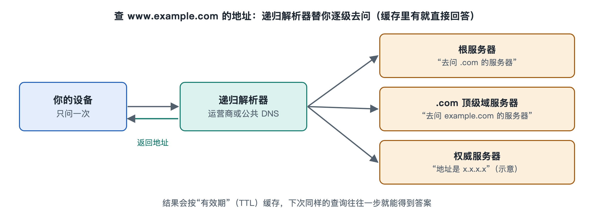

# 3.2 命名：域名系统怎样把名字变成地址

在浏览器地址栏里敲下一个网址，比如某个新闻网站的名字，按下回车，页面就出来了。可上一节刚讲过，网络里真正用来找到对方的是 IP 地址，一串数字（IPv4）或一长串十六进制字符（IPv6）。没有人会去背这些数字。名字和地址之间的翻译，是由一个叫域名系统（Domain Name System，DNS）的服务完成的。它每天要回答的查询数以万亿计，绝大多数人却从没注意过它。本节讲它干什么、为什么要这样设计，查询的详细步骤留到第六章。

## 3.2.1 名字和地址为什么要分开

拿通讯录来比：你记的是“妈妈”“张老师”，手机替你拨出对应的号码。即使张老师换了号码，只要通讯录更新，你照样能打通。

域名系统带来的好处与此相同，大致有三点：

- **好记**：人记名字，机器用数字，各取所长。
- **可迁移**：网站换了服务器或机房，IP 地址变了，只要更新域名对应的记录，用户不用改任何习惯。
- **可一名多址**：一个热门网站的名字可以对应很多台服务器的地址，不同地区的用户被引向不同的地址。第七章要讲的内容分发网络就大量依赖这一点。

互联网早期主机很少，名字和地址的对照表放在一个叫 HOSTS.TXT 的文件里，由一个机构集中维护，各台主机定期下载。主机数量增长以后，这个办法维护不过来，也更新不及时。1983 年前后，保罗·莫卡派乔斯（Paul Mockapetris）提出了 DNS 的设计，现行的核心规范是 1987 年发布的 RFC 1034 和 RFC 1035。今天你的电脑里多半还留着一个 hosts 文件，就是那个年代留下来的。

## 3.2.2 一棵倒过来的树：域名的层级结构

DNS 不再依赖一张总表，而是把名字组织成一棵倒挂的树。以 `www.example.com` 为例，要从右往左读：

| 层级 | 例子 | 含义 |
|---|---|---|
| 根（root） | 末尾隐含的“.” | 整棵树的起点 |
| 顶级域（Top-Level Domain，TLD） | `com`、`cn`、`org` | 通用类或国家/地区类 |
| 二级域 | `example` | 通常由机构或个人注册 |
| 主机名或子域 | `www` | 由域名持有者自行设置 |

这棵树最关键的设计是**授权（delegation）**：根只需要知道各个顶级域由谁管，`com` 只需要知道 `example.com` 由谁管，`example.com` 的持有者自己决定下面有哪些名字。每一层只管自己那一小块，叫作一个“区”（zone）。负责回答某个区权威信息的服务器，叫权威域名服务器（authoritative name server）。

这样一来，全世界的名字就分散到成千上万个组织手里分头维护，没有哪一台机器需要存下所有名字。这也是“网络的网络”在命名上的体现。

## 3.2.3 谁在替你查：解析器与缓存

你的手机并不会自己去一层层地问。实际分工通常是这样：

1. **存根解析器（stub resolver）**：操作系统里的一小段程序，只负责把问题交出去。
2. **递归解析器（recursive resolver）**：通常由运营商提供，也可以是公共 DNS 服务。它替你从根开始逐级询问，最后把答案带回来。
3. **权威服务器**：根、顶级域、各家域名的服务器，各自回答自己管辖范围内的问题。

如果每次上网都从根问起，根服务器会被压垮，网页也会变慢。所以 DNS 大量使用**缓存（cache）**。每条记录都带有一个“生存时间”（Time To Live，TTL），单位是秒，常见取值从几十秒到一天不等。在 TTL 到期之前，解析器直接用缓存里的答案。浏览器、操作系统、家用路由器、递归解析器都可能各存一份。这就是为什么网站改了地址以后，有人马上能访问到新服务器，有人要等一阵：各处的缓存还没过期。

根服务器常被说成“全世界只有 13 台”。准确的说法是：根服务器有 13 个名字（从 a 到 m），由十几个不同组织运营，每个名字背后通过任播（anycast）技术部署在全球大量站点。根据根服务器运营方公开的数据，写作时站点总数在一千个以上。

## 3.2.4 DNS 里存的不只是地址

DNS 本质上是一个分布式数据库，里面的条目叫资源记录（resource record），常见类型有：

| 记录类型 | 作用 |
|---|---|
| A | 名字对应的 IPv4 地址 |
| AAAA | 名字对应的 IPv6 地址 |
| CNAME | 别名，指向另一个名字 |
| MX | 这个域的邮件该交给哪台服务器 |
| NS | 这个区由哪些权威服务器负责 |
| TXT | 任意文本，常用于验证域名归属、邮件防伪 |

你给朋友发邮件时，邮件系统要查的是对方域名的 MX 记录，不是 A 记录。同一棵名字树，就这样同时服务了网页、邮件和各种验证。

## 3.2.5 设计的代价与补救

DNS 诞生时网络规模小，参与者大多彼此信任，所以最初的查询和回答都是明文，也没有校验。由此带来两类问题：

- **隐私**：途经的网络能看到你在查哪些网站。后来出现了 DNS over TLS（DoT，RFC 7858）和 DNS over HTTPS（DoH，RFC 8484），把查询放进加密通道。
- **真实性**：伪造的回答可能把用户引到假网站，这类攻击统称“DNS 欺骗”或“缓存投毒”。DNS 安全扩展（DNSSEC）给记录加上数字签名，让解析器能验证答案确实出自权威方。不过写作时它的部署程度在各顶级域和网站之间差别很大。

对普通用户来说，基本的防范是：使用可信的 DNS 服务，留意地址栏里的网址是否以 https 开头、域名是否正确，不随意修改路由器里的 DNS 设置。HTTPS 怎样在名字被篡改时仍能识破假网站，第六章讲 TLS 时再展开。

## 3.2.6 小结

DNS 用层级、授权和缓存三个办法，把“记名字”这件事分散给全世界去做。地址解决“在哪里”，名字解决“是谁”。下一节转向第三个问题：知道了目的地址，数据包又怎样一跳一跳地找到路。
