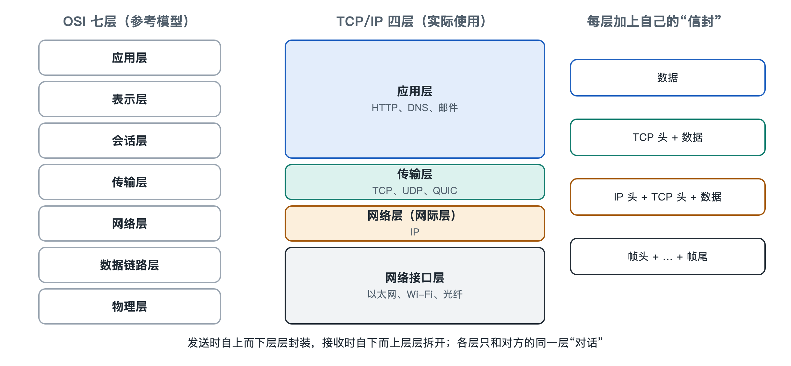

# 4.1 分层模型：TCP/IP 四层与 OSI 七层

寄一封快递时，你只需要写清收件地址、把东西装进箱子，然后交给快递员。你不用关心包裹坐的是货车还是飞机，也不用知道分拣中心怎样扫码。快递员同样不关心箱子里装的是书还是衣服。每个环节只做自己的事，只和相邻环节交接，整套物流就能运转。

互联网也是这样组织起来的。你在浏览器里按下回车，浏览器只管说清“我要这个网页”。至于这句话被切成多少个数据包、走哪条光缆、经过几台路由器，浏览器一概不管。这种“各管一层、逐层交接”的组织方式，叫作**分层模型**（Layered Model）。前三章拆开了互联网的零件，讲了各部分做什么；本章开始讲它们怎样连起来，分层就是第一条线索。

## 4.1.1 为什么要分层：把一个大问题拆成几个小问题

让一台手机和远方的服务器可靠地交换网页，要解决的问题很多：电信号或光信号怎样表示 0 和 1，同一根线上的数据怎样分给不同设备，数据怎样跨越几十个网络找到目的地，丢了怎样补发，收到的内容怎样理解成网页。如果把这些写成一个巨大的整体程序，任何一处改动都会牵连全身。

分层的做法是：把这些问题按“离物理世界远近”排成几层，每一层只依赖下一层提供的服务，同时为上一层提供服务。层与层之间约定好交接方式，叫作**接口**；同一层的双方按照共同规则对话，这套规则叫作**协议**（Protocol）。这样做带来三个好处：

- **可替换**：家里从 Wi-Fi 换成网线，上层的浏览器和 TCP 完全不用改。
- **可分工**：做芯片的、做操作系统的、做网站的，各自只需精通自己那一层。
- **可演进**：某一层出现新技术，比如传输层出现 QUIC（第七章详述），只要接口守得住，其他层就不受影响。

## 4.1.2 TCP/IP 四层模型：互联网实际在用的那一套

今天互联网实际运行所依据的，是 **TCP/IP 模型**，名称来自其中两个核心协议：传输控制协议（Transmission Control Protocol，TCP）和网际协议（Internet Protocol，IP）。描述它的权威文档是 RFC 1122，其中把主机上的通信功能分为四层。

| 层次 | 主要职责 | 典型协议或技术 | 对应前文内容 |
|---|---|---|---|
| 应用层 | 定义具体应用要说什么 | HTTP、DNS、SMTP | 3.2 命名、3.5 应用服务 |
| 传输层 | 端到端地把数据交给正确的程序，按需保证可靠 | TCP、UDP | 3.1 端口、3.4 可靠传输 |
| 网际层（网络层） | 给数据包编上地址，跨网络逐跳转发 | IP（IPv4、IPv6） | 3.1 IP 地址、3.3 路由 |
| 链路层 | 在同一段线路或同一个局域网内传送数据 | 以太网、Wi-Fi | 2.1 家庭网络、2.2 接入网 |

不同教材对最底层的叫法略有出入，有的称“网络接口层”，有的再把物理传输单独列为一层，形成“五层教学模型”。名称不同，思路一致。

这个模型里最关键的是中间那一层：**IP 是所有网络都必须会说的共同语言**。上面可以跑各种应用，下面可以是光纤、铜线、无线电，但中间只有 IP 一种。人们常把这种结构画成“沙漏形”：两头宽、中间细。正是这根细腰，让几万个技术各异的网络能够互联成“网络的网络”。第八章讲端到端原则时，还会回到这个设计。

## 4.1.3 OSI 七层模型：更细的参考框架

教科书里还常出现另一套模型：**开放系统互连参考模型**（Open Systems Interconnection Reference Model，OSI），由国际标准化组织（ISO）在 20 世纪 70 年代末至 80 年代制定，标准号为 ISO/IEC 7498。它把通信分成七层，从下到上依次是：

1. **物理层**：比特怎样变成电压、光脉冲或无线电波；
2. **数据链路层**：相邻设备之间如何成帧、检错；
3. **网络层**：跨网络寻址与路由；
4. **传输层**：端到端的可靠传送；
5. **会话层**：建立、管理和结束一次对话；
6. **表示层**：数据格式、编码、加密与压缩；
7. **应用层**：面向用户的具体服务。

两套模型的对应关系大致如下：OSI 的物理层和数据链路层，对应 TCP/IP 的链路层；网络层、传输层基本一一对应；而 OSI 的会话、表示、应用三层，在 TCP/IP 中被合并进应用层。比如 HTTPS 中的加密（第六章讲 TLS），从功能看像表示层的工作，实际上它是作为应用和 TCP 之间的一层软件来实现的，很难严格塞进某一格。

OSI 作为一整套具体协议，在与 TCP/IP 的竞争中没有成为主流；但它的七层划分清楚、术语完整，至今是网络教学和工程交流的“通用坐标”。运维人员说“这是个二层问题”“三层交换机”“七层负载均衡”，用的就是 OSI 的层号。所以可以这样记：**TCP/IP 是互联网实际走的路，OSI 是描述这条路的地图坐标。**

## 4.1.4 封装与解封：分层在数据包上留下的痕迹

分层不只是概念，它在每一个数据包上都看得见。你的浏览器发出一条 HTTP 请求后，数据会自上而下逐层“套信封”，这叫**封装**（Encapsulation）：

- 应用层写好请求内容，比如“请给我某个页面”；
- 传输层在前面加上 TCP 头部，写明源端口和目的端口、序号等；
- 网际层再加 IP 头部，写明源 IP 和目的 IP 地址；
- 链路层最后加上以太网或 Wi-Fi 的帧头帧尾，写明下一跳设备的硬件地址（MAC 地址）。

这个包到了家里的路由器，路由器拆开最外层的链路层信封，看一眼 IP 头部决定往哪里送，再换上一个新的链路层信封发出去。沿途每台路由器都重复这一步，一般只看到第三层，不碰里面的 TCP 和 HTTP。直到抵达服务器，服务器再自下而上一层层拆开，这叫**解封装**，最终把请求交给网站程序。

这像寄国际包裹：内层是你写的信，外层是跨国邮政单，最外层是每段运输的托运标签。托运标签每换一段车就换一张，邮政单一路不变，信的内容只有收件人打开。

当然，现实网络并不总是这么整齐。家用路由器做的地址转换（NAT，见 5.2 节）会改写传输层端口，防火墙和内容分发网络也常常读取更高层的信息。分层是设计原则，不是物理定律；理解它的价值，在于出问题时能迅速判断“坏在哪一层”：网线没插好是链路层，拿不到地址或路由不通是网络层，端口被拦是传输层，网页报错 404 则是应用层。

分层解决了“一台设备内部怎样组织通信”的问题。可是互联网由成千上万家机构各自运营的网络拼成，这些网络之间又靠什么规则相连？下一节，我们从一台设备的内部走出来，去看自治系统与运营商之间的互联关系。
