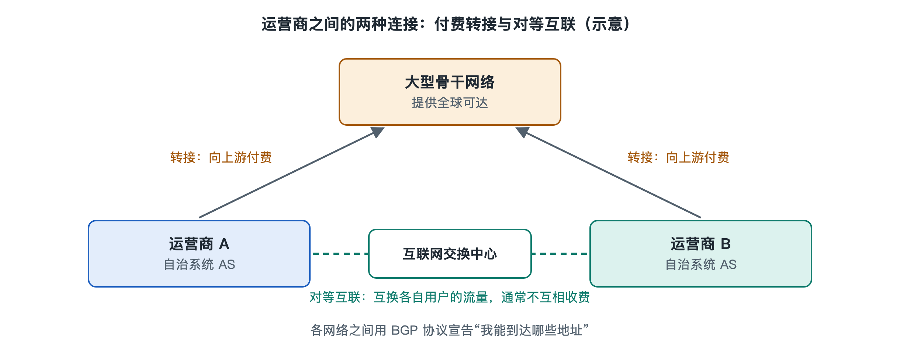

# 4.2 自治系统与运营商互联：对等与转接

打开电脑上的命令行，对一个国外网站运行一次路由跟踪，屏幕上会列出十几行陌生的地址。如果把这些地址拿到公开的网络信息查询网站上去查，会发现它们分属好几家不同的机构：先是你家宽带运营商，接着可能是另一家国际运营商，最后才是网站所在的云服务商或内容分发网络。一个网页请求，往往要穿过好几家互不隶属的公司的网络。这些公司彼此竞争，却又必须互相连通。它们靠什么约定走到一起？这就是本节要讲的自治系统与运营商互联。

## 4.2.1 自治系统：互联网上的“独立王国”

互联网由数以万计的独立网络拼成，每个网络都有自己的管理者、自己的设备和自己的路由策略。为了在全局层面区分它们，工程界引入了**自治系统**（Autonomous System，AS）这个概念。按照 RFC 1930 的描述，自治系统是由一个或多个运营者管理、对外呈现统一而清晰的路由策略的一组 IP 地址前缀。

可以把自治系统想象成一个个“独立王国”：王国内部的道路怎么修、车怎么走，由国王自己决定；王国之间的通行规则，则要通过外交谈判来定。每个自治系统都有一个全球唯一的编号，叫作**自治系统号**（Autonomous System Number，ASN）。早期编号是 16 位，最多约 6.5 万个；随着网络数量增长，RFC 6793 等标准把它扩展到 32 位，可用数量达到约 40 多亿。编号由区域互联网注册机构分配，这部分内容会在 4.4 节展开。

哪些机构会拥有自治系统号？常见的有：

- 电信运营商和宽带服务商；
- 大型云服务商和内容分发网络；
- 大学、科研网络和政府机构；
- 需要同时接入多家运营商的大型企业。

普通家庭用户没有自己的自治系统，你家的网络只是运营商自治系统里很小的一部分。公开资料中的常见说法是，全球路由表中可见的活跃自治系统数量在数万到十万这个量级。

## 4.2.2 两种基本关系：转接与对等

自治系统之间怎么连？商业上最基本的关系有两种。

**转接**（Transit）是一种买卖关系。小网络向大网络付费，大网络承诺“把你的流量送到互联网上任何地方，也让全世界都能找到你”。这就像一个小镇花钱接入国家高速公路网，从此可以通往全国。

**对等**（Peering）是一种交换关系。两个规模相近、彼此有大量往来流量的网络约定：我把发往你用户的流量直接交给你，你也一样，通常互不收费，这种情况也叫免费对等（settlement-free peering）。关键限制在于，对等只交换双方自己及各自客户的流量，不替对方转发通往第三方的流量。这就像两个相邻城市修了一条直通公路，只供两城居民往来，不让外地车借道。

| 对照项 | 转接 | 对等 |
|---|---|---|
| 商业关系 | 客户向提供方付费 | 通常互不付费 |
| 能到达的范围 | 整个互联网 | 仅限双方及各自客户 |
| 典型双方 | 小网络与大网络 | 规模和流量相当的网络 |
| 主要好处 | 一次接入，全网可达 | 节省转接费，路径更短、延迟更低 |

此外还有付费对等等混合形式，具体条款由双方协商，不同公司做法差异很大，并没有全行业统一的合同模板。

## 4.2.3 层级结构与“一级运营商”

在转接关系的层层叠加下，互联网呈现出一种松散的层级。最上层是常说的**一级运营商**（Tier 1）：它们彼此之间全部对等互联，不需要向任何人购买转接，就能到达互联网的所有地方。往下是二级运营商，既向上购买转接，又与同级广泛对等；再往下是面向家庭和企业的接入网络。

不过要注意，“一级”并不是哪个标准组织颁发的称号，而是行业里根据互联关系形成的说法，名单也随时间变化。近十几年来，大型内容公司和云服务商自建了覆盖全球的骨干网，与大量接入运营商直接对等，越来越多的流量绕过传统的上层转接网络。研究文献把这种变化称为互联网结构的“扁平化”。所以层级图只是一个帮助理解的简化模型，真实的互联网更像一张纵横交错的网。

## 4.2.4 在哪里握手：私有互联与交换中心

商业关系谈妥之后，还要有物理上的连接。常见方式有两种。

一种是**私有互联**（Private Network Interconnect，PNI），两家网络在同一座机房里拉一根专用线路直连，适合流量非常大的双方。

另一种是在**互联网交换中心**（Internet Exchange Point，IXP）连接。2.3 节介绍过，交换中心本质上是一个公共的交换平台，众多网络把路由器接上去，就能与平台上的许多伙伴对等，而不必和每一家都单独拉线。很多交换中心还提供“路由服务器”，让成员一次配置即可与多方建立对等。这好比一个集市：与其挨家挨户上门交易，不如大家约好在同一个地方摆摊。

## 4.2.5 关系如何变成路由：策略决定路径

这些商业关系最终要落实到路由选择上。自治系统之间通过**边界网关协议**（Border Gateway Protocol，BGP）互相通告“我能到达哪些地址”。与只追求最短路径的内部路由不同，BGP 的选路首先服从商业策略。研究者总结出一个被广泛引用的经验规律：

- **优先走客户路由**，因为客户付钱给我，流量越多越好；
- **其次走对等路由**，不花钱；
- **最后才走转接路由**，因为要向上游付费。

在通告时，一个网络通常把客户的路由告诉所有人，却不会把从一个对等方或上游学到的路由转告给另一个对等方或上游，否则就等于免费替别人搬运流量。正因如此，你的数据包走的往往不是地理上最短的路，而是“商业上最合适”的路。路由跟踪时偶尔看到流量绕到很远的城市再折回来，背后常常就是这种互联关系。

BGP 的具体工作方式和它的脆弱之处，会在 6.3 节详细展开。

## 4.2.6 小结

互联网没有一个总管全局的中央机构，它是由数万个自治系统通过一份份双边协议连起来的。转接让小网络一次接入全世界，对等让大网络之间省钱提速，交换中心则降低了互联的成本。理解了这些关系，就能明白“网络的网络”为什么既能覆盖全球，又在路径选择上处处体现商业考量。下一节，我们把视线从网络之间转回到通信的两端，看看客户端与服务器是怎样分工的。
