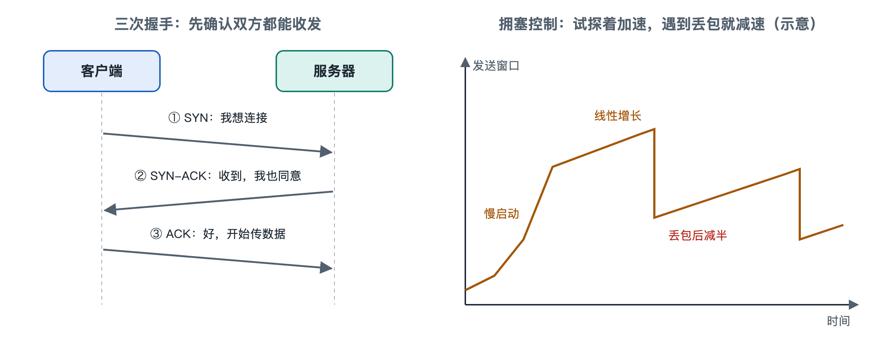

# 6.2 TCP 的握手、确认与拥塞控制

下载一个几百兆的安装包时，你也许留意过进度条：刚开始速度慢慢往上爬，过一会儿稳定下来，家里有人开始看高清视频，它又降下去一截。等下载完成，文件一个字节都不会错，哪怕中途网络卡顿过好几次。速度为什么会“试探着”上升？丢掉的数据去了哪里，又怎样补回来？这些都由同一个协议负责，它就是传输控制协议（Transmission Control Protocol，TCP）。3.4 节讲过可靠传输要解决的问题，本节打开 TCP 内部，看它怎样把“尽力而为”的 IP 网络变成一条可靠的字节管道。TCP 的核心规范最初是 RFC 793，现行版本为 2022 年发布的 RFC 9293。

## 6.2.1 三次握手：先确认双方都在线

打电话时，双方会先“喂，听得到吗？”“听得到，你听得到我吗？”“听得到。”确认线路两头都通了，才开始说正事。TCP 建立连接也是这个思路，称为三次握手（three-way handshake）：

| 步骤 | 方向 | 报文标志 | 含义 |
|---|---|---|---|
| 1 | 浏览器 → 服务器 | SYN | 我想建立连接，我的起始序号是 x |
| 2 | 服务器 → 浏览器 | SYN + ACK | 收到你的 x，我的起始序号是 y |
| 3 | 浏览器 → 服务器 | ACK | 收到你的 y，可以开始传数据了 |

SYN 是“同步”（synchronize）的缩写，ACK 是“确认”（acknowledgment）的缩写。握手要做的事是交换双方的初始序号（sequence number），握手完成后，每个字节都有编号。为了防范伪造和旧连接残留报文的干扰，初始序号不从 0 开始，而是按规范以难以预测的方式选取。

握手要花代价，至少要一个往返时间（Round-Trip Time，RTT）后浏览器才能发出第一个请求。如果服务器在另一个大洲，一个 RTT 可能达到一两百毫秒，再加上后面 TLS 加密握手（见 6.5 节），用户就能察觉到等待。7.2 节介绍的 QUIC 能缩短这段准备时间，原因就在这里。

连接结束时，双方各自发送 FIN（结束）报文并得到确认，通常需要四个报文。原因是 TCP 是全双工的，两个方向的数据流要分别关闭。

## 6.2.2 序号与确认：让每个字节都有回执

连接建立后，发送方把数据切成一个个报文段（segment）发出，每段都带着序号。接收方回送的确认号表示“到这个编号为止的字节我都收齐了，下一个请从这里开始发”，这种方式叫累积确认。

丢包的处理有两条路：

- **超时重传**：发送方为已发数据设一个重传计时器，超时仍未收到确认就重发。超时时长根据实测 RTT 动态计算（RFC 6298），不能太短，否则会白白重复发送；也不能太长，否则卡顿时间会拉长。
- **快速重传**：如果中间某段丢了，后面的报文段照常到达，接收方会反复确认同一个编号。发送方连续收到三个重复确认，就推断那一段丢了，不等超时立即重发。

现代 TCP 普遍还支持选择确认（Selective Acknowledgment，SACK，RFC 2018），接收方可以明确告诉发送方“1000–2000 没到，2000–5000 已经收到”，发送方只补缺的那部分。

乱序到达的报文由接收方按序号重新排好，再交给应用程序。浏览器拿到的始终是一串完整、有序的字节，下面的网络发生过什么，它看不到。

## 6.2.3 两扇窗口：别撑着对方，也别堵住网络

如果每发一段都要等确认回来再发下一段，跨洋连接的速度会很慢。TCP 允许发送方一次发出多段未确认的数据，可以发多少，由两扇“窗口”共同限制：

| 窗口 | 由谁决定 | 防止什么 |
|---|---|---|
| 接收窗口（rwnd） | 接收方在报文中通告 | 发送太快，撑爆接收方缓冲区，称为流量控制 |
| 拥塞窗口（cwnd） | 发送方根据网络状况自行估计 | 发送太猛，造成中间路由器排队、丢包，称为拥塞控制 |

实际可发送的量取两者中较小的那个。流量控制只涉及两端，拥塞控制针对的是整个网络。中间路由器不会告诉你“我堵了”，发送方只能从丢包、延迟变化这些迹象中去推断。

## 6.2.4 拥塞控制：在看不见的路上探着走

RFC 5681 描述的经典拥塞控制可以概括为四个动作：

1. **慢启动**：连接刚开始时，拥塞窗口很小（目前主流实现多采用约 10 个报文段的初始值，见实验性规范 RFC 6928），每过一个 RTT 大约翻一倍。名字里有“慢”，增长其实是指数式的，“慢”指的是起点低。下载进度条开头那段爬升，主要就是这一阶段。
2. **拥塞避免**：窗口涨到一个阈值后，改成每个 RTT 只加一个报文段，小心逼近网络的容量上限。
3. **快速恢复**：通过重复确认发现丢包时，认为网络只是轻度拥塞，把窗口减半后继续发送。
4. **超时回退**：一直等到超时还没有确认，说明情况更严重，窗口退回很小的值，重新慢启动。

“线性增加、乘性减少”（AIMD）这一组合有一个重要性质：多条连接共享同一段瓶颈链路时，它们的速率会逐渐趋向公平分配。家人开始看视频时你的下载速度下降，就是两条连接在瓶颈处重新分配带宽。

这套机制把丢包当成拥塞信号，但无线信号干扰也会造成丢包，这时 TCP 会误判并降速。因此出现了多种改进算法：CUBIC 在 RFC 9438 中被标准化，写作时是许多主流操作系统的默认算法；Google 提出的 BBR 则尝试通过测量带宽和最小 RTT 来估计网络容量，不完全依赖丢包。具体使用哪种算法因系统和版本而异。此外，显式拥塞通知（ECN，RFC 3168）允许路由器在丢包前给报文打上“快堵了”的标记，让发送方提前减速。

## 6.2.5 小结：可靠性在端上，网络保持简单

TCP 的握手、序号、确认、重传和窗口，全部运行在两端的主机上；按设计原则，路径中间的路由器只管转发分组，不需要保存连接状态（现实中的 NAT 和防火墙等设备是例外）。这正是 6.1 节所说“尽力而为”的网络与“聪明的端系统”之间的分工，第八章还会从端到端原则和排队论的角度说明这种设计的原因。下一节离开两台主机之间的这条连接，看路由协议 BGP 怎样在几万个网络之间安排这些分组走哪条路。
