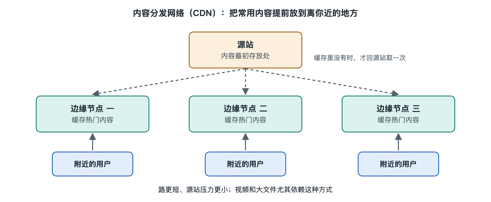

# 7.3 内容分发网络与边缘缓存

晚上打开一个视频网站，点开一部热门剧集，几乎不用等就开始播放；同一时刻，城市里可能有成千上万的人在看同一集。如果每个人的请求都要穿过骨干网、甚至跨过海底光缆，回到网站总部的那几台服务器去取数据，不仅总部的出口带宽撑不住，路上的每一段链路也会被同样的数据反复挤满。实际情况是，你看到的视频画面多半来自离你不远的一台缓存服务器，它可能就在你所在城市的运营商机房里。把内容提前搬到用户身边，这就是内容分发网络（Content Delivery Network，CDN）要做的事。第二章 2.5 节把 CDN 当作一个部件介绍过，第五章 5.4 节追踪过内容怎样流到你面前，本节换一个角度：把 CDN 当作一项关键技术，看它靠哪些机制做到“近、快、省”。

## 7.3.1 从“仓库直发”到“前置仓”

网购是个现成的类比。早年的电商从一个中心仓库发货，北京的仓库发往广州要走好几天。后来商家在各地建前置仓，把常买的商品提前铺进去，下单后从最近的仓库出货，当天就能送到。CDN 的结构与此相似：

| 电商物流 | CDN |
|---|---|
| 中心仓库 | 源站（Origin Server），内容的权威出处 |
| 前置仓 | 边缘节点（Edge Node），部署在各地机房的缓存服务器集群 |
| 区域分拨中心 | 中间层缓存，有的系统称为父节点或区域节点 |
| 订单分配系统 | 请求调度，决定由哪个节点服务你 |
| 热销商品先备货 | 热门内容先缓存或预热 |

这种分层结构解决了三个问题：距离近了，往返时延（RTT）变短；同一份内容在本地被反复取用，骨干网和源站的负担大幅减轻；某个节点故障时，请求可以改投其他节点，整体更抗压。

## 7.3.2 调度：你怎么被领到最近的节点

CDN 的第一项关键机制，是把用户的请求引到合适的边缘节点。常见的做法有两类。

**基于 DNS 的调度。** 网站通常把自己的某个域名用 CNAME 记录（别名记录）指向 CDN 服务商的域名。你的设备解析这个域名时，最终由 CDN 的权威 DNS 服务器作答。它会参考查询来源，一般是你所用的递归解析器的地址，判断你大致在哪个地区、属于哪个运营商，再返回附近节点的 IP 地址。这里有一个已知的局限：如果你用的公共解析器离你很远，CDN 看到的是解析器的位置而不是你的位置，可能把你调度错。为此，IETF 在 RFC 7871 中定义了 EDNS 客户端子网扩展（EDNS Client Subnet，ECS），允许解析器在查询中附带用户地址所在网段的一部分信息，帮助调度更准；它也带来隐私上的争议，并不是所有解析器都启用。

**基于任播的调度。** 任播（Anycast）是指多个地点的服务器对外宣告同一个 IP 地址前缀，借助第六章讲过的 BGP，用户的数据包会被路由到网络意义上“最近”的那一处。这种方式不依赖 DNS 的判断，切换也由路由自动完成。写作时，不少大型 CDN 和公共 DNS 服务采用任播，也有服务商把两种方式结合起来用。要注意，BGP 意义上的“近”指路径上的选择偏好，并不总等于地理上最近。

调度时考虑的因素通常不止距离，还包括节点负载、链路质量、运营商归属和成本，各家服务商的算法不同，属于各自的工程设计，并无统一标准。

## 7.3.3 缓存：存什么、存多久、过期了怎么办

请求到了边缘节点，节点先查本地有没有这份内容。有，叫“命中”，直接返回；没有，叫“未命中”，节点向上一层缓存或源站去取，取回后一边交给用户，一边留一份备用。命中率是衡量 CDN 效果的核心指标之一。

存多久，主要由 HTTP 协议说了算。源站在响应中通过 Cache-Control 等头部字段告诉缓存：这份内容能保存多长时间（max-age）、能否被共享缓存保存、过期后是否必须先向源站确认。相关规则在 RFC 9111（HTTP 缓存）中有明确定义。过期的内容不一定要重新下载，缓存可以带着 ETag（内容标识）或最后修改时间去问源站“变了没有”，没变时源站只回一个简短的 304 响应，省下大量流量。

缓存天然适合“很多人看同一样东西”的场景，比如图片、脚本、样式文件、软件安装包和视频分片。视频之所以特别适合 CDN，还因为现代网络视频大多被切成几秒长的小片段，每个片段都是一个独立的可缓存文件，热门剧集的片段很容易在边缘节点上反复命中。相反，个性化内容，比如你的购物车、账户余额，每人一份、随时变化，通常不缓存，或只在边缘做加速转发。

当内容需要立即更新时，网站可以向 CDN 发起“刷新”或“清除”，让各节点丢弃旧副本；对即将上线的热门内容，可以提前“预热”，主动推送到边缘，避免开播瞬间大量请求同时回源。

## 7.3.4 从“缓存”走向“边缘”

写作时，CDN 的角色已经不限于存文件。很多 CDN 节点同时承担 HTTPS 连接终结，也就是由离你最近的节点完成 TLS 握手，缩短建连时间；支持 HTTP/3 和 QUIC，把上一节讲到的提速效果带到边缘；还提供分布式拒绝服务（DDoS）攻击的流量吸收与过滤，利用遍布各地的节点把异常流量分散消化。一些服务商还允许网站把少量程序部署在边缘节点上运行，就近处理请求，这通常被称为边缘计算，具体形态因服务商而异，更深入的内容可参见本系列关于数据中心与云计算的专册。

把内容交给 CDN 也有代价：网站需要信任 CDN 持有其证书或代为处理加密连接；内容在多处存有副本，更新时存在短暂不一致；大量网站依赖少数几家大型 CDN，一家出现故障时影响面可能很广。这正是第八章将讨论的“效率与韧性”取舍的一个现实例子。

## 7.3.5 小结

CDN 的本质是用空间换时间：在网络边缘铺开大量缓存，把内容放到用户身边。调度机制决定“去哪儿取”，缓存机制决定“存什么、存多久”，二者都建立在本书前面讲过的 DNS、BGP、HTTP 和 TLS 之上，没有发明新的底层协议，而是把已有协议组合成一张覆盖全网的分发系统。下一节要讲的软件定义网络，则把视线从“内容放在哪里”转向“网络本身怎样被灵活地控制”。
