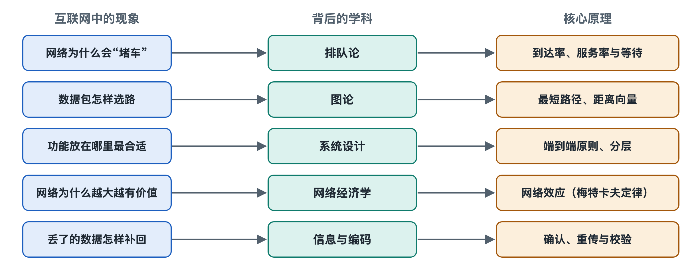

# 8.1 端到端原则与分层设计

你在手机上给朋友发一张照片，传到一半电梯关门、信号断了，出了电梯，聊天软件自己把照片补发完整。补发靠的不是路上的路由器替你“记住”那张照片，而是你手机上的软件和对方的服务器在两头对账，发现缺了哪几块就重新发送。路上的设备只管把数据包往前递，送没送到、全不全、顺序对不对，由两端负责。

这种分工方式在网络设计里有一个名字，叫端到端原则（End-to-End Principle）。前面几章讲过的 TCP 重传、TLS 加密、QUIC 在用户态实现传输，都和它有关。本节讨论这条原则讲了什么、为什么成立，以及它怎样和分层设计一起，构成互联网架构的基本思路。

## 8.1.1 一篇论文提出的问题：功能该放在哪里

1981 年，麻省理工学院的萨尔策（J. H. Saltzer）、里德（D. P. Reed）和克拉克（D. D. Clark）发表了论文《系统设计中的端到端论证》（*End-to-End Arguments in System Design*），1984 年刊于 ACM 期刊。论文的核心论断大意是：**某项功能如果只有在通信两端的应用程序参与下才能完整、正确地实现，那么把它放进底层通信系统，既做不完整，也不划算；底层可以提供不完整的版本，但只能作为提升性能的辅助手段。**

论文用“可靠的文件传输”作例子。把文件从 A 主机传到 B 主机，可能在很多环节出错：

- A 的硬盘读出时出错；
- A 的软件在内存里复制时出错；
- 网络传输中丢包、出错或重复；
- B 写入硬盘时出错；
- 任何一台机器中途崩溃。

假设网络在每一段链路上都做了严格校验，保证“链路上一个比特都不会错”，第一、二、四、五类错误照样会发生。要确认文件真的完好，最终还得由 B 端算出整个文件的校验值，和 A 端的结果比对，不一致就重传。既然两端反正要做这道检查，网络内部的层层保证就成了重复劳动，而且所有应用都要为这份开销买单，包括那些根本不需要它的应用。

## 8.1.2 为什么“哑网络、聪明终端”更合适

把这条原则放到互联网上，可以得到一个简化的对照：

| 设计取向 | 传统电话网 | 互联网 |
|---|---|---|
| 网络内部 | 复杂：建立电路、维护通话状态 | 相对简单：逐包尽力转发（见 6.1 节） |
| 终端 | 简单：电话机只负责拨号和收发声音 | 复杂：电脑、手机运行完整协议栈 |
| 新业务从哪里出现 | 主要由运营商在网内部署 | 任何人在终端写程序即可发布 |
| 中间节点故障的影响 | 正在进行的通话可能中断 | 路由绕行后，两端连接常能继续 |

这种取向有三点好处。

**一是减轻网络负担，满足不同的需求。** 网页、文件下载要求一个字节都不能错，可以用 TCP 在两端做确认和重传；视频通话更怕延迟，丢掉一帧画面比等它重传更可接受，可以用基于 UDP 的协议。如果网络内部强制“必须可靠”，后一类应用反而会被拖慢。

**二是韧性。** 克拉克在 1988 年回顾 DARPA 互联网协议设计思想的论文中提到“命运共享”（fate-sharing）思路：连接的状态信息放在两端主机上，中间路由器不保存它。这样，只要两端主机还在，中间哪台路由器坏了，换条路继续走即可，连接本身不会因此丢失。

**三是创新门槛低。** 网络不需要理解上面跑的是什么应用，于是电子邮件、万维网、即时通信、视频平台，都能在不改动路由器的前提下出现。网络效应（见 8.4 节）能充分释放，很大程度上得益于此。

需要注意，端到端原则并不禁止网络做任何事。论文本身承认，底层做一部分工作可以提升性能；今天常见的例子是 Wi-Fi 在无线链路上做本地重传，因为无线信号出错率高，如果一律等两端发现问题再重传，代价太大。原则讨论的是**正确性最终由谁负责**，不是“网络里不能有功能”。

## 8.1.3 分层设计：把端到端原则落到结构上

4.1 节介绍过 TCP/IP 四层模型。分层和端到端原则相互配合：分层规定“各做各的、只通过约定的接口打交道”，端到端原则则回答“哪一层、放在哪个位置”。

以你点开网页为例：

- **链路层**只负责把帧送到同一段网络里的下一台设备，可以是以太网、Wi-Fi 或光纤接入，具体技术可以替换；
- **网络层（IP）**只负责逐跳把数据包往目的地址方向转发，不保证送达；
- **传输层（TCP、UDP、QUIC）**只在两端主机上运行，负责可靠性、顺序和拥塞控制；
- **应用层（HTTP、DNS 等）**处理具体业务含义。

中间的路由器通常只处理到网络层，传输层和应用层只存在于两端。人们常把这种结构画成一个“沙漏”：上面有大量应用，下面有大量链路技术，中间收窄到一个统一的 IP 层。各种网络只要能承载 IP，就能接入互联网；各种应用只要用 IP 通信，就能跑在任何网络上。IPv6 的推广之所以艰难（见 7.1 节），正是因为它要更换的恰好是沙漏最窄、所有人共用的那一层。

## 8.1.4 现实中的偏离：中间盒与加密的回应

今天的互联网并不完全符合理想模型。家用路由器里的网络地址转换（NAT，见 5.2 节）会改写地址和端口；企业防火墙、运营商的流量管理设备、透明代理会检查甚至修改传输层信息。这类网络中间的设备统称为“中间盒”（middlebox）。它们解决了地址不足、安全隔离等现实问题，代价是网络开始“依赖”上层的细节：如果某个设备只认识常见的 TCP 选项，新的传输层改进就可能在路上被丢弃。业界把这种新协议难以部署的现象称为“协议僵化”（ossification）。

QUIC 的设计可以看作对这一问题的回应：它跑在 UDP 之上，并把绝大部分传输层控制信息加密（见 7.2 节），中间设备看不到也就无从干预，演进的主动权重新回到两端。HTTPS 的普及也有类似效果。不过这同样带来新的取舍，比如运营商和企业网管更难做传统的故障排查与流量分析，这一矛盾在 8.5 节还会继续讨论。

## 8.1.5 小结

端到端原则回答的是“功能放在哪里”：能且只能由两端保证的事，就交给两端；网络保持简单通用，只做提高性能的辅助。分层设计回答的是“怎样组织”：每层只依赖下层提供的服务，中间收束于 IP。两者合起来，解释了为什么你的照片能在断网后自动补发，也解释了为什么新应用无须运营商批准就能出现。但“简单的网络”意味着它只“尽力而为”，在流量多于容量时，排队和拥塞就不可避免——下一节将用排队论来看这件事。
