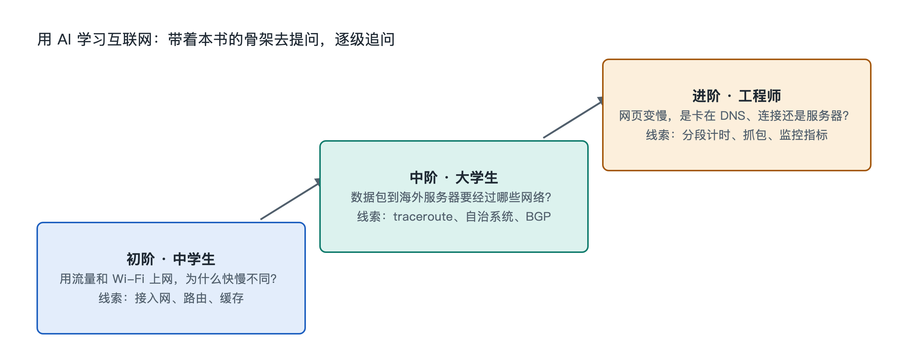

# 9.3 三阶提问阶梯：从中学生到工程师

同样是“为什么我家网页打开慢”，一个中学生、一个计算机专业的大学生和一个负责公司网站的运维工程师，想知道的东西并不一样。中学生想弄明白网页从哪里来、慢在哪一段；大学生想把现象对上教材里的 TCP、DNS 和排队；工程师要的是能落地的排查顺序和判断依据。直接把这句话丢给 AI，它多半给出一份泛泛的“重启路由器、换个浏览器、检查网速”清单，对谁都不够用。

本节把前面八章的骨架整理成一架三阶提问阶梯。读者按自己的位置选一级，用书里的概念做“抓手”，让 AI 顺着骨架往下展开，而不是在一堆零散答案里打转。

## 9.3.1 为什么提问要分阶

AI 对话助手（基于大语言模型，Large Language Model，LLM）回答的深度，很大程度上取决于提问里给了多少上下文和约束。同一个问题，加上“我是高一学生，请用快递打比方”或者“请按 OSI 分层给出排查顺序，并说明每一步看什么指标”，得到的回答在深度和组织方式上会有明显差别。

分阶还有一个用处，就是防止“够不着”和“用不上”两种浪费。基础不够时追问 BGP 路径属性，得到的回答看不懂；已经在做运维却只问“DNS 是什么”，又是在重复早已知道的东西。按本书的九层阶梯来定位，读者能先判断自己现在缺的是“对象和结构”，还是“机制和原理”，再决定问到哪一层。

三阶的划分如下表：

| 阶梯 | 典型读者 | 对应本书层次 | 提问目标 | 常用抓手 |
|---|---|---|---|---|
| 第一阶：看懂 | 中学生、普通读者 | 对象、结构、功能 | 知道有哪些部分、各干什么 | 类比、画图、一段话讲清 |
| 第二阶：讲通 | 大学生、专业入门者 | 连接、流动、机制 | 能说清一次请求的完整过程和原因 | 分层、时序、对照 |
| 第三阶：做成 | 运维、开发、产品人员 | 关键技术、原理、排查 | 能定位问题、评估方案、权衡取舍 | 指标、日志、假设与验证 |

这三阶不是身份标签。一位产品经理碰到 IPv6 时也可以从第一阶问起，一名中学生对路由算法感兴趣，也完全可以试着爬到第三阶。

## 9.3.2 第一阶：看懂——用类比搭出整体图

第一阶的任务是把看不见的网络变成脑子里的一张图。这一级提问的要点有三个：说明自己的水平，要求类比，要求 AI 指出类比在哪里不成立。

可以这样问：

- “我是初中生。请用寄快递打比方，讲清楚从我在手机上点开一个网页，到页面显示出来，中间经过了哪几站。最后告诉我这个比方有哪些地方和真实网络不一样。”
- “家里的光猫和无线路由器分别负责什么？如果只有其中一个坏了，我会看到什么现象？”
- “域名系统（DNS）为什么常被比作电话簿？这个比喻漏掉了什么？”

最后那半句“哪里不一样”很重要。类比能帮人入门，也容易让人记错。比如快递的比方会让人以为一个网页是“一个包裹”整体送达，实际上它被拆成许多数据包，可能走不同路径，到了再重新拼好。让 AI 主动说出类比的边界，读者就能避开这类误解，也正好接上第六章讲的分组交换。

## 9.3.3 第二阶：讲通——把过程按层、按时间展开

第二阶要从“有哪些部分”走到“怎样一步步发生”。这一级的抓手是第四章的分层模型和第五章的各种“流”。提问时可以要求 AI 按层或按时间顺序列出步骤，并解释每一步存在的理由。

示例问题：

- “请按时间顺序列出浏览器打开一个 HTTPS 网页的全过程：DNS 查询、TCP 三次握手、TLS 握手、HTTP 请求与响应。每一步说明它属于 TCP/IP 四层中的哪一层，以及如果省掉这一步会出什么问题。”
- “请对比 TCP 和 QUIC 建立加密连接所需的往返次数，用表格列出差异，并说明 QUIC 为什么选择建在 UDP 之上。”
- “家庭网络里，DHCP、NAT 和 DNS 分别在哪一刻起作用？请画一个文字版的时序图。”

这一阶要养成核对来源的习惯。协议细节有权威出处，比如 TCP 见 RFC 9293，QUIC 见 RFC 9000，HTTP/3 见 RFC 9114。可以要求 AI“标出依据的 RFC 编号”，再自己到 IETF 网站上查看原文的相关章节。AI 偶尔会把编号或细节记错，对照原文是最可靠的纠错办法。

## 9.3.4 第三阶：做成——带着证据去排查和决策

第三阶面对的是真实问题，提问方式要从“请解释”换成“请帮我判断”。关键是把证据交给 AI：诊断命令的输出、监控截图里的数字、出问题的时间段和范围，同时说明约束条件。

示例问题：

- “下面是我对公司网站做 traceroute 的结果（已隐去内网地址）。第 7 跳之后延迟从 20 毫秒跳到 180 毫秒，但最终目的地延迟只有 35 毫秒。这说明链路有问题吗？请给出你的判断依据和下一步验证方法。”
- “用户反馈部分地区访问慢，其他地区正常。请按‘本地网络—接入网—DNS 解析—CDN 节点—源站’的顺序给我一份排查清单，每一项写明要看什么指标、正常范围大致是多少、用什么工具获取。”
- “我们在考虑给网站开启 HTTP/3。请列出收益、风险和需要先确认的条件，比如中间网络对 UDP 的限制。”

第一个问题里的现象，第七章讲过：路由器常常给发往自己的探测报文较低的处理优先级，中间某一跳延迟高，并不等于整条路径慢。好的 AI 回答应该能指出这一点。如果它没提，读者可以追问“这会不会是路由器控制平面限速造成的”。用书里学到的原理去检验 AI 的结论，这一阶的价值就在这里。

需要注意两点。一是贴出日志前先把公网 IP、账号、内部主机名等敏感信息去掉。二是 AI 给出的命令和配置建议，先在测试环境或只读模式下验证，再用到生产系统上。涉及安全的话题，只讨论原理和防护，不要让 AI 生成针对他人系统的探测或攻击步骤。

## 9.3.5 在阶梯之间上下移动

三阶提问是一条可以来回走的梯子。工程师碰到陌生的 BGP 告警时，可以退回第一阶，问“用一段话讲清楚 BGP 路由泄露是怎么回事”。中学生弄懂了快递类比之后，可以往上一步，问“那数据包丢了以后由谁负责补发”，这样就走进了 TCP 的世界。

一个实用的方法是“三问连发”：同一个主题，先问一次第一阶，确认自己理解了整体；再问一次第二阶，把过程讲通；最后结合自己身边的现象问一次第三阶。例如围绕 DNS，可以先问“它是做什么的”，再问“一次递归解析经过哪些服务器、缓存在哪里起作用”，最后用自己电脑上的查询结果问“为什么换了 DNS 服务器后某些网站打开更快”。三问下来，本书第三章、第六章的内容就和手边的网络连在了一起。

书给出的是骨架，提问阶梯决定从哪根骨头往下长出血肉。下一节将把本章的方法收拢成一份可以随时取用的清单。
