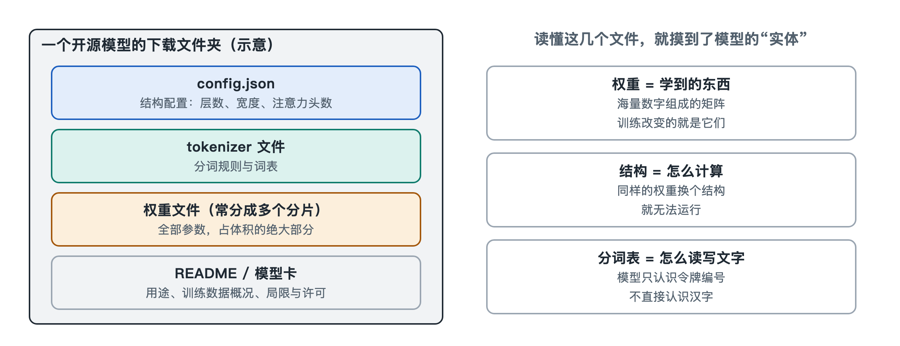

# 1.2 一个模型文件里装着什么：权重、配置与分词表

上一节我们看了模型"说话"的样子。现在换一个角度：打开一个开源模型的下载页面，看看这台"会说话的机器"落到硬盘上是什么样子。

## 1.2.1 打开下载页：一组普普通通的文件

在 Hugging Face 这样的模型托管平台上（写作时它是最常用的开源模型分发站点之一），点开一个开源大语言模型的"文件"页，通常会看到这样一组文件：

| 文件 | 大致体积 | 作用 |
|---|---|---|
| `model-00001-of-0000N.safetensors` 等 | 几 GB 到几百 GB，常被切成多份 | 权重：模型学到的全部数字 |
| `config.json` | 几 KB | 配置：模型的"建筑图纸" |
| `tokenizer.json`、`tokenizer_config.json` | 几 MB 到几十 MB | 分词表与分词规则，常附带对话模板 |
| `generation_config.json` | 几百字节 | 默认的生成参数，如温度 |
| `README.md` | 几十 KB | 模型卡：用途、训练数据、限制说明 |

体积的差距一目了然：几个 GB 的大文件旁边，躺着几个只有几 KB 的小文件。大文件装的是"知识"，小文件装的是"怎么用这些知识"。三者缺一不可：只有权重而没有配置，程序不知道这些数字该怎么排；只有配置而没有分词表，程序连你输入的文字都读不进去。

## 1.2.2 权重：几十亿个数字

权重（weights），也叫参数（parameters），是模型在训练中一点点调整出来的数字。模型名字里常见的"7B""70B"，指的就是参数个数，B 是英文 billion（十亿）的缩写。

可以做一笔简单的账。常见的存储精度是 16 位浮点数（FP16 或 BF16），每个参数占 2 个字节。那么一个约 70 亿参数的模型，权重文件大约是：

> 70 亿 × 2 字节 ≈ 140 亿字节 ≈ 14 GB

这和你在下载页上看到的数字基本吻合。反过来，看到文件大小，也能粗略估出参数量。

打开权重文件，你不会看到任何一句话、一个词条或一条规则，只有一张张按名字存放的数字表格，比如"第 12 层注意力的某个矩阵""词嵌入矩阵"。`.safetensors` 是一种只存放这些数字表格的格式，加载时不会执行任何代码，因此比早期的一些格式更安全。模型"知道"巴黎是法国首都，这件事并没有写在某一行里，而是分散在大量数字的相互关系之中——这一点我们会在第八章再回来讨论。

## 1.2.3 配置：一张建筑图纸

`config.json` 是一个纯文本文件，用记事本就能打开。以 Hugging Face 格式为例，里面常见这样一些字段（不同模型命名略有差异）：

- `num_hidden_layers`：Transformer 层叠了多少层；
- `hidden_size`：每个令牌用多长的一串数字（向量）来表示；
- `num_attention_heads`：每层注意力分成几个"头"；
- `vocab_size`：词表里有多少个令牌；
- `max_position_embeddings`：训练时设计支持的最大位置数，和上下文长度相关。

如果把权重比作一车砖瓦钢筋，配置就是图纸：告诉推理程序这些材料按什么结构搭起来——多少层楼、每层多宽、门开在哪里。同一套代码读不同的配置，就能搭出大小不同的模型。第二章拆解的分词器、嵌入层、Transformer 层、输出层，在这张图纸上都能找到对应的数字。

## 1.2.4 分词表：文字进出的海关

模型只认数字，不认文字。分词器（tokenizer）负责把"你好，世界"切成一个个令牌（token），再换成编号；模型输出编号后，又由它换回文字。`tokenizer.json` 里存着一张几万到十几万条目的词表（公开资料中常见的规模），以及切分的规则。

它还登记了一些特殊令牌，比如"一段文本开始""对话结束"的标记。很多模型的 `tokenizer_config.json` 里还附带一段对话模板（chat template），规定系统提示词、用户发言、模型回答分别用什么标记包起来。你在聊天界面看到的是一问一答，模型实际读到的是一长串夹着这些标记的令牌。模板用错，模型就可能答非所问，或者停不下来。

分词表必须和权重配套：权重里的嵌入矩阵有多少行，词表就得有多少个编号，两者一一对应。换一张别家的分词表，模型读到的就全是"乱码"。

## 1.2.5 另一种打包法：单文件格式

如果你用过在个人电脑上跑模型的工具，可能见过以 `.gguf` 结尾的单个文件。GGUF 是 llama.cpp 项目定义的格式，它把权重、配置信息和分词表打包进同一个文件，并常常把权重压缩到 8 位、4 位等更低精度，使文件体积大幅缩小。这种做法叫量化，我们在第七章细讲。无论打包方式怎么变，里面的三样东西并没有变：权重、配置、分词表。

## 1.2.6 小结

一个模型文件夹，本质上是"一大堆数字 + 一张图纸 + 一本字典"。它本身不会运行，也不会联网，需要推理程序把它读进内存、按图纸组装、用字典翻译，才变成你看到的那个对话者。那么，模型本体和你每天用的对话产品之间还隔着什么？这正是下一节要划清的边界。
