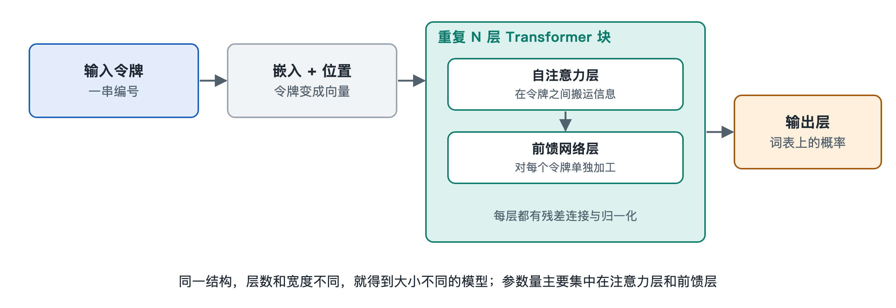

# 2.3 Transformer 层的堆叠：注意力层与前馈层

如果你在上一节之后打开一个开源模型的配置文件（常见文件名是 `config.json`），会看到一串看似枯燥的字段：`num_hidden_layers`、`num_attention_heads`、`hidden_size`、`intermediate_size`。再打开权重文件的索引，会发现成百上千个张量名字，像 `layers.0.self_attn.q_proj`、`layers.0.mlp.up_proj`、`layers.1.self_attn.q_proj`……编号从 0 一路排下去。这两样东西合在一起，其实已经把模型主体的结构告诉了你：**同一种积木，重复堆叠很多层。**这种积木就叫 Transformer 层。

## 2.3.1 从文件名读出结构：一层里有两个部件

Transformer 是 2017 年谷歌研究团队在论文《Attention Is All You Need》中提出的神经网络结构，今天绝大多数大语言模型的主体都建立在它之上。原论文的版本同时包含“编码器”和“解码器”两部分，而 GPT 系列以及目前常见的开源对话模型，大多只用其中的“解码器”一侧，称为“仅解码器”（decoder-only）结构。

拆开任意一层，它主要由两个部件组成：

| 部件 | 文件里常见的名字 | 一句话职责 |
|---|---|---|
| 注意力层（Attention） | `self_attn`、`attention` | 让每个令牌去“看”前面的其他令牌，把相关信息取过来 |
| 前馈层（Feed-Forward Network，FFN） | `mlp`、`feed_forward` | 对每个令牌自身的向量做一次加工和变换 |

每个部件前后还配有归一化和“残差连接”，它们负责让信号在很多层之间稳定传递，第四章 4.1 节再专门展开。本节先盯住两个主角。

可以用一个比喻来记：一句话里的每个令牌，好比会议室里的每位参会者，手里各拿着一张写满数字的卡片（就是上一节讲的向量）。注意力层是“讨论环节”，每个人听取别人的发言，把有用的信息记到自己卡片上；前馈层是“独立思考环节”，每个人关起门来，根据卡片上已有的内容进行整理和联想。一层 Transformer，就是“讨论一轮，再思考一轮”。

## 2.3.2 注意力层：令牌之间的信息交换

看一个例子：“小王把书还给了小李，因为他明天要考试。”这里的“他”指谁？要判断，必须把“他”和前面的“小王”“小李”“还书”“考试”联系起来。注意力层做的正是这件事：为当前令牌计算它与前面每个令牌的“相关程度”，再按相关程度把那些令牌的信息加权汇总过来。

对仅解码器模型，还有一条硬规矩：**每个令牌只能看自己和自己之前的令牌，不能偷看后面的。**这叫因果掩码（causal mask）。原因很直接：模型的任务是预测下一个令牌，如果训练时能看到答案，就学不到真本事。

配置文件里的 `num_attention_heads` 说明注意力被分成多个“头”并行工作，好比讨论环节分成几个小组，各自关注语法、指代、语义等不同关系。至于“相关程度”具体怎样用查询、键、值三组向量计算出来，属于机制层面的问题，留到第六章 6.1 和 6.2 节细讲。

## 2.3.3 前馈层：每个令牌各自的深加工

前馈层的结构反而更朴素：先把向量“放大”到更高的维度，经过一个非线性函数，再“压缩”回原来的维度。配置里的 `intermediate_size` 就是放大后的宽度，公开资料中常见的设计是隐藏维度的数倍（经典做法约为 4 倍，许多新模型采用略有不同的比例）。

与注意力层不同，前馈层**不在令牌之间传递信息**，每个令牌各算各的。那它做什么？可解释性研究中一种被较多引用的看法是：前馈层像一张巨大的“键—值”记忆表，存储了大量从训练数据中学到的事实和模式。比如读到“埃菲尔铁塔位于”，相关的前馈层单元可能被激活，把“巴黎”方向的信息加进向量。这种说法有实验支持，但并不是对前馈层全部功能的完整解释，第八章 8.5 节会再讨论。

一个值得记住的工程事实：在常见的大模型中，**参数的大头往往在前馈层**，一般占每层参数的一半以上，注意力层占其余部分。这也是第七章“混合专家”技术主要改造前馈层的原因。

## 2.3.4 为什么要堆叠很多层

单独一层能做的事有限：一轮讨论加一轮思考，只能建立比较浅的关联。把几十层叠起来，每一层的输出成为下一层的输入，向量就被一遍遍改写，表达的内容也逐渐从“这是哪个字”走向“这句话在说什么、接下来该说什么”。

研究者用“探针”方法观察各层向量时，大致看到这样的趋势（是统计意义上的倾向，并非严格分工）：

- **较低的层**：更多反映词形、词性、局部搭配等表层信息；
- **中间的层**：更多反映句法结构、指代关系和语义；
- **较高的层**：更多服务于“预测下一个令牌”这个最终任务。

层数是模型规模的重要旋钮。公开资料中，小型开源模型常见二三十层，大型模型可达近百层甚至更多；具体数字请以各模型的配置文件为准。值得注意的是，**在常见的模型里，各层结构基本相同，主要区别在于权重**（也有模型让部分层采用不同设计），这正是为什么权重文件里的名字会按 `layers.0`、`layers.1`……整齐地重复。不同的能力不是写在不同的“程序代码”里，而是分布在这些同构积木各自的权重数值中。

## 2.3.5 小结：一台由同一种积木搭成的流水线

把本节和前两节连起来，一个令牌的旅程是：分词器把文字切成令牌编号，嵌入层把编号变成向量，然后向量依次穿过几十个 Transformer 层，在每一层里先经过注意力层与其他令牌交换信息，再经过前馈层独自深加工。走完最后一层，向量已经“装满”了上下文的含义。

但到这里，模型还没有说出任何一个字。那个最终的向量怎样变成“下一个令牌是什么”的答案？这就是下一节输出层与概率分布要回答的问题。
