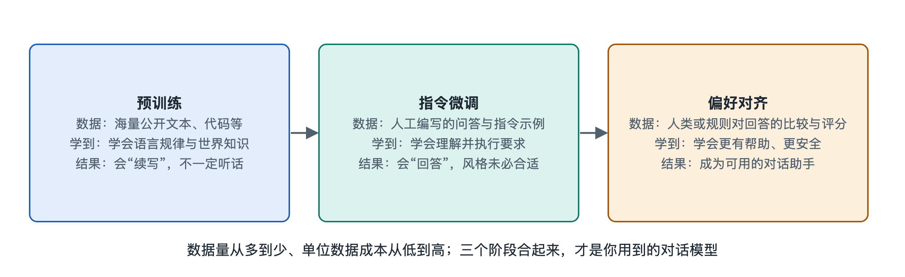

# 3.1 预训练：学会语言与世界知识

在电脑上打开一个开源模型的下载页面，常会看到同一个系列有两种文件：一种名字里带“Base”（基座），另一种带“Instruct”或“Chat”（指令版、对话版）。两个文件大小几乎一样，结构完全相同，用起来却差别很大。给基座模型输入“中国的首都是”，它多半会接上“北京”，然后可能继续写下去，像在续写一篇百科文章。如果问它“请帮我写一封请假条”，它可能接着又编出几道类似的题目，好像自己在出一份练习册，并不会直接替你写。

这个“只会续写、不太听话”的基座模型，就是**预训练**（Pre-training）的产物。模型的语言能力和大部分知识都来自这一步，它也是大语言模型生命周期中最昂贵的一步。本节要回答三个问题：预训练让模型做了什么，它从中学到了什么，它的边界在哪里。

## 3.1.1 一道题做几万亿遍：下一个令牌预测

预训练的任务只有一个，叫**下一个令牌预测**（Next-token Prediction）。第二章讲过，文字会被分词器切成令牌（Token），模型读入前面的令牌，在输出层给出“下一个令牌是什么”的概率分布。预训练就是拿海量文本让模型反复做这道题：

1. 从语料里取出一段文本，比如“床前明月光，疑是地上霜”；
2. 让模型只看“床前明月”，预测下一个令牌；
3. 拿它的预测和真实答案“光”对比，算出差距，这个差距叫**损失**（Loss）；
4. 按照让损失变小的方向，微调模型里的每一个参数；
5. 换一个位置、换一段文本，重复上面几步。

这里不需要任何人工标注，文本本身就提供了答案，每一个位置的下一个字都是现成的“标准答案”。这种做法叫**自监督学习**（Self-supervised Learning）。正因为不需要人来批改，整个互联网规模的文本都能直接拿来当教材。

可以把它想象成一个从没上过课的学生，面前是一座图书馆，他只做一件事：遮住下一个词去猜，猜完揭开对答案，再修正自己的直觉。只做几次，这个练习毫无意义。按公开资料中常见的说法，主流大模型预训练时读过的令牌数量在万亿量级。做到这个次数，就会出现一些远超“猜词”的能力。

## 3.1.2 为了猜对下一个词，模型被迫学会了什么

要把下一个词猜得准，只记住“哪些字常挨在一起”是不够的。看几个例子：

| 待补全的文本 | 想猜对需要掌握的东西 |
|---|---|
| “他们昨天去了公园，玩得很开心，所以___” | 语法、因果连接词的用法 |
| “水在标准大气压下的沸点是___摄氏度” | 事实性知识 |
| “小明比小红高，小红比小刚高，所以最矮的是___” | 简单推理 |
| “def add(a, b):\n    return ___” | 编程语言的规则 |
| “这部电影烂透了，我给它打___星” | 情感与语境判断 |

在训练过程中，这些规律被压缩进数以十亿、百亿甚至更多的参数里。第一章说的“模型文件里装着权重”，装的正是这些压缩后的统计规律。研究者常把预训练称为一种**压缩**：模型越能准确预测文本，就越是抓住了文本背后的结构。第八章会从信息论角度解释这个说法。

需要说清楚的是，模型学到的是“文本中呈现出来的世界”，并不是世界本身。书里反复写到的事，它记得牢；很少出现的冷僻细节，它记得模糊；语料里本身就错了的说法，它也可能一并学去。第六章讨论的“幻觉”，有一部分根源就在这里。

## 3.1.3 教材从哪里来：预训练语料

预训练的效果很大程度上取决于读了什么。根据各家公开的技术报告，常见的语料来源包括：

- **网页数据**：通常占比最大，例如公益组织 Common Crawl 长期抓取并公开的网页存档；
- **书籍与百科**：语言规范、知识密度高；
- **代码**：来自公开代码仓库，有助于提升逻辑和结构化表达能力；
- **学术论文、问答社区、多语言文本**等。

原始网页里混杂着广告、乱码、重复内容和有害信息，必须经过去重、过滤、质量打分等清洗才能使用。这条从网页到训练数据集的“数据流”，第五章第4节会展开。各家具体用了哪些数据、比例多少，往往属于商业机密，即使是开源模型，公开的通常也只是大致描述。

## 3.1.4 为什么预训练如此昂贵

预训练要让数量庞大的参数在万亿量级的令牌上反复更新，需要成千上万块加速芯片连续工作数周到数月。公开资料中，前沿模型单次预训练的成本常被描述为数千万美元甚至更高的量级。芯片、集群和数据中心怎样支撑这样的计算，属于本丛书第十七册《人工智能系统》的内容，这里只需记住一点：预训练是整个流程里最耗资源的阶段，后面的微调和对齐，花费通常要少得多。

这也解释了开头那两个文件的关系：机构先花大代价训练出一个基座模型，再在它上面用相对少的数据做加工，得到对话版。同一个基座，可以派生出多个不同用途的版本。

## 3.1.5 小结：一个博学却不懂规矩的续写者

预训练结束后，我们得到的是一个读过大半个互联网、语言流畅、知识面很广，但只会“接着往下写”的模型。它不知道你在向它提问，不知道应该怎样回答才算有帮助，也不懂哪些话不该说。用前面的比喻来说，它是一个博览群书却从未学过如何答题的学生。

要把这个续写者变成你每天使用的那个对话助手，还需要两道工序：先教它听懂指令，再教它按人类认可的方式回答。这正是接下来两节**指令微调**和**偏好对齐**要讲的内容。
