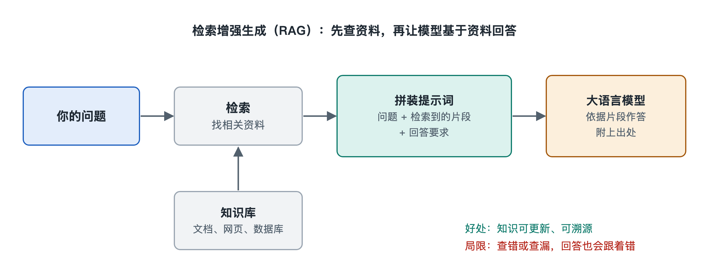

# 4.3 模型与外部知识：检索增强生成

假设你把公司新发布的一份员工手册上传到某个 AI 对话工具，问它：“出差住宿的报销上限是多少？”几秒钟后它给出答案，还标明这句话出自手册第几页。可是这份手册是上周才写好的，模型训练时根本没见过它。模型自己并没有被重新训练，它是怎么答对的？

答案藏在一种叫“检索增强生成”（Retrieval-Augmented Generation，RAG）的连接方式里。上一节讲过，模型能“看到”的只有上下文窗口里的内容。RAG 的思路很朴素：先到外部资料里找出相关的几段文字，把它们放进上下文，再让模型照着回答。

## 4.3.1 模型知识的两个硬伤

第三章讲过，预训练让模型从海量文本中学到语言规律和大量世界知识，这些知识分散存放在数十亿乃至更多的权重里，通常叫“参数化知识”。这种存法有两个先天不足。

第一是**会过时**。训练数据有一个截止时间，之后发生的事模型无从得知。重新训练一次大模型代价很高，不可能每天都做。

第二是**不可查证、也不可修改**。你没法打开权重文件，指着某个数字说“这里存着报销标准”，更没法只改掉这一条。模型对冷门或私有的信息印象模糊时，还可能编出一个听起来合理的答案，这就是第六章要专门讨论的“幻觉”。

打个比方：参数化知识像一个人多年读书形成的记忆，广博，但会模糊、会过时；RAG 则像允许他考试时翻书，书可以随时换成最新版，答案也能注明出处。

## 4.3.2 一次检索增强的完整流程

一个典型的 RAG 系统分为两个阶段：先把资料整理好，再在每次提问时现查现用。

### 4.3.2.1 离线准备（建索引）

1. **切块**（chunking）：把手册、网页、合同等文档切成几百字左右的小段。块太大，混进的无关内容多；块太小，又容易把一句话的前因后果切断。
2. **向量化**：用一个专门的“嵌入模型”（embedding model）把每一段文字变成一串数字，也就是向量。第二章讲过，模型内部用向量表示令牌；这里是把整段话压成一个向量，意思相近的段落，向量在空间中也彼此靠近。
3. **存入向量数据库**（vector database）：把向量和对应的原文一起存起来，供以后快速查找。

### 4.3.2.2 在线问答（检索并生成）

1. 把用户的问题用同一个嵌入模型变成向量。
2. 在向量数据库里找出与它最接近的若干段落，这一步称为“语义检索”。很多系统还会同时做传统的关键词检索，再把两路结果合并，这种做法叫“混合检索”。
3. 有的系统会再用一个“重排序”（rerank）模型，对候选段落按相关性重新打分，只留下最好的几段。
4. 把这些段落和问题拼成一段提示词，大意是：“请根据以下资料回答问题；资料中没有的，请说明不知道。”
5. 大语言模型读完这段上下文，生成答案，常常还会附上引用的出处。

整个过程中，**大语言模型本身的权重一个字都没有改**。改变的只是送进上下文窗口的内容。

## 4.3.3 两种“补知识”的方式对照

想让模型掌握新知识，还有一条路是用新资料继续微调模型。两者常被拿来比较：

| 对比项 | 检索增强生成（RAG） | 微调（fine-tuning） |
|---|---|---|
| 知识存放在哪里 | 外部文档库 | 模型权重 |
| 更新知识 | 替换或增加文档即可 | 需要重新训练 |
| 能否给出出处 | 能，可以指向原文段落 | 通常不能 |
| 擅长什么 | 补充事实、私有资料、时效信息 | 调整风格、格式、领域表达习惯 |
| 主要代价 | 每次提问要检索，上下文变长 | 训练所需的数据、算力和时间 |

这两种方式并不互相排斥。常见的说法是：想让模型“知道更多事实”，优先考虑 RAG；想让模型“换一种说话方式”，才考虑微调。实际系统里两者也常常一起用。

## 4.3.4 RAG 也会出错

把资料放进上下文，并不等于万无一失。RAG 系统的错误大致来自三处：

- **检索没找对**：问题和原文用词差别太大，或者切块时把关键信息切断了，真正有用的段落没被找出来。这时模型手里拿的是一本“翻错了页的书”。
- **资料本身有问题**：文档过时、彼此矛盾，或者被人故意塞进误导性内容，模型往往会照单全收。
- **模型没用好资料**：资料明明在上下文里，模型却忽略它，转而依赖自己的参数化记忆；或者把两段资料拼接出原文并没有的结论。上下文很长时，位于中间位置的信息更容易被忽视，第七章讲长上下文时还会提到这个现象。

所以，看到回答后面附有引用时，值得点开出处核对一下。引用让核查成为可能，但不能代替核查。

## 4.3.5 小结：给模型接上一座图书馆

RAG 体现的是一种重要的系统思路：**不必把所有知识都塞进模型，而是让模型学会使用外部知识**。权重负责理解与表达，文档库负责事实与时效，检索把两者连接起来。在写作时，许多对话产品里的“上传文件后提问”“联网搜索”以及企业内部的知识库问答，大多采用了这一类架构，只是各家在切块、检索和重排序上的具体做法不同，细节未必公开。

检索是模型“伸手去拿资料”。如果模型不只能读资料，还能调用计算器、查询数据库、发送请求，甚至替你执行一系列操作呢？下一节，我们就来看模型怎样与工具连接。
