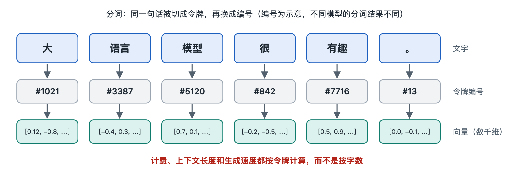

# 5.1 令牌流：一句话的分词、编码与生成

在对话框里输入“帮我把这句话翻译成英文：今天下雨了”，按下回车，屏幕上的回答通常不是一下子整段出现，而是一小块一小块地“流”出来。这种逐字吐出的样子不只是界面动画，它直接反映了模型内部的工作方式：模型每次只产生一个令牌（token），再把它接回输入，接着产生下一个。第二章已经分别介绍了分词器、嵌入层、Transformer 层和输出层这几个部件，本节把它们串成一条线，跟着一句话从进入模型到变成回答，看令牌怎样在系统中流动。

## 5.1.1 第一站：从文字到编号

你的那句话并不是单独送进模型的。对话产品会先把系统提示词、之前的对话历史和你这次的输入拼接起来，并插入一些特殊令牌，用来标记“这里是系统说明”“这里是用户发言”“轮到助手回答了”。不同模型使用的标记格式各不相同，这些格式一般写在模型文件附带的对话模板（chat template）里。

拼好的长文本交给分词器。分词器按照词表把文本切成令牌，再把每个令牌换成一个整数编号。“今天下雨了”可能被切成两三个令牌，也可能切得更碎，具体结果取决于各个模型的词表。到了这一步，模型看到的已经不是文字，而是一串整数，比如“[1532, 8817, 402, …]”这样的形式（这里的数字只用来示意）。

## 5.1.2 第二站：从编号到向量，再穿过层层网络

整数本身不带含义。嵌入层像一本查找表，把每个编号换成一个由几千个数字组成的向量，同时加入位置信息，让模型知道每个令牌排在第几位。

接下来，这一串向量依次穿过几十层 Transformer 层。每一层都会对每个位置的向量做一次加工：注意力子层让各个位置互相参考，前馈子层对每个位置单独做变换。向量的个数始终和令牌数相同，只是里面的数值一层层被改写。注意力怎样在令牌之间搬运信息，留到下一节详细讲。

走到最后一层，模型只需要用到序列最末尾那个位置的向量。输出层把它变成一张覆盖整个词表的打分表，再换算成概率分布：下一个令牌是“It”的概率是多少，是“Today”的概率又是多少。

## 5.1.3 第三站：选出一个令牌，接回队尾

按照采样策略（第六章会讲温度、Top-p 等参数），系统从这个概率分布里选出一个令牌，例如“Today”。然后发生了关键的一步：这个新令牌被追加到输入序列末尾，整条序列再次进入模型，用来预测下一个令牌。这样一圈接一圈地进行，直到模型输出表示“结束”的特殊令牌，或者达到长度上限为止。这种“产生一个、接回一个”的方式叫作自回归生成（autoregressive generation）。

每产生一个令牌，分词器就把它的编号反向换回文字，界面立刻显示出来，这就是流式输出（streaming）。有时屏幕上先出现半个汉字或乱码，然后才变正常，原因是一个汉字被拆成了几个字节级令牌，要等它们全部到齐才能拼出完整的字。

## 5.1.4 两个阶段与一份“草稿缓存”

如果每生成一个令牌都把整条序列从头算一遍，计算量会非常大。工程上的通行做法是把它拆成两个阶段：

| 阶段 | 英文常用名 | 做什么 | 用户的感受 |
|---|---|---|---|
| 预填充 | prefill | 一次性并行处理你输入的全部令牌 | 按下回车后要等一会儿，第一个字才出现 |
| 解码 | decode | 每次只算一个新令牌 | 文字以大致稳定的速度往外冒 |

两个阶段之间靠一份缓存衔接，叫作键值缓存（KV cache）。注意力计算中，每个已经处理过的令牌都会留下一组中间结果（“键”和“值”，第六章解释）。把这些结果存下来，新令牌只要和它们做比对，不必重算旧令牌。代价是缓存随对话长度不断增大，要占用大量显存。这也是长对话会变慢、长上下文成本更高的直接原因之一，第五章第五节和第七章还会回到这个问题。

## 5.1.5 小结：一条环形的令牌流

把整个过程连起来，令牌流是一个循环：

1. 文字 → 分词 → 整数编号；
2. 编号 → 嵌入向量 → 逐层加工；
3. 末位向量 → 概率分布 → 采样出一个令牌；
4. 新令牌 → 转回文字显示，同时接回序列末尾，回到第 2 步。

从这个循环可以看出大语言模型的几个基本特点。它“说话”是一步一步往前写的，已经写出的令牌不会回头修改。它的计费和速度通常按令牌计算，而不是按字数计算。它能“记住”的内容，就是这条序列加上缓存里装着的东西。下一节，我们走进第 2 步内部，看信息在令牌之间是怎样被搬来搬去的。
