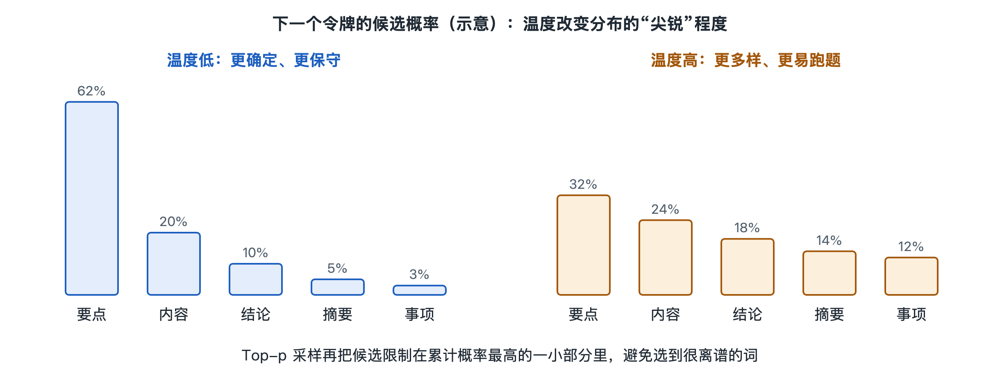

# 6.3 采样策略：温度、Top-p 与重复惩罚

同一个问题，在对话界面里点一下“重新生成”，往往会得到一段措辞不同、甚至思路也不同的回答。模型文件没有变，输入也没有变，为什么输出会变？答案不在 Transformer 层里，而在模型输出之后的最后一步：**采样**（sampling）。第二章讲过，输出层给出的是一张“下一个令牌的概率表”，而不是一个确定的字。从这张表里挑出哪一个令牌，由一套叫作**采样策略**的规则决定。本节就打开这一步，看看温度、Top-p 和重复惩罚这几个旋钮各自在拧什么。

## 6.3.1 从概率表到一个令牌：贪心与随机

假设模型读完“今天天气很”之后，给出的候选大致是这样（数字只是示意）：

| 候选令牌 | 概率 |
|---|---|
| 好 | 0.45 |
| 热 | 0.25 |
| 冷 | 0.15 |
| 不错 | 0.10 |
| 其他几万个令牌 | 合计 0.05 |

最简单的做法是**贪心解码**（greedy decoding）：每一步都选概率最高的那个，这里就是“好”。它的优点是稳定、可复现，同样的输入总得到同样的输出；缺点是容易千篇一律，长文本里还常常陷入重复的句式，像一个只会说“标准答案”的学生。

另一种做法是**随机采样**：按概率掷骰子，45% 的机会选“好”，25% 的机会选“热”……这样回答就有了变化。但完全照原概率掷骰子也有风险：那合计 5% 的“长尾”里藏着大量不合适的令牌，一段几百个令牌的回答里，偶尔掷中一次，句子就可能突然跑偏。采样策略要解决的，就是在“稳定”和“多样”之间找到合适的位置。

## 6.3.2 温度：把概率分布拉尖或压平

**温度**（temperature）是最常见的旋钮。回忆一下，输出层先算出每个令牌的原始得分（logits），再经过 softmax 函数变成概率。温度的做法是在进入 softmax 之前，把所有得分统一除以一个数 T：

- **T 小于 1**：得分差距被放大，高的更高、低的更低，分布变“尖”。“好”的概率可能从 0.45 升到 0.7 以上，回答更保守、更确定。
- **T 等于 1**：保持模型原本的分布。
- **T 大于 1**：得分差距被缩小，分布变“平”，原本冷门的候选也有了更多机会，回答更发散，也更容易出错。
- **T 趋近于 0**：几乎等同于贪心解码。

可以把温度想象成考场上的心态：低温是紧张谨慎、只写最有把握的答案；高温是放松随意、什么想法都敢写。要注意的是，温度不会让模型“更聪明”或“更有创造力”，它只是改变从同一张概率表里抽签的方式。模型不知道的东西，调高温度也变不出来。

## 6.3.3 Top-k 与 Top-p：先划定候选圈

温度调整的是整张表的形状，但长尾依然存在。于是有了“先截断、再抽签”的方法。

**Top-k 采样**：只保留概率最高的 k 个候选，其余一律淘汰，再在这 k 个里按比例重新分配概率后抽取。缺点是 k 固定：模型很有把握时（比如“中华人民共和”后面几乎只能是“国”），保留 40 个候选纯属多余；模型拿不准时，40 个又可能不够。

**Top-p 采样**，又称**核采样**（nucleus sampling）：把候选按概率从高到低排好，依次累加，直到总和达到 p（例如 0.9）为止，只在这个“核”里抽签。用上面的表来算，“好、热、冷、不错”累计正好 0.95，p 取 0.9 时，长尾里的几万个令牌全被排除在外。它的好处是候选圈大小会自适应：模型笃定时，圈里可能只有一两个令牌；模型犹豫时，圈会自动变大。

在常见的推理工具中，这些步骤会组合起来执行，不同工具的先后顺序不完全相同：一般先做重复惩罚等得分调整，再进行温度调节和 Top-k、Top-p 截断，最后抽样。具体顺序和默认值因工具而异，以所用软件的文档为准。

## 6.3.4 重复惩罚：别总说同一句话

即使有了温度和截断，模型仍可能反复输出同一个词或同一句话，尤其是在小模型或长文本生成中。原因在于自回归生成的特点：一个短语出现过一次，它就进入上下文，注意力会让模型更倾向于再写一遍，形成循环。

**重复惩罚**（repetition penalty）就是针对这一点的修正：对已经在上下文中出现过的令牌，人为压低它们的得分，降低再次被选中的机会。不同系统的实现方式不同，例如：

- 在本地推理工具（如 llama.cpp 一类）中，常见一个名为 `repeat_penalty` 的参数，对近期出现过的令牌按比例降分。
- OpenAI 的接口在写作时提供 `frequency_penalty`（按出现次数累加惩罚）和 `presence_penalty`（只要出现过就惩罚一次）两个参数，前者抑制啰嗦，后者鼓励引入新话题。

惩罚不宜过重。中文里“的”“是”这类高频字必然反复出现，代码里变量名也必须重复使用，惩罚过度反而会让句子别扭、代码出错。

## 6.3.5 怎样选择：任务决定旋钮

下表是公开资料和工具文档中常见的经验搭配，仅供参考：

| 任务 | 温度倾向 | Top-p 倾向 | 理由 |
|---|---|---|---|
| 写代码、做计算、抽取信息 | 低（接近 0） | 较小或不用 | 需要确定、可复现 |
| 日常问答、写邮件 | 中等（约 0.7 上下） | 0.9 左右 | 自然又不跑题 |
| 头脑风暴、写诗写故事 | 偏高 | 较大 | 需要多样表达 |

很多对话产品并不开放这些参数，而是由厂商替用户预先设好；通过开发者接口或本地推理工具，才能直接调节。还要说明的是，写作时一些带“深度思考”功能的推理模型，其接口会限制或忽略部分采样参数，这是具体厂商的设计选择，并非所有模型的通用规则。

回到开头的“重新生成”：模型给出的概率表每次都一样，变化来自采样时那一次“掷骰子”。理解了这一点，就能明白大语言模型的输出本质上带有随机性，同一问题多问几次、比较答案，本身就是一种检验方法。不过，采样只决定“从表里怎么挑”，表本身由上下文决定。下一节我们将看到，仅仅在提示词里放几个例子，就能明显改变这张表——这就是上下文学习。
