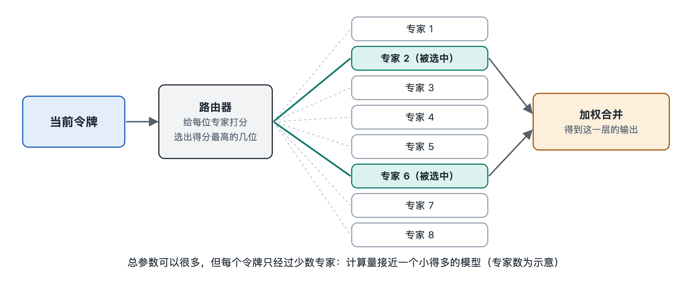

# 7.1 规模定律与模型规模的选择

打开任何一个开源模型下载页面，你会发现同一个模型家族往往同时提供好几个版本：文件名里带着“1B”“7B”“70B”之类的标记。这里的 B 是英文 billion（十亿）的缩写，指模型的参数量。小的版本几个 GB，笔记本电脑就能跑；大的版本几十上百 GB，需要专门的服务器。于是一个很实际的问题摆在面前：模型是不是越大越好？大一倍，到底能好多少？训练者又是怎样决定“这一次造多大”的？回答这些问题的核心工具，叫作规模定律。

## 7.1.1 从经验观察到“定律”

规模定律（Scaling Laws）是研究者在大量训练实验中总结出的经验规律：在其他条件合理的前提下，模型的测试损失（可以理解为“预测下一个令牌时平均犯错的程度”，第八章会把它和交叉熵联系起来）会随着三个量的增长而稳定下降：

- **参数量 N**：模型里可调整的数字有多少；
- **训练数据量 D**：训练时“读”过多少个令牌；
- **训练计算量 C**：训练总共做了多少次运算，大致与 N × D 成正比。

关键在于下降的形状。2020 年前后，OpenAI 的研究人员在论文中报告：损失与这些量之间近似呈幂律（power law）关系。把横轴和纵轴都画成对数刻度，数据点会排成一条相当直的斜线。这意味着两件事：第一，投入增加，效果确实持续变好，而且可以提前预测；第二，收益是递减的——要让损失再降同样一截，往往需要把投入翻好几倍，而不是加一点点。

这里的“定律”与物理定律不同。它是在特定架构、特定数据分布、特定训练方法下拟合出来的曲线，换了条件，曲线的斜率和位置都会变。把它理解成“工程上非常好用的经验公式”更准确。

## 7.1.2 钱该花在模型上，还是数据上

计算预算总是有限的。同样一笔算力，可以训练一个更大的模型但少读些数据，也可以训练一个较小的模型但多读些数据。哪种分配最划算？

早期的研究倾向于“优先把模型做大”。2022 年，DeepMind 的研究团队发表了一项后来被广泛称为 Chinchilla 研究的工作，他们系统比较了不同分配方式后得出结论：在给定计算预算下，参数量和训练令牌数应当大致同比例增长；按他们的拟合，一个“计算最优”的模型，训练令牌数大约是参数量的二十倍左右（这是公开资料中最常被引用的说法，是一个粗略的经验比例，并非精确常数）。按这个标准回看，当时不少大模型其实“读书太少”。

| 策略 | 做法 | 优点 | 代价 |
|---|---|---|---|
| 偏重参数 | 模型大、数据相对少 | 单位训练算力下容量大 | 训练不充分，推理成本高 |
| 计算最优 | 参数与数据同比例增长 | 给定训练预算下损失最低 | 不一定考虑推理成本 |
| 偏重数据（“过训练”） | 模型小、数据远超最优比例 | 推理便宜、易于部署 | 训练阶段多花算力 |

## 7.1.3 为什么很多小模型故意“超量训练”

表格最后一行值得多说一句。计算最优只关心训练这一次花多少钱，但模型训练完后要被成千上万的用户反复调用，推理的花费会长期累积（第五章“成本流”一节讨论过这一点）。模型越小，每次回答越便宜、越快，也越容易放进个人电脑和手机。

因此在写作时，许多开源模型家族的小尺寸版本都选择用远超“二十倍”比例的数据去训练：多花一些训练算力，换来一个体积小但能力更强的模型。规模定律在这里不是被推翻了，而是被放进了更完整的账本：训练成本加上预期的推理成本，一起决定最合适的规模。

## 7.1.4 规模之外：定律没说的事

规模定律预测的是平均损失，而人们真正关心的是具体能力：会不会解数学题、能不能写对代码。两者之间并非一一对应。有研究报告某些能力似乎在模型达到一定规模后才“突然出现”，被称为涌现能力（emergent abilities）；但也有研究指出，这种“突然”在很大程度上与评测方式有关，换用连续的打分标准，曲线往往变得平滑。这个问题在学界仍有争论，宜把它当作开放问题看待。

此外，还有几个因素会改变曲线本身：

- **数据质量**：同样数量的令牌，经过清洗和筛选的数据效果明显更好；
- **数据总量的天花板**：高质量的公开文本是有限的，单纯“多读”终有尽头；
- **架构与训练方法**：更好的设计可以让同样的算力达到更低的损失，下一节的混合专家就是一例；
- **推理时计算**：第三章讲过的思维链说明，让模型在回答时多“想”几步，也能换来能力提升，这被一些研究者视为与训练规模并列的另一条扩展维度。

## 7.1.5 读者该怎样挑选模型规模

回到下载页面上的那串数字。对普通使用者而言，可以按这样的思路选：先看硬件——模型文件大小必须能装进显存或内存（量化能显著压缩体积，见 7.4 节）；再看任务——日常问答、摘要、翻译，几个 B 的模型常常够用，复杂推理和长篇写作则更依赖大模型；最后看训练数据量和模型卡中的评测说明，而不只看参数量，因为同样大小的两个模型，读过的数据可能相差数倍。

规模定律告诉我们，“变大”是一条可预测、但越来越贵的路。于是一个自然的追问出现了：能不能让模型拥有很多参数，却在每次计算时只动用其中一小部分？这正是下一节混合专家模型要回答的问题。
