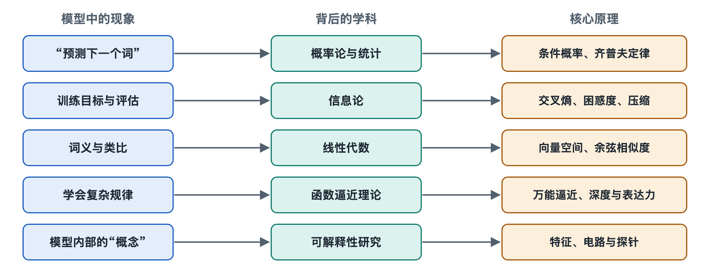

# 8.1 语言的统计结构：从齐普夫定律到 n 元模型

打开手机输入法，敲下“今天天气”，候选栏里很可能已经出现了“很好”“怎么样”。输入法没有理解天气，它只是在大量文字里见过这几个字后面最常跟着什么。前面几章拆开了大语言模型的结构与机制，从这一章开始要追问：这些机制为什么行得通？第一个答案藏在语言本身。语言不是随机排列的字符，它有很强的统计规律，而“预测下一个令牌”正是在利用这些规律。

## 8.1.1 少数词用得极多：齐普夫定律

随便找一本小说，统计每个词出现的次数，再按次数从高到低排名，会发现一个稳定的现象：排第 1 的词出现次数大约是排第 2 的两倍、排第 3 的三倍。也就是说，一个词的出现频率大致与它的排名成反比。这条经验规律以美国语言学家齐普夫（George Kingsley Zipf）命名，称为**齐普夫定律**（Zipf's law）。他在二十世纪三四十年代系统研究并推广了这一现象。

在中文里，“的”“是”“了”“我”这类词占据了排名前列；在英文里则是 the、of、and。这一规律带来两个直接后果：

- **高频词很少，却覆盖了大部分文本。** 少量最常用的词就能占到一篇文章字数的一大半。
- **低频词极多，形成一条“长尾”。** 大量专业术语、人名、生僻表达，每一个都很少出现，加起来却数量庞大。

这条长尾正是第二章分词器采用子词切分的原因之一：词表不可能把每个罕见词都收进去，但可以把它们拆成常见的片段来表示。长尾也意味着，模型想“见过”足够多的罕见知识，就需要非常大量的语料，这与第七章的规模定律遥相呼应。

## 8.1.2 前文约束后文：语言是一条有记忆的链

除了单个词的频率，词与词的先后关系更有规律。看到“一衣带”，几乎所有中文读者都会接上“水”；看到“因为”，后面多半会有“所以”。

最早用数学刻画这种依赖关系的，是俄国数学家马尔可夫（Andrey Markov）。1913 年，他统计了普希金长诗《叶甫盖尼·奥涅金》中元音与辅音的交替情况，发现下一个字母是元音还是辅音，明显受前一个字母影响。这类“下一步只取决于前面有限几步”的模型，后来被称为**马尔可夫链**（Markov chain）。

1948 年，信息论奠基人香农（Claude Shannon）在其经典论文中做了一个著名演示：按照英文中字母或单词的出现统计，依次只看前 0 个、1 个、2 个单位来随机生成文本。看得越多，生成的文字越像英语，从一堆乱码逐渐变成“读起来有点像句子”的字串。这个实验清楚地表明：**用前文预测后文，本身就能捕捉相当一部分语言结构。**

## 8.1.3 n 元模型：把“看前面几个词”变成可计算的方法

把上面的思路工程化，就得到了 **n 元模型**（n-gram model）。“n 元”指连续的 n 个词（或字）组成的片段。做法很朴素：

1. 在大量文本中统计每个 n 元片段出现的次数；
2. 预测下一个词时，只看紧挨着的前 n−1 个词；
3. 用“这几个词后面跟着某词”的次数，除以“这几个词出现”的总次数，作为概率。

| 模型 | 预测时看的前文 | 例子：预测“天气”之后 |
|---|---|---|
| 一元模型（unigram） | 不看前文 | 只按词频猜，常猜出“的” |
| 二元模型（bigram） | 前 1 个词 | 看“天气”，猜“很好”“预报” |
| 三元模型（trigram） | 前 2 个词 | 看“今天 天气”，猜得更准 |

在深度学习普及之前，n 元模型长期是语音识别、机器翻译和输入法的核心部件。它与今天的大语言模型做的是**同一个任务**：给定前文，输出下一个单位的概率分布。第二章讲到的输出层，本质上也是在给出这样一张概率表。

## 8.1.4 n 元模型的天花板：稀疏与短视

既然任务相同，为什么不把 n 元模型做大就行？因为它有两个难以逾越的问题。

**一是数据稀疏。** n 越大，可能的片段组合呈爆炸式增长，绝大多数组合在语料里从未出现。一个合理但没见过的句子会被算成概率为零。工程师为此发明了各种**平滑**（smoothing）技巧，给没见过的组合分一点概率，或者在长片段查不到时退回短片段，但这只是修补。

**二是看不远。** 实际系统中 n 通常只取 3 到 5 左右。而语言的依赖可以跨越很远：一段话开头提到的人物，几十个词之后才用“她”指代；一个“虽然”可能隔着一整句才等来“但是”。n 元模型对窗口外的内容一无所知。

更根本的是，n 元模型把每个词当作互不相干的符号。“猫”和“狗”在它眼里与“猫”和“桌子”一样陌生，在“猫”上学到的规律无法迁移到“狗”。

## 8.1.5 从计数到学习：大语言模型接过了什么

对照起来，大语言模型的关键改进恰好对着这三个弱点：

| 问题 | n 元模型 | 大语言模型 |
|---|---|---|
| 没见过的组合 | 靠平滑硬分概率 | 用向量表示相似性，可以泛化 |
| 看多远 | 前几个词 | 整个上下文窗口，由注意力选择相关内容 |
| 词与词的关系 | 独立符号 | 嵌入向量，相近含义彼此靠近 |

齐普夫定律告诉我们语言的分布极不均匀，马尔可夫与香农告诉我们前文能预测后文，n 元模型证明了这个思路可以实用，也暴露了“死记片段”的极限。大语言模型保留了“预测下一个令牌”的目标，却把查表换成了学习一个能够泛化的函数。要衡量这种预测做得有多好，还需要一把尺子，这就是下一节要讲的信息论：困惑度、交叉熵与压缩。
