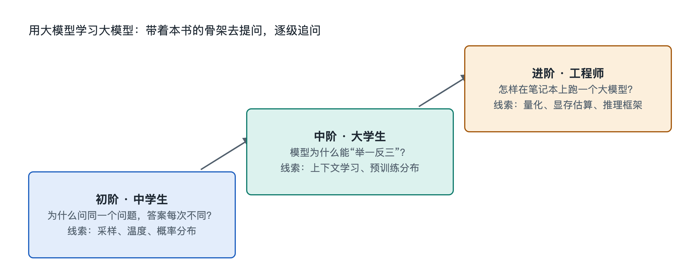

# 9.3 三阶提问阶梯：从中学生到工程师

打开任意一个 AI 对话工具，输入“注意力机制是什么”，你会得到一段像模像样的解释。可如果换成一位中学生、一位大学生和一位工程师来问，他们真正需要的答案其实完全不同：中学生需要一个能讲给同桌听的画面，大学生需要一张能对上公式的结构图，工程师需要知道这个机制在自己手上的模型里到底占多少显存、怎么调。同一个问题，问法不同，AI 展开的深度也就不同。

本节给出一把“三阶提问阶梯”，把前面八章的知识骨架变成可以一级一级往上爬的提问方式。它不要求你一开始就站在顶层，而是让你知道自己现在站在哪一级、下一级怎么迈。

## 9.3.1 第一阶：看见——用类比和场景问“它是什么”

第一阶的目标是在脑子里形成一个不出错的画面。这一级的提问有三个特点：要求类比、要求贴近生活、要求指出类比在哪里失效。

示范问法：

- “请用中学生能懂的类比解释分词器做了什么，并告诉我这个类比哪里不准确。”
- “大模型生成一句话时是一个字一个字往外蹦的吗？用一个日常例子说明。”
- “模型文件里的‘权重’是什么？能不能把它比作某种我见过的东西？”

最后那句“哪里不准确”很关键。类比是梯子，不是房子。比如把注意力比作“开会时每个人决定听谁发言”，画面很直观，但它会让人误以为模型里真有一个“人”在做决定。让 AI 主动说出类比的边界，有助于避免第一阶的画面在第二阶变成误解。

这一级对应本书的第一、二章：对象和结构。只要能说清“一次对话里，文字先变成令牌，再变成向量，经过很多层计算，最后给出下一个令牌的概率”，第一阶就算站稳了。

## 9.3.2 第二阶：拆开——用结构和因果问“它为什么这样”

第二阶的目标是把画面拆成零件，并弄清零件之间的因果关系。这一级的提问开始出现“为什么”“如果……会怎样”“和……有什么区别”。

示范问法：

- “为什么 Transformer 需要位置编码？如果去掉它，模型会把哪两句话当成一样的？”
- “温度调高和 Top-p 调高，对输出的影响有什么不同？请各举一个例子。”
- “残差连接解决了什么问题？没有它，深层网络训练时梯度会发生什么？”
- “检索增强生成和微调都能让模型‘知道新知识’，两者的代价和适用场景有什么区别？请列成对照表。”

这一级的关键技巧是**反事实提问**：假设拿掉某个零件，看系统哪里坏掉。零件的作用，往往在它缺席时最清楚。这一级对应本书第三到第六章：功能、连接、流动与机制。

第二阶还有一个要求：开始核对。AI 给出的解释，可以拿回本书相应章节对照，也可以追问“这个说法出自哪篇论文或哪份公开文档”。如果它给出的论文名或数字无法查到，就要按第六章讲过的幻觉机制来理解，不能直接采信。

## 9.3.3 第三阶：动手——用参数、代价和证据问“它在我手上怎样”

第三阶的目标是把原理落到具体的模型文件、具体的工具和具体的取舍上。这一级的问题带着约束条件：硬件多大、任务是什么、能接受多少误差。

示范问法：

- “我有一台显存约 8GB 级别的电脑，想在本地跑一个开源模型做中文摘要。请分析参数规模、量化位数和上下文长度之间该怎么取舍，并说明每种选择会损失什么。”
- “这份模型卡里写的训练数据说明和许可证条款，对我在公司内部使用有什么限制？哪些信息模型卡里没写、需要我另外确认？”
- “请解释这段推理代码里 KV 缓存的作用，并估算上下文从几千令牌增加到几万令牌时，缓存大小大约按什么规律增长。”

这一级对应第七、八章：关键技术与原理。工程师级的提问有一个标志——**要求给出估算方法，而不只是结论**。“按什么规律增长”比“会不会变大”更有用，因为方法可以迁移到下一个模型，结论却会随版本过时。写作时的主流模型更新很快，但量化、缓存、规模与成本之间的关系相对稳定，值得问透。

## 9.3.4 三阶对照：同一个主题怎样往上爬

下表以“幻觉”为例，展示同一主题在三阶上的不同问法：

| 阶梯 | 目标 | 示范问题 | 验证方式 |
|------|------|----------|----------|
| 第一阶 看见 | 形成正确画面 | “模型为什么会一本正经地说错？用一个生活例子说明。” | 能用自己的话讲给别人听 |
| 第二阶 拆开 | 理清因果 | “从‘预测下一个令牌’的训练目标看，为什么模型缺少‘我不知道’的天然倾向？对齐训练能改善多少？” | 能对上本书第三、六章的结构 |
| 第三阶 动手 | 落到实践 | “在我的检索增强问答系统里，怎样设计提示词和引用检查，降低编造来源的概率？怎么测试效果？” | 能设计一个小实验并看到结果 |

爬阶梯不必一次到顶。中学生停在第一阶并把画面讲准，就是很好的收获；管理者到第二阶，足以判断供应商的说法是否靠谱；入门工程师则应当把第三阶的问题变成真实的实验记录。

## 9.3.5 让阶梯持续生长的三条习惯

第一，**先声明自己在哪一阶**。在提问开头写上“我是高中生，没学过线性代数”或“我熟悉 Python，想看实现细节”，AI 会相应调整深度。这正是第六章讲的上下文学习在你身上的应用。

第二，**每升一阶，回头验证一次**。用新学到的结构去检查旧画面：第一阶的类比在第二阶还成立吗？哪里需要修正？

第三，**把问答沉淀回骨架**。把 AI 的好回答对应到本书的九层阶梯上，标注它属于结构、机制还是原理。书是骨架，AI 是血肉，只有挂到骨架上的知识，才不会在下一次对话时散掉。

三阶提问阶梯本质上是把“对象—结构—功能—连接—流动—机制—关键技术—原理”这条认知路线，翻译成了可以随时使用的提问模板。下一节将回顾本章骨架，并给出最后一组动手任务。
