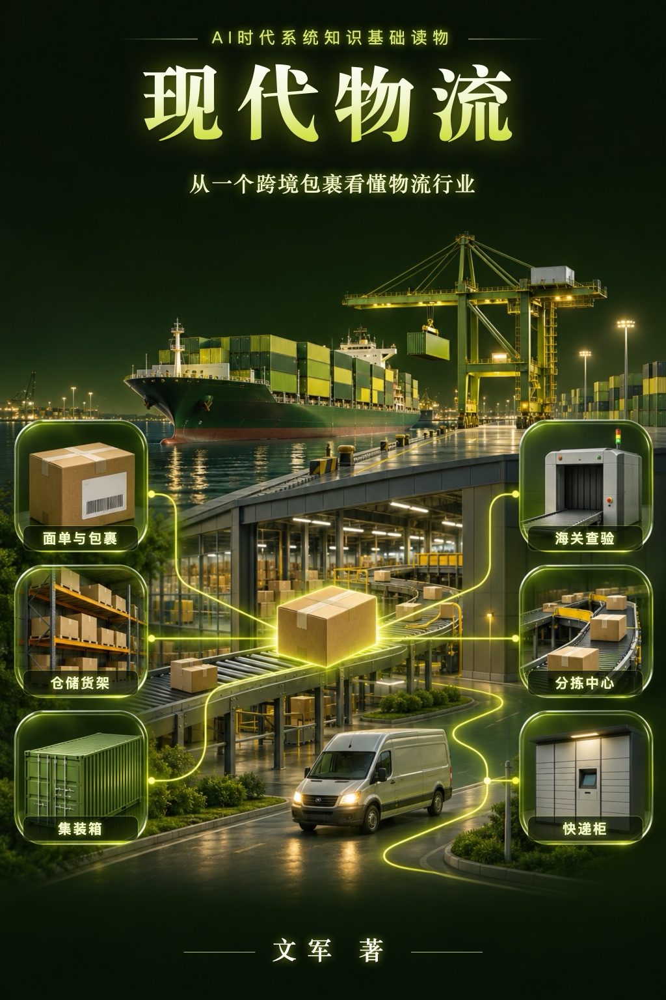

# 关于本书

**《现代物流》**——从一个跨境包裹看懂物流行业

《AI时代系统知识基础读物》丛书，作者：文军。

## 怎样读这本书

本书采用“书 + 实物 + AI”的学习方式：书给出一张稳定的知识骨架，你手边的实物就是教具，遇到想深入的地方，可以把书中的问题直接拿去问 AI，让它继续往下展开。

全书按九层认知阶梯组织：对象 → 结构 → 功能 → 关系 → 流动 → 机制 → 关键技术 → 原理 → AI 协同。

## 知识网

物流本身就是一张网，这本书的知识也连成了一张网：九章分九层九色，一个节点是一节，一条线是两节都讲到的物流概念。点任何节点，看它连着哪些节，再跳回原文；还可以「跟一个包裹走」，沿着 1.1 节那只跨境包裹的路线看一遍全书。

👉 [打开《现代物流》知识网](net/index.html)

## 留言

每页底部的评论区由 Giscus 提供，评论保存在本书 GitHub 仓库的 Discussions 中，需要用 GitHub 账号登录后留言。

## 版权

© 文军。保留所有权利。
