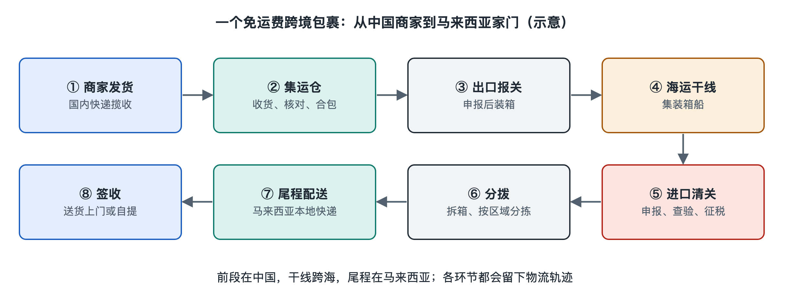

# 1.1 从一个免运费包裹出发：中国网购海运到马来西亚的全程

你在马来西亚拆开一个网购包裹，里面有从中国不同商家买的小物件。下单页面写着“免运费”，物流记录则出现过“集运仓签收”“合包完成”“海运运输中”“清关完成”。几件商品怎样变成手中的一个包裹，又怎样越过海峡来到家门口？沿着它走一遍，就能看见现代物流最基本的工作：让货物在不同地点、企业和运输方式之间持续交接。

这样的包裹并不少见。截至本书写作时，拼多多就是向马来西亚消费者提供这类服务的中国电商平台之一：商家先把商品寄到平台指定的国内集运仓，集运仓合包后再安排国际运输，据马来西亚媒体报道多走海运、约需 15 到 30 天，具体方式和时效以平台当时公布的规则为准；平台规则和免运费的门槛几经调整，也没有公开运费怎样分担。本书用这样一个包裹做贯穿全书的例子，但讲的是所有跨境物流共同的结构和道理，不只是某一家平台的做法。

## 1.1.1 第一段路：从商家到集运仓

下单后，商家通常先完成备货、打包和发货。包裹上的**面单**是供物流人员识别的标签，通常载有收件信息、条码或运单号码。国内快递企业揽收后，包裹可能经过网点、分拨中心和运输车辆，抵达指定的**集运仓**——集中接收多个来源的货物，再安排后续运输的仓库。

此时，商品还没有直接奔向你在马来西亚的住址。集运仓需要辨认每个到仓包裹属于哪位用户、哪笔订单，核对数量与状态，再按服务安排处理。若你从不同商家买了三件商品，它们可能分别坐三辆车到仓，先后被签收。物流页面上的“集运仓签收”，只表示仓库接收了相应货件，不等于所有商品已经齐备，更不等于已经出海。

一些集运服务会把同一收件人的多个包裹**合包**：将原本分散的货件归并为一个后续交付单元。是否拆除外包装、能否把不同商品装在一起，要看商品属性和实际服务规则。合包的好处是减少重复包装与交接，但易碎、液体或其他受运输限制的物品，不能仅凭“省空间”来处理。

## 1.1.2 第二段路：从仓库到海上的运输单元

合包后的货件还要离开集运仓，到达出口港口或其周边的集货地点。这段从发货地走向国际运输起点的路，常被称为**头程**。它可能包含仓内出库、国内运输、出口申报，以及在港口交给承运方等多次交接，并不是“一辆车从仓库开到码头”那么简单。

单个网购包裹通常装不满一个海运集装箱。物流服务商会把许多货主或订单的货物汇集起来，利用同一运输空间；这种组织方式可称为**拼箱**。在装箱前，货物可能先按目的地、服务线路或申报要求分类。你手中的小包裹，到了这一层，已经是更大货物单元中的一部分：包裹装入袋或箱，袋箱随其他货物进入集装箱，再由船舶运往目的地港口。

从“一个小包裹”变成“许多货物一起走”，是物流降低单位运输成本的重要办法，但也带来等待：货要集齐，装箱和船期要衔接。海运通常比空运慢，适合对运输时间要求相对宽松的货物。下单页显示的预计送达时间，是在一系列作业顺利衔接的条件下给出的估计；实际时间还受集货、船期、港口作业和目的地处理影响。

## 1.1.3 第三段路：跨越国境，不只是坐一趟船

货物离开中国前，需要按适用规定办理出口申报；到达马来西亚后，还要履行当地要求的进口申报和监管程序。人们常把进口环节的申报、可能发生的查验、税费处理和放行统称为**清关**。清关不是“所有包裹都要开箱检查”，也不是物流企业自己说一句“通过”就算完成。申报资料、商品类别、适用监管要求和海关处理结果，都会影响货物能否继续流转。

因此，“免运费”不能理解成“没有任何跨境费用”，也不能据此推断包裹一定免税。运费如何向商家、平台或服务商结算，与进口时是否产生税费，是两个不同问题；具体税费取决于马来西亚当时适用的规定和货物情况。消费者看到的运费为零，只说明在这笔订单的展示与结算条件下，自己没有另付这项运费，并不说明船舶、仓库和派送员免费工作。平台活动与服务规则会变化，判断一笔订单仍应以当时页面及订单记录为准。

## 1.1.4 最后一段路：从港口到家门口

货物获准继续流转后，还需从港口或处理场所进入马来西亚境内的配送网络。这段面向最终收件人的运输与派送，常称为**尾程**。包裹可能经过分拣、转运和本地站点，最后由派送人员送到住址，或按约定交付至自提点。系统记录交付成功，通常称为**妥投**；它是物流服务中的交付结果状态，但若收件人发现错投或破损，仍需要依据实际情况核实。

回看手机上的轨迹，你会发现它不是包裹的连续定位画面，而是各环节接收、扫描或录入后留下的节点记录。“海运运输中”不一定表示船正在海上，也可能只是系统尚未取得下一条可显示的记录。理解这一点，就不会把几天没有更新直接等同于丢件；若超过承诺时效，再凭运单号码向相应服务方查询，才更有针对性。

这个包裹走完了中国境内揽收、集运仓合包、出口、海运、马来西亚进口处理和本地派送。每一段都有不同的作业者、运输单元和信息记录。接下来认识物流的各项基本功能时，你可以始终拿它作参照：货物在哪里被搬动、暂存、重新包装和交付，信息又怎样让下一位接手者知道该做什么。
