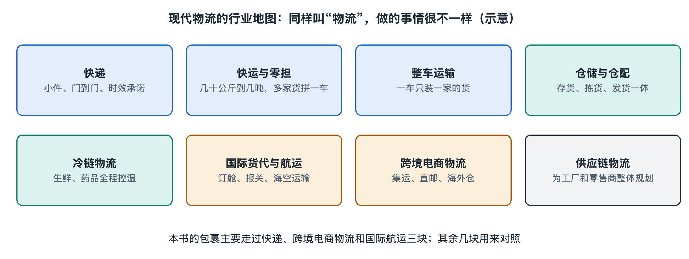

# 1.3 行业地图：快递、快运、零担、整车、仓储、冷链、跨境与供应链物流

在小区门口，你可能同时看到快递员送来一只鞋盒、搬运工卸下一台冰箱，以及货车给便利店送来成箱饮料。它们都属于物流，却不一定由同一种企业、用同一套网络完成。如果只把物流理解成“送快递”，就很难看懂仓库、货车、港口和跨境包裹各自在做什么。

画行业地图时，先问三个问题：运的是什么货？每次运多少？需要哪些特别服务？“快递、快运、零担、整车”主要帮助我们理解运输组织；“仓储、冷链、跨境、供应链物流”则从作业功能、货物要求或服务范围补充地图。这些名称不是互不相交的格子，一票货可以同时落在几个格子里。

## 1.3.1 从鞋盒到家具：快递、快运与零担

**快递**是以单件包裹为主要处理对象，经过揽收、分拣、中转和派送，把货送到收件人的服务。鞋盒、书本和日用品适合进入这类网络：每一件都有标识，分拨中心按目的地将大量小件重新组合，再交给末端网点派送。快递网络擅长处理“收件人很多、每票货较小”的需求。

一张餐桌或几箱瓷砖也要跨省运输，但它们可能太大、太重，难以按普通小包裹作业。市场上常用**快运**称呼以较大、较重货物为对象，强调网络覆盖、中转与派送服务的运输业务。不过，“快运”并没有一条全国统一的重量分界线；不同企业的产品范围和收费方式可能不同，不能只凭货物重量判断它一定属于快递还是快运。

理解快运，还要认识**零担运输**：同一托运人的货物不足以单独装满一辆车，承运方把不同货主、去往相近方向的货拼在一起运输。比如三家店分别发出数箱货，先送到集货场，再按目的地装车。这样能提高车辆利用率，但通常需要集货、分拨和交接。零担描述的是一种装车与运输方式；快运描述的常是一类面向客户的服务，两者有交集，却不是同义词。

## 1.3.2 一车货与一座仓：整车、仓储怎样接上运输

如果一家工厂要把足够多的货送到同一处收货地点，可能使用**整车运输**：为一票货安排一辆车，通常不与其他货主的货在途中拼装。它减少了为拼货而进行的中转，适合货量较大、装卸地点比较集中的任务。但整车不等于“车厢必须装得满满的”，实际选择还取决于车型、货物性质、时效和费用。零担与整车，回答的是“多位货主共用一辆车，还是为一票货安排一辆车”。

货物也不是始终在路上。**仓储**是对货物进行接收、保管、库存记录和出入库作业的服务。仓库里的货可能等待销售订单，也可能等待转运班次；工作人员要知道货放在哪、还有多少、哪一批应先发出。运输解决空间上的移动，仓储解决货物在某处停留时如何被保存和管理。两者接起来，商品才能按需求出库，而不是一生产出来就必须立即送到消费者手中。

## 1.3.3 需要控温或过境：冷链与跨境是另一种分法

看见冷藏车，不妨问：它与普通货车的差别只是车厢更冷吗？**冷链物流**是针对需要温度控制的货物，在储存、运输和交接等环节按要求维持温度条件的物流活动。生鲜食品、部分药品等货物对温度有不同要求，不能一概而论。冷链的关键是让相应环节的温度管理衔接起来：冷库保管得当，运输或卸货时温度失控，仍可能影响货物品质。因此冷链可以包含仓储、整车、零担或末端配送，不是与它们平行的一条单独道路。

**跨境物流**则以货物跨越国家或地区的边界为特征。它除了运输、仓储，还涉及出口与进口两侧的单证、申报、查验及交付安排。这里先记住地图位置：跨境不是“海运”的别名，也可以使用空运或陆运；海运也不必然跨境。

回到本书的包裹：消费者在中国网购，几件商品到达**集运仓**后合包，再经海运送往马来西亚。合包后的货仍可能在不同区段接入不同网络：在中国境内以包裹形式流转，海上与其他货物共同利用运输能力，到达马来西亚后再进入当地派送环节。它既是跨境物流的一票货，也用到了仓储、运输和配送。至于消费者看到的“免运费”，是购物页面上的收费呈现，不表示这些作业没有成本。

## 1.3.4 从送一票货到安排全程：供应链物流

如果客户只问“这箱货怎样送到”，讨论重点多半是一次运输。如果客户还要决定货放在哪座仓、备多少库存、订单来后从哪里发，以及怎样处理退货，问题就扩大了。**供应链物流**关注货物从采购、生产到销售等环节之间的衔接，综合安排库存、仓储、运输和配送，使货物在需要的时间到达需要的地点。它不是某一种车型或某一种仓库，而是一种跨环节组织物流的视角与服务范围。

一家公司可以提供多种服务，一票货也会依次使用多种服务。遇到行业名称，别急着给企业贴单一标签；先辨认它解决的是“小件还是大件”“拼车还是整车”“要不要储存和控温”“是否跨境”“是否统筹多个环节”。带着这些问题再看包裹轨迹或路边的货车，物流行业就不再是一串陌生名词，而是一张能找到位置的地图。
