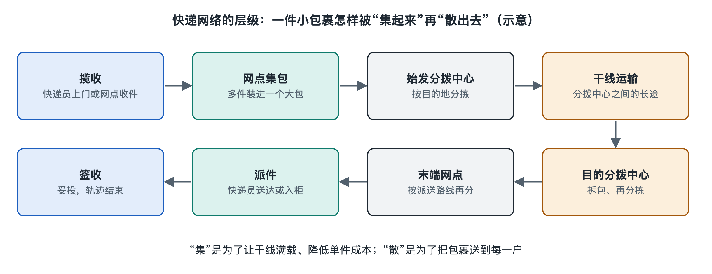

# 2.2 快递网络的层级：揽收、集包、中转、干线、分拨与派件

你在手机上看到“已揽收”“运输中”“派送中”，可能觉得包裹是在一站一站地前进。可如果把这些轨迹放到地图上，问题就来了：为什么明明是寄往邻市，包裹却先去了更远的省会？为什么同一天寄出的两件货，会在不同的分拨中心出现？要回答这些问题，得先把目光从单个包裹移开，看看快递企业怎样组织成千上万件货。

## 2.2.1 从上门取件到集包：先把小件聚起来

**揽收**，是快递网络接收寄件人交付的货物，并将其纳入运输流程。快递员上门取件、商家把货交到网点，都可能是揽收的形式。“已揽收”通常说明承运方已记录这件货，但不等于它已经离开寄件地；具体状态要结合该企业的轨迹定义判断。

取回的包裹先到网点或揽收场地。工作人员核对标签、称重或测量，按去向初步分类。寄往同一处理中心的许多小件，往往会被装入袋、笼车等容器，这类把零散包裹集中成便于交接和运输的作业叫**集包**。集包的价值很直观：车辆和处理中心不必逐件接收散落的小包，作业人员也更容易核对数量、查找异常件。

集包不是把地址相近的包裹永久绑在一起。一个包裹可能先随“去某中心”的一袋货出发，到中心后又被拆出，按更细的目的地重新归类。它在不同层级不断加入、离开不同的货物组合，这正是快递网络能够同时处理大量目的地的基础。

## 2.2.2 中转与干线：用大流量连接远处

货到处理中心后，会经历扫描、卸载、分类和重新装载。**中转**指货物在运输途中经过处理节点，换装、换车或重新确定下一段去向。它不一定意味着绕路，也不一定每次都要开包分拣；关键是货物在这里完成了下一段运输的交接。

连接两个较大处理节点、承担较长距离和较大货量运输的线路，通常称为**干线**。公路车辆是常见运力，具体线路也可能使用铁路、航空等方式。相对于干线，网点到中心、中心到派送网点之间还有较短距离的接驳线路。把许多分散的小流量汇到较大的节点，再集中发往远处，能提高车辆装载率；代价是包裹可能增加一次中转。因此，地图上的直线距离最短，不代表实际运输方案一定最快或最省。

例如，两座相邻城市之间若没有足够稳定的直达货量，快递企业可能让包裹先进入区域处理中心，再由那里发出。判断一条轨迹是否异常，不能只看“有没有绕路”，还要看它是否长期停滞、是否反复返回同一节点，以及承诺的时效是否受到影响。

## 2.2.3 分拨与派件：从“大方向”细化到门牌号

包裹接近目的地后，仍需要按更小的区域分类。**分拨**就是依据目的地信息，将货物分配到不同下游线路、网点或派送区域的作业；承担这种作业的场所称为分拨中心或处理中心。分拨并非只发生在最后一站：寄件地可能按省份分，目的地中心可能按城区和网点分，网点还可能按快递员负责的片区分。每往下一层，去向就更具体。

包裹到达末端网点，交给快递员或其他末端服务网络后，进入**派件**环节，即把包裹从末端节点送往约定收件地点。派件可以是送上门，也可能依照服务约定和当地规则，送到驿站、柜机等地点。“派送中”并不保证下一分钟就能收到：快递员还要按路线、地址和收件情况逐票完成交付。只有交付符合约定并形成相应记录，才可称为**妥投**；放在某处但收件人尚未按约定取得货物，不能一概视为妥投。

| 层级 | 主要解决的问题 | 常见轨迹表述 |
|---|---|---|
| 揽收、集包 | 把零散包裹纳入网络并集中 | 已揽收、已发往处理中心 |
| 中转、干线 | 组织节点间的大批量运输 | 到达转运中心、运输中 |
| 分拨、派件 | 将货物细分到末端并完成交付 | 到达网点、派送中、已签收 |

轨迹文字是系统对作业事件的记录，不是包裹位置的实时直播。扫描可能发生在装车前、卸车后或交接时；两次扫描之间没有新消息，也不等于货物一直静止。不同企业对状态的命名和展示范围也不完全相同。

## 2.2.4 把层级套回跨境包裹

本书贯穿的那件包裹，先在中国境内完成商家发货与国内运输，再进入集运仓，与读者购买的其他商品合包。这里的“合包”是把同一收件人的多件商品合成一个出境包裹；它与快递网点为运输方便而进行的集包，目的和作业对象并不一样。合包后，货物还要接入出口运输、海运及马来西亚境内的末端网络。不同服务商之间如何交接，决定了读者在一条轨迹里能看到多少节点。

快递网络的层级可以归结为一句话：先把分散的小件聚成适合运输的大流量，再逐层拆分，直到送达具体收件人。下次查看轨迹，不妨试着标出每条记录属于“聚起来”“运过去”还是“分下去”。这样，即使包裹暂时没有更新，你也能更准确地判断它可能处于哪一种作业阶段。
