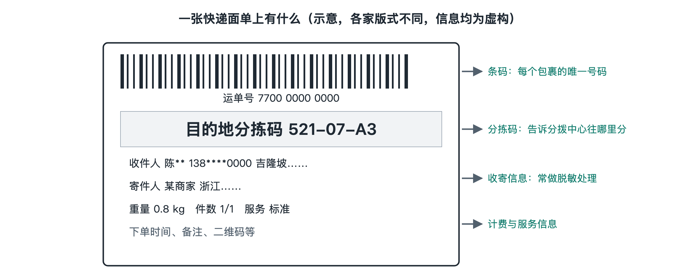

# 3.1 面单与运单：一张标签上的全部信息

收到快递时，你多半先找剪刀，却很少细看纸箱上的标签。标签上有收件地址、条码，有时还印着“转运”“集运”等字样。对人来说，它告诉快递员往哪里送；对机器来说，条码把眼前这个包裹与系统里的记录连接起来。不过，标签上印出的并不是包裹的“全部信息”。要看懂它，得先分清贴在箱上的纸、系统中的记录，以及两者怎样配合。

## 3.1.1 面单贴在包裹上，运单记录在系统里

**面单**是贴在包裹外侧、供各环节识别的标签，通常包含地址、联系人、编号和条码。**运单**则是记录一次运输服务所需信息的业务单据；今天它往往以电子记录为主，纸质面单只是其中一部分信息的呈现。行业里，人们有时也把贴出来的标签叫“运单”，具体含义要结合场合判断。

面单上最重要的不是商品名称，而是**运单号**：运输服务商用来查询和管理这票货物的编号。**条码**则把编号变成扫描设备容易读取的图形。工作人员在网点收件、分拨中心分拣、派送站交接时扫描条码，系统便能找到对应记录，并按作业结果更新状态。条码本身通常不会告诉机器“这件货已到港”；它提供的是识别入口，到港信息还需要相关环节完成交接和数据上传。

因此，面单不是一张静止的“路线图”，更像包裹随身携带的索引卡。它让不同岗位认出同一个处理对象，也让系统中的记录有机会跟着实物向前走。

## 3.1.2 一张标签要回答哪些问题

拿起一个普通快递包裹，你通常能从面单上找到四类信息。不同企业和业务的版式不一样，字段也不一定全部公开印出，但各类信息承担的任务相近。

| 信息类别 | 常见内容 | 作业中的用途 |
| --- | --- | --- |
| 收寄信息 | 寄件地、收件地、姓名、电话、地址 | 确认从哪里接收、向哪里交付 |
| 识别信息 | 运单号、条码或二维码 | 扫描、查询、交接和对账 |
| 分拣信息 | 目的地区域、网点代码或分拣标识 | 帮助人员和设备选择下一处理方向 |
| 服务提示 | 件数、特殊操作提示等 | 提醒现场按相应要求处理 |

其中，地址给人看，编码也方便机器读，两者缺一不可。地址可能写错、不完整，机器也未必能准确理解自由填写的文字；分拣代码便于按网络规则处理，却不能代替派送员核对具体门牌。电话号码有助于联系收件人，但并不需要让每一位经手者看到完整号码。中国快递业务中可见隐去部分号码或通过虚拟号码联系的做法；隐私面单展示哪些字段，仍取决于企业系统和业务场景。

标签还可能带有仓库内部编号、客户订单号或平台订单号。它们不必与运单号相同：一个购物订单可能拆成几个包裹，几个订单的商品也可能在符合业务规则的情况下合成一个包裹。看见两个不同号码，先问“它们各自识别什么”，不要急着认定其中一个印错了。

## 3.1.3 换一段运输，为什么可能换一张面单

以从中国网购、送入集运仓合包后海运到马来西亚的包裹为例：几件商品先分别由中国境内快递送到集运仓。此时，每个原包裹可以各有一个国内运单号。仓库收到它们后，按收件人或业务订单核对、合包，再为新的外包装建立后续运输所需的识别信息。到了马来西亚，如果由当地配送服务商承担送达，还可能出现供当地网络使用的编号或标签。

这不是“同一个包裹莫名其妙改了名字”，而是运输对象和服务边界发生了变化：原先要识别的是几件分别入仓的货物，合包后要识别的是一个新的外包装；不同运输服务商也可能各用自己的系统。**关联号**就是把这些不同阶段的编号对应起来的信息，供平台、集运仓或服务商查询交接关系。各企业的编号规则并不统一，读者不必期待用一个号码查遍所有网站。

面单也不能代替报关资料。跨境运输需要的商品描述、数量、价值及相关申报信息，按实际业务和进出口要求提交；外箱标签只展示现场作业需要的一部分。仅凭“国际包裹”字样或一个境外地址，无法判断货物是否已完成中国出口或马来西亚进口的相应手续。清关进度要看负责申报和运输的服务方提供的可靠记录，不能从标签外观推断。

## 3.1.4 扫描记录说明了什么，没有说明什么

你在手机上看到“已揽收”“到达分拨中心”等轨迹，通常是某个作业节点扫描或录入后生成的状态。面单上的条码让扫描员能迅速选中正确记录，但“扫描成功”不等于下一段运输已经开始。例如，包裹在仓库完成出库扫描后，还可能等待装车；装车后，也可能等待班次发运。

反过来，暂时没有新轨迹，也不能直接断定包裹停在原地。实物移动、交接作业和信息上传并不总是同时发生；跨企业、跨国境衔接时，系统显示还可能有延迟。看轨迹时，最可靠的办法是分开问：最后一条记录由谁产生？记录的是扫描、交接、发运，还是签收？它能证明什么，不能证明什么？

一张面单把货物、人员和信息系统接在一起，却不能单独证明整个运输过程。下次收到包裹，不妨先遮住个人信息，再辨认运单号、地址和分拣标识：你看到的不只是几行字，而是物流网络让一件实物被识别、被交接、被送往下一站的起点。
