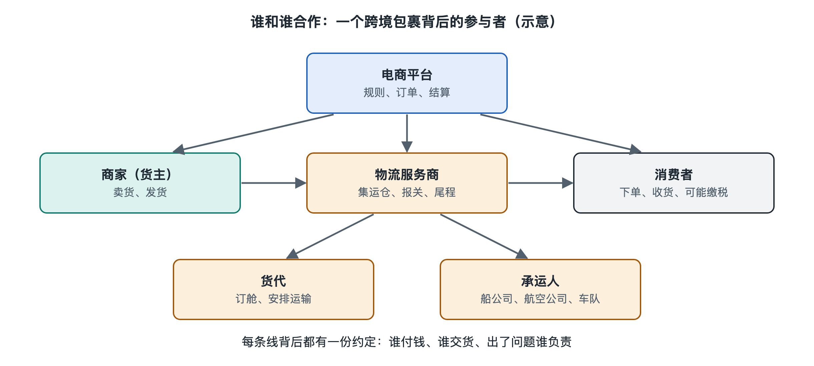

# 4.1 平台、商家与物流服务商：分工、结算与责任

你在购物页面看到“免运费”，付款后又看到“商家已发货”，最后收到一条快递公司的派送短信。三个界面背后，可能是三个不同的主体在工作：“免运费”说明你在下单时没有另付一笔运费，却不说明运输没有成本；“商家已发货”通常是一条订单状态，也不一定表示包裹已被承运方实际接收。要看懂物流行业，先要把页面上的动作和实际承担动作的人分开。

## 4.1.1 谁承诺销售，谁组织运输

**平台**是连接买卖双方、提供交易页面和规则的系统及其经营者。有的平台主要提供交易场所，有的还向商家提供仓储、运力采购或售后工具；是否亲自承担某项物流服务，要看具体服务安排。**商家**负责销售商品、备货，并按订单要求交付货物。**物流服务商**则接受委托，完成揽收、仓储、运输、分拣或派送等工作。一家企业可以兼任多种角色，但这些角色不能因为名称相近就混为一谈。

以从中国网购、经集运仓合包后海运到马来西亚的包裹为例：商家把商品交给国内承运方，包裹到达集运仓后，与同一收件人的其他商品合成一个出境包裹，随后再由不同服务商接力运送。页面上显示的可能始终是同一个订单入口，现场作业却已经换过几批人。**集运仓**是接收多件货物、暂存并按规则合并或转运的作业节点；它不是“平台”“商家”或“快递公司”的同义词。

## 4.1.2 一笔运费怎样在几方之间结算

消费者付款、商家向物流服务商付款、平台向合作方结算，是不同的资金关系。**物流结算**指按照约定的计费方式、服务范围和账期，核对并支付物流服务费用。例如，商家可能按票向国内快递企业付费；集运服务的委托方可能按包裹、重量或体积与服务商结算。具体由谁付款，取决于合同，而不能只凭购物页面判断。

| 消费者看见的内容 | 不能直接推出的结论 |
|---|---|
| 页面写着“免运费” | 运输免费、无人承担费用 |
| 一个订单号可查全程 | 全程由同一家企业运输 |
| 平台显示物流轨迹 | 每条轨迹都由平台现场扫描 |

所谓“免运费”，通常只是消费者在该笔交易中无需单独支付所标示的运费。物流成本仍可能计入商品价格，由商家承担，或由平台、商家按当时的活动安排分担。公开页面若没有披露结算条款，就不能据此推算某个包裹的补贴额。促销规则、适用地区与服务范围也会变化，判断具体订单应以其下单时展示的条款为准。

## 4.1.3 出了问题，先辨认是哪一种责任

假设包裹到手时少了一件商品。先别急着认定“快递丢了”：可能是商家漏发，可能是集运仓合包时未装入，也可能是运输中外包装破损、内件遗失。**交接记录**是货物在不同主体之间转移时留下的扫描、签收、称重或异常记录，作用是帮助确认“在哪一段出现了差异”。照片、面单和订单明细，也能与这些记录相互核对。

对消费者而言，售后入口通常在购买商品的平台或商家处；商家、平台和物流服务商之间如何追偿，则要依据适用法律、平台规则及各自合同处理。不能把“向谁申请售后”等同于“最终由谁赔付”。在跨境订单中，中国境内段、国际运输段和马来西亚境内派送段还可能由不同主体承担作业，服务承诺和责任边界尤其需要逐段确认。

遇到异常时，一个实用的顺序是：先保存订单、商品清单、外包装和面单照片；再核对物流轨迹中最后一次可确认的交接；最后通过订单售后入口说明问题，并按要求提供证据。这样做不是让消费者替企业查案，而是让每一方都能围绕同一个包裹、同一段时间和同一处差异沟通。

## 4.1.4 用“三张图”看懂合作关系

读一笔订单，可以在心里画三张图：第一张是**货物流**，标出商品实际经过哪些节点；第二张是**信息流**，标出谁生成订单、谁上传扫描和派送状态；第三张是**资金流**，标出消费者付款给谁、谁向物流服务商结算。三张图不一定重合：负责展示轨迹的平台，未必亲自运输；接收消费者投诉的商家，也未必是发生破损的作业方。

这就是本章讨论合作关系的起点：先辨认主体，再看委托、交接与结算，最后依据证据讨论责任。下次看到“商家已发货”或“运输中”，不妨追问一句：这条状态由谁产生，此刻货物实际由谁保管？
