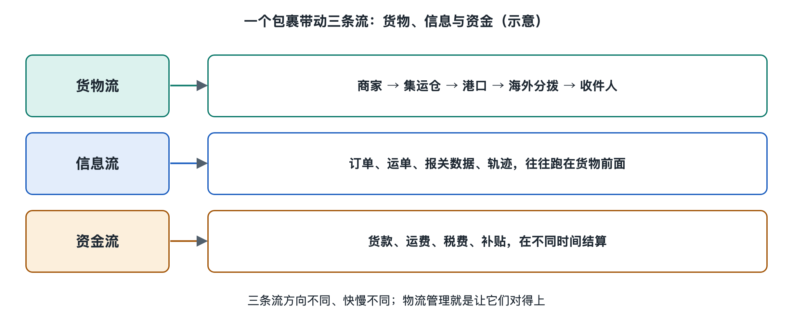

# 5.1 货物流：时效、中转次数与在途时间

打开手机，包裹轨迹停在“已离开转运中心”。过了两天，下一条才显示“已到达目的地处理中心”。包裹是在路上走了两天，还是在某个仓库等了两天？只看这两行字，无法判断。本章要跟着包裹的实际移动，分清运输、等待和交接：物流的快慢，不只取决于车、船或飞机开得多快。

## 5.1.1 从下单到收到，究竟在计哪段时间

**时效**是完成某段物流服务所用的时间。说“几天到”，首先要问起点和终点是什么：从下单到签收、从商家交给物流企业到签收，还是从船舶开航到抵港？起止点不同，同一个包裹就会有不同的时效数字。

以中国网购、经集运仓合包后海运到马来西亚的包裹为例，读者感受到的总等待时间，可能包括商家备货、国内快递、集运仓收货与合包、出口环节、海上运输、马来西亚进口环节，以及当地派送。其中，**集运仓**是汇集多个订单或包裹、再统一安排后续运输的仓库；**合包**是按服务规则把同一收件人的多个包裹集中处理后发出。它们能减少分散发运的次数，却也需要等货、核对和打包。

**在途时间**通常指货物从一个起点运往终点期间经历的时间，但实际使用时，必须看清统计口径。有的统计从物流企业收件算起，有的从某一仓库发出算起。包裹暂存在分拨中心、等待下一班车或船时，虽然没有移动，仍可能处于这段在途过程之中。因此，不能把在途时间简单理解为“车轮转动加船舶航行的时间”。

观察时效，可以先把总过程拆为三类：货物正在移动，货物在节点等待，货物正在接受处理。卸车、分拣、装箱、交接都属于处理；等货凑齐、等班次、等放行则属于等待。对收件人来说，这些时间都会累加到“还没收到”的日子里。

## 5.1.2 多一次中转，包裹经历了什么

**中转**是货物在途经节点卸下、分类，再装上下一段运输工具的过程；**中转次数**记录这样的转换发生了多少次。例如，商家的包裹先进入国内分拨中心，再到集运仓，随后进入港口作业体系，到马来西亚后再进入当地分拨网络。哪些节点算一次中转，要看统计者的定义，不能只凭轨迹上出现了几个地名来数。

中转的价值，是让不同来源、不同去向的小批量包裹汇成较大的运输批量。一辆车不必为每个收件地址单独跑长途，一条海运线路也不必只服务一个包裹。货物在节点被重新组合，干线运输才更容易装载充分。这里的**干线**，指连接主要枢纽或地区、承担较长距离运输的线路。

但每次中转也要付出时间：进站登记、卸货、扫描、分拣、暂存、装车和出站，都需要作业。交接环节增多，还意味着包裹要接受更多次搬运和核对。所以，“少中转”常有利于缩短时间、减少交接，却不等于“零中转一定最好”。如果为了绕开一个枢纽，改用装载不足的直达车辆，运输成本可能明显增加；如果直达班次很少，等候时间甚至可能更长。

判断一条路线，不能只数中转次数，还要看每次中转是否顺路、衔接是否及时。一个高频运作的枢纽，可能比一条班次稀少的“直达”线路更快。

## 5.1.3 海运包裹的时间，常花在衔接处

跨境链条把这种差别放大了。**头程**指货物从始发地出发的前段运输，各服务商用法不完全相同：在本书这样的集运模式中，多指从商家到集运仓或出运节点的一段；在海外仓模式中，常把国际干线也算在内；**国际干线**是跨越国境、连接两国主要节点的运输段；**尾程**是货物进入目的国后，通向收件人的后续运输与派送。不同服务商对这些词的起止点可能划分得略有不同，比较报价或时效时应先确认口径。

这个海运包裹在中国集运仓完成合包后，未必立刻上船。它可能要等同批货物集齐、完成装载安排，再进入港口。船抵达马来西亚，也不代表当天就能交给快递员：货物还要经过卸船、提取、进口**清关**——向目的国海关提交所需资料，按规定接受审核、查验及税费处理，并取得放行——然后才能接入当地配送网络。具体手续随货物、申报方式和当地规定而异。

可以把一段运输想成赶车：走到车站花半小时，车程两小时，但错过班次就要多等一天。包裹也是如此。船舶航行速度固然影响时间，集运仓的发运安排、港口与运输班次的衔接、清关所需时间，同样可能决定收件日期。由此也能理解，货物轨迹几天没有更新，不能直接推断它在海上、在仓库，或出现了异常；轨迹只标出了部分作业节点，不是对货物状态的连续直播。

## 5.1.4 用一张时间线辨认真正的慢点

读自己的物流记录时，可以把每条可见节点按时间抄下，并在旁边标注“移动、处理、等待或无法判断”。先核对时间标注是否采用同一时区：跨境轨迹可能汇集中国与马来西亚两地的记录，界面显示方式也未必相同。再看相邻节点之间发生了什么，而不是只盯着最长的一段空白。

例如，“集运仓已收货”到“集运仓已发出”之间，可能包含等待其他包裹、合包与出库；“船舶抵港”到“当地快递揽收”之间，可能包含港口作业和进口手续。只凭两端扫描时间，能算出经过了多久，却不能精确分配每项作业各用了多久。遇到这种情况，诚实的判断是“这段衔接耗时较长，原因尚不能确定”，而不是替物流企业编一个解释。

最后还要区分“到达”与“收到”。包裹到达目的地城市后，仍可能需要分拨、安排派送；直到按约定交付并形成**妥投**记录，才算完成派送。货物流因此是一条由移动、停留和交接组成的时间线。看懂时效，要看清起止点；看懂中转，要看它换来了怎样的线路和班次；看懂在途时间，则要把“正在路上”与“正在等待下一步”都纳入视野。下一节再看：这些货物动作，是怎样变成手机上的一条条物流信息的。
