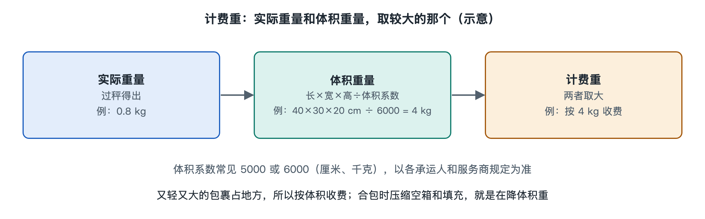

# 6.1 计费规则：首重续重、体积重与计费重

拿起一个快递盒，放上秤是两千克；再看它的外形，却像能装下好几个同样重的小盒子。承运人该按秤上的数字收费，还是按它占据的空间收费？这就是物流计费首先要回答的问题。网购页面上的“免运费”只是收件人的支付方式，并不意味着包裹不产生运输费用。要看懂费用如何形成，得先分清重量、体积和具体规则。

## 6.1.1 从首重续重读懂阶梯报价

在快递报价中，**首重**是起步价格覆盖的重量，**续重**是超过首重后继续计价的重量。假设一份示例报价规定：首重一千克八元，此后每增加不足或等于零点五千克，续重三元。一个重一点二千克的包裹，超出首重零点二千克，按这一规则需付八元加三元，共十一元。

这只是解释算法的假设，不是任何企业的现行价格。实际报价必须核对三个问题：首重是多少、续重以多大重量为一档、不足一档怎样取整。有的服务按每票设最低收费，有的按单件分别计算；同样是一点二千克，换一种分档办法，结果就可能不同。比较运费时只看“每千克多少钱”，往往会漏掉起步价和进位规则。

这里还要区分**实重**，即称重设备测得的包裹重量，通常连同外包装一起计入。商品详情页写的商品净重，不等于封箱、贴标后的实重。仓库重新装箱或加缓冲材料后，实重也可能变化。

## 6.1.2 为什么轻而大的盒子也可能贵

快递车和飞机都有载重限制，也有装载空间限制。一箱轻薄的泡沫制品，也许没有用完车辆允许承载的重量，却先占满了货厢。为了把这种空间占用转换成可比较的数字，报价会使用**体积重**：根据包裹外部尺寸折算出的计价重量。

常见的表达方式是“长×宽×高÷体积折算系数”。例如，某份示例报价以厘米量尺寸，并规定除以六千：外箱长五十厘米、宽四十厘米、高三十厘米，体积重就是十千克。如果这箱货实重只有二点四千克，按该报价的规则，它虽然轻，却占用了相当于十千克计费量的空间。

“六千”不能当作行业统一标准。不同承运人、产品、运输方式和合同，可能采用不同系数，也可能对尺寸进位、异形包装另作规定。量尺寸时通常看封好后的外包装，而不是商品本体；鼓起的箱盖、突出部分，都可能影响测量结果。寄件前把过大的箱子换成合适包装，可能比减去一点填充物更能改变报价，但不能为省钱牺牲必要的防护。

## 6.1.3 计费重怎样进入账单

**计费重**是报价规则最终用于计算基础运费的重量。许多快递产品会比较实重和体积重，取较大者，再按合同规定进位。上面的纸箱若适用这一规则，基础运费按体积重十千克而非实重二点四千克计算。注意，是“取较大者”，不是把两种重量相加。

| 看到的数字 | 它回答的问题 | 取得方式 |
| --- | --- | --- |
| 实重 | 包裹实际上有多重？ | 封装后称重 |
| 体积重 | 包裹占用多少运输空间？ | 量外部尺寸并按约定系数折算 |
| 计费重 | 基础运费按多少重量算？ | 按该产品规则比较、进位 |

计费重也不一定等于账单总额。运费还可能涉及保价、偏远地区配送、特殊操作等费用，是否收取及如何收取，都应以所选服务的公开说明或合同为准。遇到重量争议，保存封箱后的称重照片、三边尺寸和运单号，比只凭商品页面上的净重更容易核对。

## 6.1.4 一只跨境合包，可能面对不止一套规则

想想从中国网购、送到集运仓后合包，再经海运到马来西亚的包裹。国内商家发往集运仓时，可能先按国内快递规则形成一笔费用；集运仓将几件货合为一箱后，外箱尺寸和总实重都变了；跨境运输及马来西亚境内派送，又可能分别适用各自的报价办法。这些环节不应拿同一个“每千克单价”直接套算。

读者在平台上看到的“免运费”，也不能反推出每一段运输都免费，或判断平台、商家、物流服务商各自承担了多少。具体由谁付款，取决于订单条款和服务协议；平台活动规则可能变化，应以订单生成时适用的说明为准。

因此，看一张运费账单可以按顺序追问：**量的是哪只箱子、实重和体积重各是多少、用哪份规则得到计费重、基础运费之外还有什么项目？**掌握这四步，就能从“为什么这么贵”的直觉，走向可核对的计算。下一节谈海运拼箱与整箱时，我们会看到：当计价对象从小包裹变成一批货，空间的作用还会更加明显。
