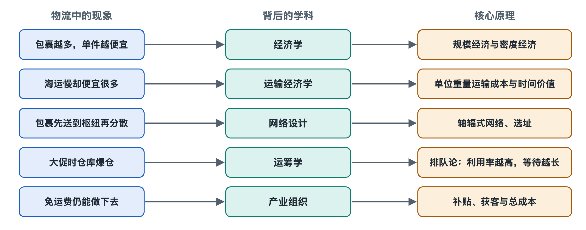

# 8.1 规模经济与密度经济：单位成本为什么会下降

## 8.1.1 一车多装几件，省下的是什么

傍晚，一辆快递车从分拨中心驶向派送网点。车上装了半车包裹，司机、车辆和这一趟行驶都已安排好。如果再装进一些同方向的包裹，只要不超出车辆载重、空间和作业时间，这趟车的总支出未必增加多少，但分摊到每件包裹上的费用会下降。这是物流行业谈“量”时首先关心的问题：不是包裹越多就一定越赚钱，而是现有资源有没有得到更充分的利用。

**单位成本**，是把一定范围内的总成本除以完成的业务量，例如一趟车的运输成本除以运送件数。使用这个数字必须先说明“单位”是什么：一件包裹、一吨货，还是一吨货运输一公里？口径不同，数字不能直接比较。物流公司还要区分**固定成本**与**变动成本**：前者在一定业务量范围内不随件数直接变化，如已经租下的仓库和已安排的班车；后者随作业量增加，如包装材料和部分按件支付的费用。这个区分不是绝对的：业务量大到必须再租仓、加开一辆车时，成本会跳上一个台阶。

## 8.1.2 规模经济：让设施和班次被更多货物使用

**规模经济**（economies of scale），指业务规模扩大时，在一定条件下，平均每单位成本下降。假设一趟已安排的班车总费用为600元，运输300件包裹，简单分摊为每件2元；若在车辆许可范围内运送400件，且总费用仍为600元，则变成每件1.5元。这只是说明分摊原理的假设，不是任何企业的真实运价；装卸、分拣等费用也可能随件数增加。

仓库同样如此。场地、货架、信息系统和管理人员服务于更多订单时，部分投入可由更多件货物共同承担。集装箱、船舶等运载工具也需要尽量利用空间和载重。读者的跨境包裹在集运仓与其他订单合包，再进入海运链条，正体现了“让小批量货物共享较大运载单元”的思路。但合包本身要花费收货、核对和打包的人力，并非只要合在一起就一定省钱。

规模经济还取决于业务是否稳定。每天都有足够货量，企业才容易安排固定班次和人员；如果只有促销当天突然涌入大量包裹，临时加班、租车和处理积压的费用可能上升。衡量规模的好处，不能只看一天的件量，还要看设施、车辆在一段时间内的使用情况。

## 8.1.3 密度经济：货物是否聚在同一条路上

同样是每天送1000件，均匀散落在广阔地区，与集中在几片相邻街区，成本很可能不同。**密度经济**（economies of density），指在既定区域或线路上，货量更集中，使线路、站点和人员的利用率提高，单位服务成本下降。它关注的不是公司总共做了多少件，而是“这些件在哪里、什么时候出现”。

派件员沿一条街送十件，通常比为十件分别驶往相距很远的地点更容易节省行驶时间。固定线路的班车，如果每天都有足够货物，往返空驶和舱位闲置也更容易减少。可以把两种经济性并排记住：

| 观察角度 | 规模经济 | 密度经济 |
| --- | --- | --- |
| 主要问题 | 总业务量能否分摊设施、设备等投入 | 同一区域、线路或时段是否有足够货量 |
| 典型场景 | 仓库处理更多订单、车辆提高装载量 | 同一街区连续派件、同一通道稳定发车 |
| 常见限制 | 扩容可能带来新的固定投入 | 货物分散或到达时间错开，难以合并作业 |

一家企业即使全国件量很大，在某条偏远线路上仍可能货少、每件成本高；一家企业总体规模不大，却可能因专注某片区域而形成较高的派送密度。两者有关，但不能混为一谈。

## 8.1.4 省下单位成本，不等于没有代价

要把不同商家的货集中到同一辆车、同一只集装箱，往往需要等待、转运和分拣。货量集中提高装载率，也可能增加包裹的在途时间。因此，物流企业并不单纯追求“装得最满”，还要满足约定的时效，控制破损、错分和延误。车装得超过核定限值，更不是节约成本的办法。

成本下降也不是无限的。分拨中心货量接近处理能力上限时，排队和加班可能增加；仓库过满会使找货、搬运变慢；派件范围过大，则可能抵消同一趟多送几件的好处。判断是否真的出现规模或密度经济，要同时看业务量、总成本和服务结果，而不能只看其中一个指标。

这也解释了“免运费”为什么不等于运输没有成本。读者下单时不单独支付运费，不改变揽收、仓储、运输和派送都需要资源的事实。较大的货量与较高的线路密度可能降低每件成本，但具体费用由谁承担、怎样结算，还取决于交易安排。理解物流成本，先问两件事：哪些投入能被更多货物共同使用？这些货物能否在合适的地点和时间聚到一起？这两个问题，是看懂行业报价与运营选择的起点。
