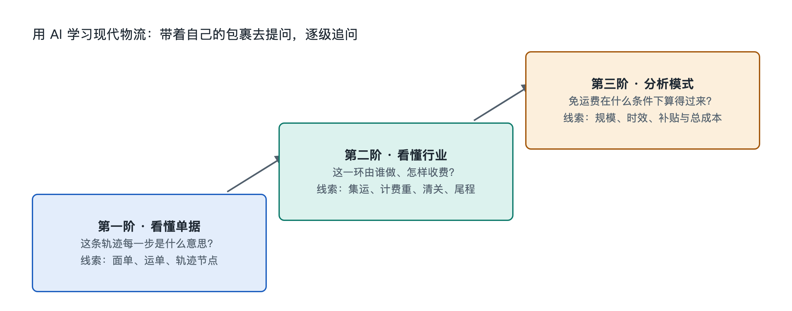

# 9.3 三阶提问阶梯：从查物流到分析行业

手机上的物流轨迹停在“已到达目的地港口”，两天没有更新。你可能只想问：“我的包裹什么时候到？”AI可以帮忙理解这行字，却看不到尚未公开的作业记录，也不能替承运人承诺送达时间。更有效的办法，是把问题分成三阶：先辨认眼前的信息，再还原包裹所处的环节，最后分析整个行业为什么这样安排。同一张轨迹截图，问法不同，能得到的知识也不同。

## 9.3.1 第一阶：查清“这条记录说了什么”

第一阶处理的是可见事实。打开购物平台或承运人的查询页面，先记下记录原文、显示时间和查询来源，再让AI解释陌生词。例如：“轨迹显示‘已交国际运输’，请用普通话解释这句话通常表示什么；哪些事情尚不能由它证明？”这比直接问“是不是已经上船”更严谨。

**物流轨迹**是物流系统向用户展示的一组状态记录，通常包含状态名称和时间，有时还包含地点。它不是连续播放的包裹位置录像。一个状态可能来自工作人员扫描、设备读取，也可能来自系统接收的交接信息；不同企业使用的状态名称也不完全相同。因此，“已交国际运输”通常能说明某个交接或数据处理环节已有记录，却不足以单独证明货物正处于海上某个位置。

读AI的回答时，给每句话贴上三种标签：**原文事实**、**常见解释**、**仍待核实**。例如，截图确实写着“已到达目的地港口”，这是原文事实；“后面通常还有进口手续与本地配送”，是对流程的解释；“明天下午送到”，若没有承运人承诺或后续记录，就是无法据此确认的预测。遇到具体包裹的异常、税费或派送安排，应回到承运人、平台或当地主管机构的正式信息核对。

把截图交给AI前，还要遮住姓名、电话、详细地址、完整运单号，以及清关通知中的证件信息。若只是询问术语，抄录必要的状态文字即可，不必上传整张面单。

## 9.3.2 第二阶：沿着交接点问“它处在哪一段”

理解一条记录后，再把相邻记录连起来。贯穿本书的例子是：中国网购的多个商品先到**集运仓**——集中接收不同包裹，并按订单或收件人要求处理的仓库；合包后海运至马来西亚，完成进口环节，再由当地网络派送。这里的**合包**，是把符合要求的多个包裹重新组合为一个发运单元；它改变的是后续处理方式，不会抹去原有商品和订单需要核对的信息。

你可以按顺序向AI提供已核实的几条记录，并问：“请把它们分别归入中国境内运输、集运处理、出口、国际运输、马来西亚进口和本地派送；不能确定的记录请标‘待核实’，不要补出缺失节点。”这一步的重点不是让AI猜中包裹的位置，而是看清各段之间的**交接**：货物由谁接收，信息由谁记录，下一方凭什么继续处理。

对照下面三个问题，能避免把不同性质的等待混为一谈：

| 看到的现象 | 先问什么 | 还需核实什么 |
|---|---|---|
| 到达集运仓后暂未更新 | 是否正在等待入库核对或合包？ | 平台或仓库是否有后续处理记录 |
| 显示国际运输中 | 这是交承运人、已装船，还是另一种状态名称？ | 该承运人对状态的官方解释 |
| 到达马来西亚后未派送 | 是否仍在进口处理或等待本地交接？ | 清关通知与当地承运人的记录 |

**清关**是货物入境时，按进口地规定完成申报、可能的查验与税费处理，并取得相应放行结果的过程。马来西亚进口的具体要求取决于货物、申报方式及适用规定，不能仅凭“到港”两个字断定已经放行。同样，记录短时间不更新，也不必然意味着包裹丢失：货物移动、系统接收信息和用户看到信息，可能不是同时发生的。只有结合前后记录、服务说明及必要时的人工查询，才更容易判断问题出在哪个交接点。

## 9.3.3 第三阶：把个案变成可检验的行业问题

第三阶不再只问“我的包裹怎样了”，而问“为什么物流网络要这样设计”。例如，几件小商品为什么先分别送进集运仓，而不是各自直接从中国寄往马来西亚？合包、海运和本地派送分别可能节省什么，又增加什么等待与操作？这些问题连接起本书的对象、结构、流动、机制与成本。

提问时，先限定条件，再要求AI列出相反情况：“以普通商品、多个订单合包后海运为例，比较合包与分别寄送可能产生的运输、仓内处理、包装和末端派送成本；不要编造某平台的实际单票成本，并说明哪些条件下合包未必划算。”这样得到的应是分析框架，而不是一个看似精确却无来源的价格。合包可能减少重复包装和运输单元，但也需要入库、核对、等待其他商品及重新打包；海运通常适合对时效要求较宽松的运输，却不能保证每个包裹都比其他方式便宜。结论要看货物特性、运量、线路和服务要求。

还可以进一步问：“用户看到的‘免运费’，与运输、仓储、报关及派送没有成本，区别是什么？”**免运费**通常是用户在某一购买环节不单独支付运费的价格呈现方式，不等于物流作业免费。费用可能通过商品定价、商家承担、平台安排或其他结算方式分摊；具体由谁支付，应查看当时适用的交易和服务规则，不能从页面上“免运费”三个字反推出某家企业的补贴金额。

这一级提问最好以可验证的假设收尾。例如：“如果增加一次中转，会怎样影响操作次数、潜在破损环节和线路选择？请分别说明可能的好处、代价，以及需要哪些数据才能判断。”AI给出的机制解释，可拿公开服务说明、运单条款、物流企业资料和自己的时间线逐项核对。若资料不足，保留“尚不能判断”，也是一种可靠的分析结果。

三阶提问并非从简单走向复杂的考试，而是一条防止误读的路：先读准一条记录，再认清它前后的交接，最后用成本、时效和责任去解释网络。读完全书后，还可以让AI把遇到的物流术语整理成自己的术语表，附上原始出处和一个包裹中的实例；遇到含义因企业或国家而异的词，再回到对应来源核实。这样，下次看到轨迹停在某一站，你既知道该去哪里查，也知道自己究竟在问什么。
