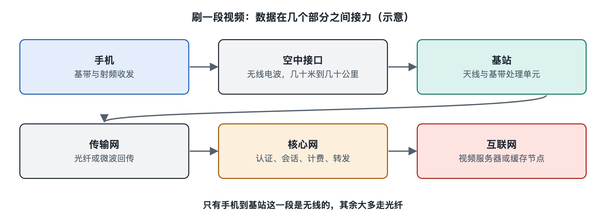

# 1.1 打一个电话、刷一段视频：信号走过了哪些地方

晚上十点，你坐在回家的地铁上，拇指一划，短视频开始播放；车厢摇晃着穿过隧道，画面没有卡顿。几站之后你给家人打了个电话，说“快到了”。整个过程不过几十秒，你没有插任何线，手机右上角的信号格时多时少，但连接一直都在。

这几十秒里，信号走了很长一段路。本节先把这条路完整地走一遍，不急着解释每个环节的原理，只求在脑中留下一张“路线图”。后面各章会沿着这张图逐段放大。

## 1.1.1 第一段：从手机到基站，看不见的“最后几百米”

信号的旅程从你手里的手机开始。你点下播放键，手机里的应用程序发出一个请求：“我要这段视频的数据。”这个请求先交给手机的**基带芯片**（Baseband），它负责把数字信息按照移动通信标准规定的格式打包、编码；再交给**射频前端**（Radio Frequency Front-End，RF），把信息“装载”到特定频率的电磁波上，最后从手机内置的天线发射出去。

这串电磁波在空气中传播，穿过车窗、绕过人群，被附近一座**基站**（Base Station）的天线接收。在地铁里，这座“基站”多半不是你在楼顶看到的铁塔，而是沿隧道布设的漏泄电缆或车站里的室内分布天线，它们连接着地面机房中的基站设备。在 4G 系统里基站叫 eNodeB，在 5G 系统里叫 gNodeB，名字不同，角色相同：它是手机与整个网络之间的第一个“接口”，负责收发无线信号。

手机到基站这一段，业内称为**空中接口**（Air Interface，简称空口），通常距离从几十米到几千米不等。这通常是整条路上唯一的无线环节（少数用微波回传的站点除外），也是最不稳定的一段：距离、墙壁、人体、雨水、其他手机的干扰都会影响它。你看到的信号格，主要就是手机对这一段信号强弱和质量的粗略显示。

## 1.1.2 第二段：从基站到核心网，地下的光纤“高速路”

基站把无线信号还原成数字数据后，并不自己处理“你要看哪个视频”这件事。它通过光纤（少数偏远站点用微波）把数据送往后方，这段线路属于**传输网**（Transport Network），也叫承载网。如果说空口是乡间小路，传输网就是城市之间的高速公路，由埋在地下或架在杆路上的光缆组成，容量大且稳定。

数据沿传输网到达**核心网**（Core Network）。核心网是运营商机房里的一组设备和软件，它要回答几个关键问题：

- 这部手机是谁？有没有合法开通服务？（认证）
- 这个用户用了多少流量、打了多少分钟电话？（计费）
- 这个数据请求要送到哪里去？（路由与转发）
- 用户在移动，下一次该从哪座基站找到他？（移动性管理）

确认身份、记录用量之后，核心网通过一个“出口”把你的视频请求送进**互联网**。互联网内部怎样找到视频服务器，属于本系列第二十五册讨论的内容，这里只需知道：请求最终抵达视频平台的服务器，往往是离你较近的内容分发节点。

## 1.1.3 第三段：原路返回，以及“一边走一边换路”

服务器把视频数据分成许多小块（数据分组），沿着几乎相反的方向回来：互联网 → 核心网 → 传输网 → 基站 → 空口 → 你的手机。手机的射频和基带把电磁波还原成比特，应用程序再把比特解码成画面和声音。

但这里有一个固定电话和家用宽带没有的难题：**你在移动**。地铁每分钟可能驶过上千米，你会离开一座基站的覆盖范围，进入另一座的范围。如果连接只能固定在一座基站上，视频会在出站时中断。移动通信系统的做法是：手机持续测量周围多个基站的信号，并报告给网络；当新基站更合适时，网络指挥手机在极短时间内“换乘”过去，这叫**切换**（Handover）。核心网同时更新“这个用户现在归哪座基站管”的记录，后续数据就改走新路线。你感觉不到换乘，正是因为这套机制在后台持续工作。

## 1.1.4 打电话有什么不同

打电话的路线大体相同，但有两点区别。

第一，**被叫方也要被找到**。你的家人可能在另一座城市，手机处于待机状态。网络需要知道他大致在哪片区域，向那里发出“寻呼”（Paging），他的手机响应后才能建立通话。这就是为什么即使你不用手机，它也会时不时与网络“打个招呼”，报告自己的位置区域。

第二，**语音对时延更敏感**。视频可以先缓冲几秒再播放，通话却不行，对方说话后如果隔了明显的时间你才听到，交谈就会别扭。在 4G、5G 网络中，语音也被打包成数据分组传送，即 VoLTE、VoNR，但网络会给它更高的优先级和专门的保障。早期的 2G、3G 则为通话单独占用一条“电路”，第五章会详细比较这两种方式。

下面把两条路线放在一起对照：

| 环节 | 刷视频 | 打电话 |
|---|---|---|
| 手机 ↔ 基站 | 空口无线传输 | 空口无线传输 |
| 基站 ↔ 核心网 | 传输网（光纤为主） | 传输网（光纤为主） |
| 核心网做什么 | 认证、计费、转发到互联网 | 认证、计费、找到被叫、建立会话 |
| 终点 | 视频平台服务器 | 对方的手机（可能经过另一张网） |
| 最在意什么 | 速率（带宽） | 时延与连续性 |
| 移动中如何保持 | 切换 | 切换，且要求更严格 |

## 1.1.5 一张路线图，四个“站点”

把上面的过程浓缩，可以得到一条贯穿全书的主线：

### 1.1.5.1 手机（终端）→ 基站与无线接入网 → 传输网 → 核心网 → 互联网或另一部手机

在这条主线上流动的不只是你看到的视频和听到的声音，还有大量你看不到的“控制消息”：开机时的登记、待机时的位置报告、通话前的寻呼、移动中的切换指令。前者称为用户数据，后者称为信令，它们像同一条路上的货车和交通指挥信号，缺一不可。

这张路线图里还藏着许多值得追问的问题：手机怎样在几百个频率中找到该连的基站？成千上万部手机同时说话，基站怎样听清每一个？信号格满格时网速为什么仍可能很慢？接下来的 1.2 节先回答一个更根本的问题：既然路线如此复杂，“移动通信系统”究竟应该怎样定义，它和普通的通信网络有什么本质区别。
