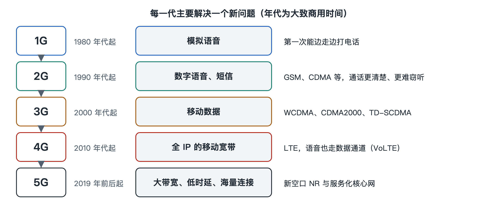

# 1.4 从 1G 到 5G：每一代解决了什么问题

打开手机设置里的“移动网络”，常能看到“首选网络类型”一栏，里面写着“5G/4G/3G/2G 自动”之类的选项。屏幕右上角的标识也会在“5G”“4G”之间跳动。这些“G”是英文 Generation（代）的缩写。每一代移动通信并非单纯“更快”，而是针对上一代暴露出的具体问题给出答案。按“问题—办法—新问题”的线索读，比背参数更容易看清演进的逻辑。

## 1.4.1 1G 与 2G：从“能打电话”到“打得清、打得安全”

**第一代（1G）**大约在 20 世纪 80 年代投入商用，典型系统有北美的 AMPS、欧洲和中国曾用的 TACS 等。它要解决的问题很朴素：**让人离开固定电话线，在移动中通话**。1G 采用模拟调制，把声音的起伏直接“刻”在电波上；多个用户靠**频分多址（FDMA，Frequency Division Multiple Access）**分开，每人占一小段频率。

模拟方式带来三个毛病：

- 频谱利用率低，一段频率只能服务一个通话，用户一多就打不进；
- 信号受干扰时杂音明显，音质难保证；
- 几乎没有加密，用简单的接收设备就可能听到别人的通话，号码也容易被盗用。

**第二代（2G）**在 90 年代普及，代表是欧洲主导的 GSM 和美国高通推动的 IS-95（CDMA）。2G 的关键变化是**数字化**：先把声音变成比特，再压缩、编码、加密后发送。GSM 用**时分多址（TDMA）**让多个用户轮流使用同一频率，IS-95 则用**码分多址（CDMA）**靠不同编码区分用户。数字化使同样的频谱能容纳更多通话，GSM 还引入了基于 SIM 卡的鉴权与空口加密。2G 还带来了**短信（SMS）**这项意外走红的业务。后来的 GPRS、EDGE 在 GSM 上叠加了分组数据能力，常被称为“2.5G”，让手机第一次能慢速上网。

## 1.4.2 3G：把“上网”变成正式任务

2G 的数据能力是“附加功能”，速率一般在每秒几十到上百千比特的量级，看网页尚且吃力。**第三代（3G）**的目标是让移动数据成为核心业务。国际电信联盟（ITU）为此制定了 IMT-2000 框架，三大主流标准是 WCDMA、CDMA2000 和由中国提出的 TD-SCDMA，它们都以 CDMA 技术为基础。

3G 演进到 HSPA 等版本后，下载速率可达每秒数兆比特的量级，视频通话、手机地图和应用商店因此兴起。但 3G 仍保留着“两张网”的格局：语音走电路交换域，数据走分组交换域，网络结构复杂，CDMA 在大带宽下的效率也遇到瓶颈。

## 1.4.3 4G：全 IP 与正交频分

**第四代（4G）**的主流技术是 3GPP 制定的 **LTE（Long Term Evolution，长期演进）**及其增强版本，对应 ITU 的 IMT-Advanced 要求。4G 回答了两个问题：

1. **如何在更宽的频带上高效传数据？**采用**正交频分多址（OFDMA）**，把宽频带切成大量相互正交的窄子载波，再配合多天线（MIMO）技术，抗多径能力和频谱效率都明显提升。
2. **如何简化网络？**核心网改为**全 IP**的扁平架构，取消电路交换域，语音也变成 IP 数据包，由 **VoLTE（Voice over LTE）**承载。

移动支付、短视频、直播等应用正是在 4G 普及后大规模出现的。

## 1.4.4 5G：从“连人”扩展到“连万物”

**第五代（5G）**由 3GPP 制定的**新空口（NR，New Radio）**和 **5G 核心网（5GC）**组成，对应 ITU 的 IMT-2020。ITU 为 5G 定义了三类典型场景，正好说明它要解决的不只是速度：

| 场景 | 英文缩写 | 要解决的问题 | 典型例子 |
|---|---|---|---|
| 增强移动宽带 | eMBB | 更大带宽、更高峰值速率 | 高清视频、云游戏 |
| 超高可靠低时延通信 | URLLC | 时延短且几乎不出错 | 工业控制、远程操作 |
| 海量机器类通信 | mMTC | 单位面积连接海量低功耗设备 | 智能表计、传感器 |

为此，5G 引入了更灵活的帧结构、毫米波等更高频段、大规模天线波束赋形，以及服务化架构和网络切片。这些技术将在第六、七章详细展开。

## 1.4.5 一条贯穿的主线

把五代放在一起看，可以归纳出一张简表：

| 代际 | 核心问题 | 关键手段 |
|---|---|---|
| 1G | 能否移动通话 | 模拟调制、FDMA、蜂窝组网 |
| 2G | 容量、音质与安全 | 数字化、TDMA/CDMA、数字鉴权与加密 |
| 3G | 移动上网 | CDMA 宽带化、分组数据 |
| 4G | 高效宽带与网络简化 | OFDMA、MIMO、全 IP |
| 5G | 多场景、连万物 | NR 新空口、服务化核心网、切片 |

每一代都受同样的约束：频谱有限、电波会衰减和干扰、建网有成本。各代技术的差别，在于用什么办法逼近香农定理给出的容量上限，又如何在覆盖、容量和成本之间取舍。关于 6G，ITU 已发布 IMT-2030 框架，公开研究方向包括通信与感知融合、AI 原生网络、与卫星网络协同等。这些方向在写作时仍处于研究和标准化阶段，本书不作预测。

需要注意的是，各代网络在现实中长期共存。许多国家的运营商已陆续关闭 2G 或 3G 网络以腾出频谱，具体安排因国家和运营商而异。所以，你手机上的“G”标识反映的是当前所接入网络的类型，并不代表某一代已经被完全取代。
