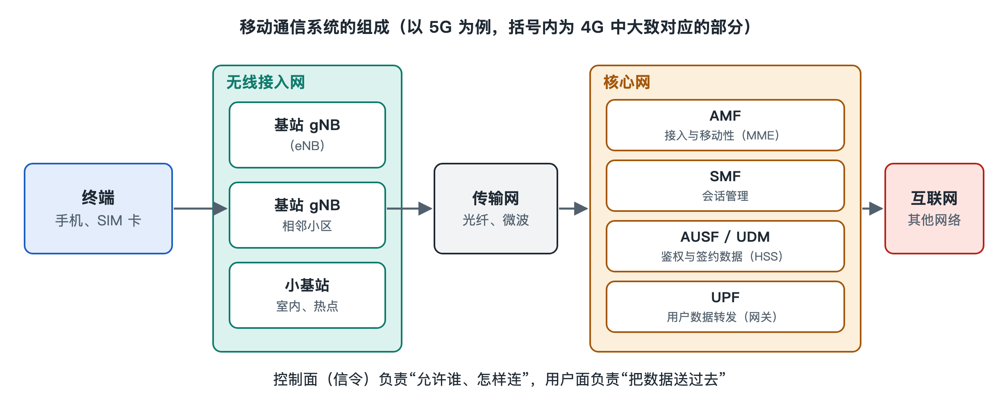

# 2.4 核心网：认证、计费与数据转发的大脑

坐飞机落地后打开手机，几秒钟内信号格亮起，接着收到一条运营商的短信：“欢迎来到某地，国际漫游资费如下……”。你没有去营业厅，也没有输入任何密码。网络却已经知道你是谁、开通了哪些业务、该按什么价格计费，还把你的上网流量接通到了互联网。基站只负责“听见”和“喊话”，做这些判断的是藏在运营商机房深处的另一部分系统：核心网（Core Network，CN）。

## 2.4.1 基站管“连上”，核心网管“认人、记账、找路”

打个比方，无线接入网像遍布城市的快递网点，负责最后一公里的收件与派送；核心网则像快递公司的总部与分拣中心。网点不需要知道每位客户签了什么合同，但总部必须知道：这个人是不是合法客户、包裹该送往哪里、运费记在谁的账上。

具体来说，核心网承担几类相互关联的工作：

| 工作 | 通俗说法 | 日常体现 |
|---|---|---|
| 用户数据管理 | 保管“客户档案” | 号码、套餐、是否开通国际漫游 |
| 认证与安全 | 核对“你是不是你” | 开机后自动入网，别人难以冒用你的身份 |
| 移动性管理 | 记住“你大概在哪” | 你在城市里移动，来电仍能找到你 |
| 会话管理 | 为你开一条“数据通道” | 打开 App 就能上网 |
| 数据转发 | 把分组送进送出互联网 | 视频、网页内容的进出口 |
| 策略与计费 | 决定“给多少、记多少” | 流量用尽限速、定向流量免费 |

这些功能的具体原理会在第三章“接入”“移动性”“安全”各节展开，本节先看清它们分别住在哪些设备里。

## 2.4.2 从“交换机”到“网元”：核心网的演进脉络

早期的 2G 网络中，核心网的核心是移动交换中心（Mobile Switching Center，MSC），本质上是一台加了“移动”能力的电话交换机，主要处理语音的电路连接。用户档案存放在归属位置寄存器（Home Location Register，HLR）里。后来为了上网，又在旁边加了一套分组域设备（GPRS 网络），形成“电路域 + 分组域”两条腿走路的结构。

到了 4G，3GPP 定义了演进型分组核心网（Evolved Packet Core，EPC），整个核心网只保留分组域，语音也改走 IP（详见 5.4 节）。EPC 由几个主要“网元”（Network Element，指承担特定功能的网络设备或软件实体）组成：

- **MME**（Mobility Management Entity，移动性管理实体）：负责手机的接入控制、鉴权流程发起和位置跟踪，只处理“信令”，不转发用户数据。
- **HSS**（Home Subscriber Server，归属用户服务器）：HLR 的继任者，保存用户签约信息和鉴权所需的密钥材料。
- **SGW**（Serving Gateway，服务网关）与 **PGW**（PDN Gateway，分组数据网网关）：真正搬运数据分组的设备，PGW 是通往互联网等外部网络的出口，也为手机分配 IP 地址。
- **PCRF**（Policy and Charging Rules Function，策略与计费规则功能）：决定某个用户、某类业务该享受什么速率和计费规则。

5G 核心网（5G Core，5GC）进一步把这些功能拆细、改用“服务化”的方式组织，例如 AMF 接替 MME 的接入与移动性管理，SMF 负责会话管理，UPF 负责用户数据转发，UDM 管理用户数据，PCF 负责策略。其架构思想与网络切片将在 7.3 节专门讲解，这里只需记住：名字变了，“认人、记账、找路、搬数据”这几件事没变。

## 2.4.3 控制面与用户面：大脑与手脚分开

观察上面的网元，会发现它们分成两类：MME、HSS 只“说话”，交换的是控制消息；SGW、PGW 则“搬货”，处理的是你真正要看的视频数据。通信工程里把前者叫控制面（Control Plane），后者叫用户面（User Plane）。

把两者分开是核心网演进中一条持续的主线。原因很实际：控制消息数量多但每条很小，需要复杂的逻辑判断；用户数据量巨大但处理规则相对简单，需要高吞吐。分开后，两者可以各自扩容，用户面设备还可以下沉到离用户更近的城市机房甚至园区里，减少数据绕路。4G 后期 3GPP 引入的控制与用户面分离（CUPS）以及 5G 的 SMF/UPF 拆分，都是这一思路的体现。这也是“边缘计算”能落地的结构基础之一。

## 2.4.4 计费：每一个字节都要有人认账

你看到的“本月已用 12.3 GB”，背后是一条完整的计费链路。用户面网关在转发数据时统计流量，按照策略功能下发的规则区分业务类型，再把记录送往计费系统。计费大致分两种：

- **离线计费**：先记录、后结算，适合月结的后付费套餐。
- **在线计费**：实时扣减额度，余额或流量用尽时可以立即限速或停止服务，适合预付费和流量包。

至于“某些 App 流量不计入套餐”这类定向流量，属于各运营商自行设计的资费产品，实现上依赖策略功能识别业务并套用不同费率，具体做法因运营商而异。

## 2.4.5 核心网在哪里：少而集中，层层冗余

基站数量通常以万甚至十万计，而核心网设备在一个国家的运营商网络中通常只部署在少数几个大区或省级数据中心，这是公开资料中常见的描述。原因在于核心网掌握全网用户的数据与状态，集中部署便于管理和保护。也正因为集中，它对可靠性要求极高：设备成对或成组部署、跨机房容灾，避免一处故障影响大片用户。如今许多运营商的核心网已运行在通用服务器和云化平台上，这一趋势在写作时仍在推进中，相关的数据中心与云计算知识可参阅本系列的专册。

## 2.4.6 小结

核心网不发射一丝无线电波，却决定了你能不能入网、能用什么业务、该付多少钱、数据从哪里进出互联网。它通过控制面与用户面的分工，把“大脑”与“手脚”分开；又通过从 EPC 到 5GC 的演进，变得更加模块化。不过，基站与核心网往往相隔数十乃至上百公里，连接它们的是什么？下一节我们就沿着基站背后的光纤和微波，看看传输网与承载网。
