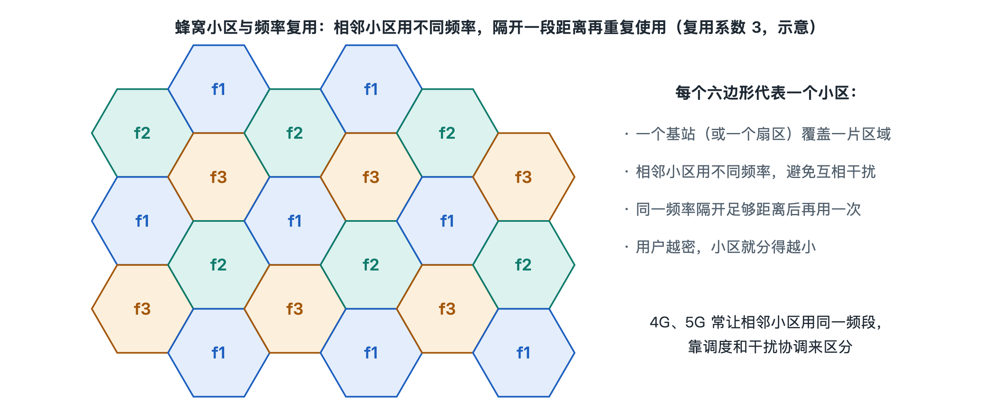

# 3.1 覆盖：蜂窝小区与频率复用

坐高铁或开车穿过城市时，留意一下手机右上角的信号格：它很少一直满格，也很少长时间掉到零。格数起起落落，通话和视频却大体连续。这说明你身边并不是只有一座“超级信号塔”在照顾你，而是有许多基站各管一小片，你走到哪一片，就由哪一片的基站接手。这种“化整为零”的覆盖方式，就是移动通信被称为“蜂窝网络”的原因。本节要讲清三件事：小区是什么，为什么要把覆盖切成小块，以及切成小块之后，有限的频率怎样被反复使用。

## 3.1.1 从“一座大塔”到“许多小格”

早期的无线电话系统曾经采用一种直观的思路：在城市制高点立一座大功率发射塔，覆盖方圆几十公里。这种做法的问题出在频率上。一路通话要占用一段频率，一座塔手里的频率是有限的，整个城市能同时打电话的人数也就被卡死了。公开的历史资料中常提到，这类系统在一座大城市里往往只能同时支持几十路量级的通话，申请者需要排队等待。

20 世纪 40 年代末，美国贝尔实验室的工程师提出了“蜂窝”设想，到 70 年代逐步形成完整方案：不再追求一座塔覆盖全城，而是降低每个发射点的功率，让它只覆盖一小块区域，称为**小区**（Cell）。许多小区拼接起来覆盖整座城市。小区足够多、频率可以重复使用，系统的总容量就能随小区数量增长。所谓“蜂窝”（Cellular），指的就是这种由许多小区拼成的覆盖形态。

## 3.1.2 小区为什么画成六边形

教科书和运营商规划图里，小区常被画成正六边形，拼在一起像蜂巢。这是一种便于计算的理想模型，原因有三：

| 候选形状 | 能否无缝拼接 | 与“圆形覆盖”的接近程度 |
|---|---|---|
| 圆形 | 不能，拼接会留缝隙或大量重叠 | 最贴近天线的理想覆盖 |
| 正方形 | 能 | 角落离中心较远，偏差较大 |
| 正六边形 | 能 | 在可无缝拼接的形状中最接近圆 |

天线发出的信号在空旷地带大致呈圆形向外扩散；要让许多圆既不留空隙又尽量少重叠，用六边形来近似最合适。

现实中的小区并不规则。楼宇遮挡、地形起伏、天线朝向都会把边界扭得弯弯曲曲，网络规划时通常会让相邻小区之间留出一条重叠带，这条重叠带正是手机从一个小区换到另一个小区的地方（切换机制在 3.3 节展开）。还要注意，一座基站通常不只对应一个小区。常见做法是把一座铁塔上的天线分成三组，每组朝向约 120 度的扇区，每个扇区就是一个独立的小区。所以你在楼顶看到的一根抱杆上挂着三面天线，往往意味着三个小区。

## 3.1.3 频率复用：同一段频率用很多次

把城市切成小格，真正的收益来自**频率复用**（Frequency Reuse）：相距足够远的两个小区可以使用同一组频率，彼此的干扰弱到可以接受。

可以用学校排课来理解。全校只有几间音乐教室（频率），如果每个班都要求独占一间，很快就排不开了。但隔得远的两栋教学楼可以各自在同一时间上同一种课，彼此听不见。频率复用也是这个道理：只要相隔足够远，就能“同时同频”。

在 2G 时代的 GSM 等系统中，常用“复用簇”来组织频率：把运营商手里的频率分成若干组，例如 7 组，相邻的 7 个小区各用一组，组成一个**簇**（Cluster）；下一簇再从头使用这 7 组频率。簇里的小区数目叫**复用因子**，常见取值有 3、4、7、12 等。这里存在一个取舍：

- **复用因子大**（如 7 或 12）：同频小区离得远，干扰小，但每个小区分到的频率少，单小区容量低。
- **复用因子小**（如 3）：每个小区分到的频率多，但同频小区离得近，干扰大。

到了 3G 的码分多址系统，以及 4G LTE 和 5G 新空口，主流做法变成了**同频组网**，也就是复用因子为 1：相邻小区使用同一段频率。这样做之所以可行，是因为这些系统在设计上就把邻区干扰当作常态来处理，依靠扰码区分小区、自适应调制编码、干扰协调和多天线等手段把干扰压下去（这些机制在第六章详细讲）。代价是小区边缘的用户更容易受到干扰，这也是你在两个小区交界处网速常常明显下降的原因之一。

## 3.1.4 小区的大小：由什么决定

小区的大小是网络设计的结果，要综合考虑覆盖距离和用户密度。粗略地说，公开资料中的常见范围如下：

| 类型 | 典型覆盖半径（量级） | 常见场景 |
|---|---|---|
| 宏小区（Macro cell） | 一公里到十几公里 | 郊区、农村、高速公路 |
| 微小区（Micro cell） | 百米到数百米 | 城市街道、商业区 |
| 皮小区 / 飞小区（Pico / Femto cell） | 数米到数十米 | 室内、商场、写字楼、家庭 |

决定小区大小的因素主要有：

1. **频率高低**：频率越高，传播损耗越大，穿墙越难，同样功率下覆盖越小。低频段适合广覆盖，高频段适合在热点地区提供大容量。5G 的毫米波频段，覆盖距离通常只有百米量级。
2. **用户密度**：一个小区的容量有上限。人越多，小区就要切得越小，所以市中心的基站往往比郊外密集得多，这种做法叫**小区分裂**（Cell Splitting）。
3. **发射功率与天线高度**：塔越高、功率越大，覆盖越远，但也更容易干扰远处的同频小区。

因此，覆盖从来不只是“信号能传多远”的问题，它同时也是容量问题。农村基站求“远”，城区基站求“密”，背后是同一套蜂窝思想在不同人口密度下的两种取值。

## 3.1.5 小结：信号格背后的“拼图”

回到手机上的信号格。它反映的是你当前所在小区的信号强度，格数变化往往意味着你正在靠近或离开某个小区的中心，或者已经被另一个小区接管。整个蜂窝网络像一张由大小不一的小区拼成的拼图：小区让有限的发射功率覆盖到每个角落，频率复用让有限的频谱服务尽可能多的人。

不过，覆盖只解决了“这里有信号”的问题。手机开机后怎样从众多小区中挑出一个、向网络报到并获准使用，是下一节“接入”要回答的问题。为什么距离稍远干扰就能下降到可以接受，复用因子背后的数学关系又是什么，将在第八章 8.3 节溯源。
