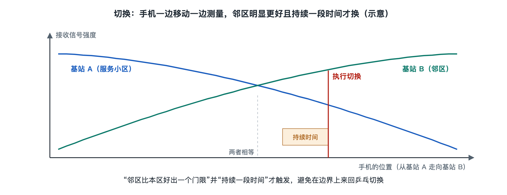

# 3.3 移动性：切换与位置管理

坐高铁时打着视频电话，窗外的铁塔一座座闪过，画面却没有断。手机右上角的信号格可能从满格掉到两格，又回到满格。每一座铁塔只照顾周围一小片区域，人却在不停地跨越这些区域。“边走边连”能成立，靠的是移动通信系统的移动性管理。它要回答两个问题：**正在通话的人走远了，怎样换一座基站继续服务？没在用手机的人走到哪了，来电时怎样找到他？** 前一个问题对应切换，后一个对应位置管理。

## 3.3.1 两种状态，两套办法

手机并不总是在“说话”。按照 3GPP 标准，手机与网络之间的连接大体分为两类状态：

| 状态 | 日常场景 | 网络是否时刻知道手机在哪个小区 | 换小区由谁决定 |
|---|---|---|---|
| 连接态（Connected） | 正在通话、刷视频、下载 | 知道，精确到小区 | 网络决定，称为**切换** |
| 空闲态（Idle） | 手机锁屏放在口袋里 | 只知道大致区域 | 手机自己决定，称为**小区重选** |

5G 还增加了一种介于两者之间的“非激活态”（RRC Inactive），手机暂时释放无线资源，但保留部分连接信息，下次恢复更快、更省电。这样分层的原因很直接：时刻精确跟踪每一部手机代价太高，既耗网络信令，也耗手机电量。所以只对“正在用”的手机精细管理，对“暂时不用”的手机粗略管理。

## 3.3.2 切换：接力赛中的交棒

切换（Handover）可以类比为接力赛。正在跑的选手（当前服务基站）在交接区把接力棒（你的通话或数据连接）交给下一位选手（目标基站），比赛不能停。

一次典型的切换包含三步：

1. **测量**：基站事先告诉手机“请留意这几个邻近小区，信号达到某个条件就向我报告”。手机在通信间隙测量邻区的信号强度和质量，例如 LTE 和 5G 中常用的参考信号接收功率（RSRP）。
2. **判决**：当邻区信号比当前小区好出一定幅度、并持续一小段时间，手机上报测量结果，当前基站据此决定是否切换。之所以要求“好出一定幅度”和“持续一段时间”，是为了防止手机站在两个小区交界处来回“乒乓切换”。
3. **执行**：当前基站与目标基站提前协商、预留资源，然后命令手机转到目标小区；手机接入新小区后，核心网把数据通道改到新基站上。

在 2G、4G 和 5G 中，常见的做法是“先断后连”的硬切换，但断开时间被压缩得很短，加上数据在两个基站之间转发，用户通常感觉不到。3G 的码分多址系统还用过“先连后断”的软切换，手机可以同时与多个基站保持连接。切换的具体信令过程将在第六章 6.5 节展开。

## 3.3.3 位置管理：网络怎样找到口袋里的手机

手机锁屏时，网络并不知道它具体在哪个小区。这时来了一个电话，怎么办？办法分为两半：**手机定期“报到”，网络需要时“广播找人”。**

- **跟踪区与登记**：运营商把许多小区划成一个个“区域”，4G 中称为跟踪区（Tracking Area，TA），2G、3G 中叫位置区。每个小区都在广播自己所属区域的编号。手机在空闲态下自行选择信号较好的小区驻留，只要发现进入了一个不在自己登记列表里的新区域，就向核心网报告一次，称为跟踪区更新（TAU）；5G 中对应的是“注册区”与移动性注册更新。此外，即便原地不动，手机也会按网络设定的周期报到，让网络确认它仍然在线。
- **寻呼**：来电或有数据要下发时，核心网只在手机最近登记的区域内所有小区里发出寻呼（Paging），相当于在一栋楼里用广播喊名字。手机在空闲态下按约定的节奏周期性“醒来”听寻呼，听到自己的临时身份标识，就发起接入，转为连接态。

可以用一张对照表看清分工：

| 环节 | 谁主动 | 精度 | 目的 |
|---|---|---|---|
| 跟踪区更新 | 手机 | 区域级 | 让网络大致知道你在哪 |
| 寻呼 | 网络 | 在区域内广播 | 需要时找到你 |
| 切换 | 网络指挥 | 小区级 | 使用中不断线 |

## 3.3.4 区域划多大：一个权衡

跟踪区划得太小，手机在城市里走几步就要报到一次，信令和电量消耗都上升；划得太大，每次来电都要在成百上千个小区里同时寻呼，浪费无线资源。运营商需要根据人流、道路、地铁线路等因素规划区域边界，比如尽量避免让区域边界正好横跨一条繁忙的主干道，以免大量手机在边界附近频繁更新。4G 起引入的“跟踪区列表”允许给手机一次登记多个区域，就是为了缓解这种边界问题。这类划分属于各家运营商的网络规划工作，并没有统一数值。

## 3.3.5 小结

移动性管理把“人在动”这个难题拆成了两层：使用中的手机靠切换在基站之间接力，空闲中的手机靠区域登记与寻呼被网络找到。前者追求不断线，后者追求省信令、省电量。手机能被找到、能被接力，前提是网络确认“你就是你”，而且别人无法冒名或偷听——这就是下一节要讲的安全：鉴权与加密。
