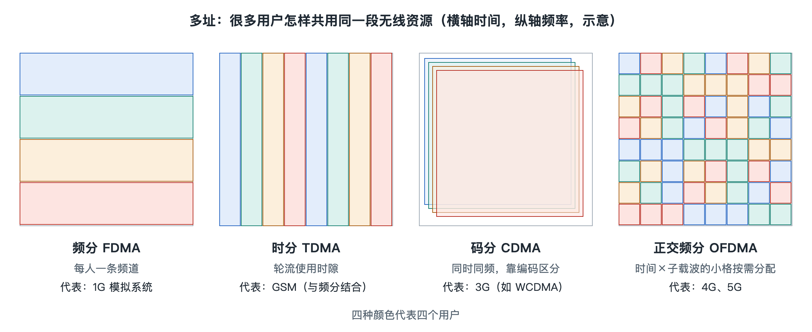

# 6.1 多址：频分、时分、码分与正交频分

晚上十点，小区里几百部手机同时亮着：有人在刷短视频，有人在打语音电话，有人的手表在悄悄同步心率。它们连着的可能是楼顶同一个基站，用的是同一段频谱。空中只有一片“公共空间”，这么多用户的信号为什么没有乱成一团？回答这个问题的技术叫**多址**（Multiple Access）：让多个用户共享同一套无线资源，又能被彼此区分开。从 1G 到 4G，每一代移动通信最显眼的变化之一，就是换了一种多址方式；5G 则在 4G 的正交频分基础上进一步扩展。

## 6.1.1 一个比喻：一间屋子里怎样同时说话

设想一间会议室里有很多人需要交谈，可以有几种办法：

- **分房间**：每对人去一个隔间里谈，互不打扰。这对应按频率划分。
- **轮流发言**：大家用同一个房间，但每人只说几秒钟，按顺序轮换。这对应按时间划分。
- **用不同语言**：所有人同时在一个房间里说话，一对讲中文，一对讲法语，一对讲阿拉伯语，各自只听得懂自己的语言，别人的声音就成了背景噪声。这对应按编码区分。
- **把房间切成很多小格子**：时间和“隔间”都切得很细，管理员按需要给每人分配若干格。这就是今天 4G、5G 采用的正交频分思路。

无线电里能拿来区分用户的“维度”无非几种：频率、时间、编码，还有空间（不同方向的波束，留到 6.3 节讲）。下面按历史顺序逐一看。

## 6.1.2 频分与时分：1G 和 2G 的做法

**频分多址**（FDMA，Frequency Division Multiple Access）把一段频谱切成许多窄窄的“频道”，每个用户通话时独占一个。1G 模拟系统基本就是这样，一路通话占用约几十千赫兹（kHz）带宽，这是公开资料中常见的典型量级。它原理直观，和收音机调台一样：手机和基站对准同一个频率就能通话。缺点是一个频道在通话期间被一个人一直占着，即使对方沉默也不能让给别人；频道之间还要留“保护带”，防止互相串扰，频谱利用率不高。

**时分多址**（TDMA，Time Division Multiple Access）在此基础上再切一刀。2G 的 GSM 系统把每个约 200 kHz 的载波按时间分成 8 个**时隙**（Time Slot），每个用户轮流使用其中一个。由于语音已经数字化并被压缩，一个用户只需要在自己的时隙里快速“说一小段”，就能连起来还原成连续的声音。这样同样的频谱能服务的用户数就成倍增加。时分的代价是收发双方必须严格对时，离基站远的手机信号传播要更久，基站还得让它“提前发送”，以免挤进别人的时隙。

实际上 GSM 是频分加时分的组合：先分载波，再分时隙。这也说明多址方式往往不是单选题。

## 6.1.3 码分：3G 的“同时同频”

**码分多址**（CDMA，Code Division Multiple Access）走了一条不同的路：所有用户在同一时间、同一频带上发送，各自用一串专属的“扩频码”给数据“打上口音”。接收端拿着对应的码去做相关运算，就能把自己的信号提取出来，其他用户的信号在运算后表现为较弱的噪声。

码分有几个吸引人的特点：

- 相邻小区可以使用同一频率，网络规划更灵活；
- 手机可以同时和两个基站通信，实现“软切换”，切换过程更平滑；
- 容量是“软”的，多一个用户只是背景噪声略升，而不是直接没有空位。

但它也有明显的软肋：既然大家互为噪声，近处手机如果功率过大，就会把远处手机的信号淹没，这叫**远近效应**。CDMA 系统因此必须做非常快速、精细的功率控制（6.4 节详述）。3G 的三大主流标准 WCDMA、CDMA2000 和 TD-SCDMA 都以码分为基础。随着数据速率要求越来越高、带宽越来越宽，码分在宽带下受多径影响的处理复杂度也变得很高，这为下一代的转向埋下伏笔。

## 6.1.4 正交频分：4G 和 5G 的“资源格子”

**正交频分多址**（OFDMA，Orthogonal Frequency Division Multiple Access）建立在 OFDM（正交频分复用）技术之上。它把一大段带宽分成成百上千个很窄的**子载波**。LTE 中子载波间隔为 15 kHz；5G 新空口在此基础上可以选 15、30、60、120 kHz 等多种间隔。这里的“正交”是关键：子载波可以部分重叠、彼此紧挨着而不互相干扰，不必像 FDMA 那样留大段保护带，频谱利用率因此大大提高。

每个子载波都很窄，数据在上面传得较慢，单个符号持续的时间相对较长，多径反射造成的“回声”就不容易扰乱前后符号；再加一小段**循环前缀**（CP，Cyclic Prefix）作为缓冲，接收端的处理就简单得多。这正是宽带移动通信最需要的特性。

在此基础上，基站把时间和频率切成网格，最小的调度单位在 LTE 中叫**资源块**（RB，Resource Block），频率上占 12 个子载波。每隔约 1 毫秒（LTE 的一个子帧），调度器就重新决定每个用户分到哪些格子。信号好的用户可以分到更多、用更高阶的调制，视频卡顿的用户可以临时多给一些。

| 多址方式 | 区分用户的维度 | 代表系统 | 主要优点 | 主要难点 |
|---|---|---|---|---|
| FDMA | 频率 | 1G 模拟系统 | 简单直观 | 频谱利用率低 |
| TDMA | 时间（常与频分结合） | 2G GSM | 同频谱容纳更多用户 | 需要严格时间同步 |
| CDMA | 扩频码 | 3G | 同频组网、软切换 | 远近效应、宽带下处理复杂 |
| OFDMA | 时间 + 频率的二维网格 | 4G LTE 下行、5G NR 上下行 | 频谱效率高、抗多径、调度灵活 | 发射信号峰均比较高 |

表中最后一行的“峰均比”值得一提：OFDM 信号的瞬时功率起伏很大，会让功率放大器效率降低，这对靠电池供电的手机不太友好。因此 LTE 上行采用了一种改造的单载波方式 SC-FDMA，以降低峰均比；5G 新空口上行则同时支持 CP-OFDM 和 DFT-s-OFDM 两种波形，可根据覆盖情况选择。这些细节都以 3GPP 规范为准。

## 6.1.5 从“分配位置”到“按需分配”

回头看这条演进线，变化的不只是切分的维度，还有分配的理念。1G 和 2G 时代，资源是“包房”式的：通话一建立，频道或时隙就归你，直到挂断。到了 4G、5G，资源变成按毫秒计、按需分配的“共享格子”，正好适合突发性强的数据业务：刷视频时数据一阵一阵地来，没数据时就把格子让给别人。

还要说明一点，多址并不排斥其他手段。今天的系统同时用正交频分划分时频资源，用多天线在空间上再区分用户，用功率控制压低干扰。至于格子里每次能装多少比特，取决于调制与编码，这正是下一节要回答的问题。
