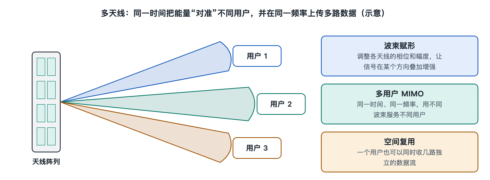

# 6.3 多天线与波束赋形：MIMO 怎样提高容量

拿起手机，你看不到一根外露的天线。可如果拆开一部写作时主流的 5G 手机，会发现机身边框、后盖内侧藏着好几组天线，公开拆解资料中常见的数量是十根上下，分别负责不同频段和不同用途。再抬头看路边铁塔，4G 时代的天线大多是一块块细长的“板子”，5G 时代则常换成更方正、更厚实的“盒子”。手机和基站为什么都要用这么多天线？答案就是本节的主角：多输入多输出（Multiple-Input Multiple-Output，MIMO）和波束赋形（Beamforming）。

## 6.3.1 一根天线的天花板

上一节讲调制与编码时我们看到，一个符号装多少比特取决于信号质量；第八章还会讲到香农定理：在一条信道里，容量由带宽和信噪比决定。带宽是买来的频谱，贵且有限；信噪比提高一倍，容量只增加一点点，因为它在公式里处在对数位置上。这就像一条单车道公路：路宽固定，车开得再整齐，通过量也有上限。

MIMO 的思路是不再死磕这一条车道，而是在同一段频率、同一时刻，利用“空间”再开出几条车道。它并不违背香农定理，而是把一条信道变成了几条并行的信道。

## 6.3.2 空间复用：同一频率上并排跑几路数据

设想基站有两根发射天线，手机有两根接收天线。基站从两根天线同时发出两路不同的数据，用的是完全相同的频率。按常理，两路信号会在空中混在一起，手机根本分不开。

关键在于多径传播。电波从基站到手机会经过楼房反射、树木散射，形成许多条路径（第八章 8.2 节详述）。两根发射天线到两根接收天线，一共四条“链路”，每条链路经过的反射环境略有不同，信号到达时的强弱和相位也不同。手机通过基站发送的参考信号，测出这四条链路各自的特征，组成一张“信道矩阵”，再像解一组联立方程那样，把混在一起的两路数据还原出来。

这种用法叫空间复用。可以用一个类比理解：两个人同时对你说话，如果声音从完全相同的位置传来，你很难分辨；如果一人站左边、一人站右边，你的两只耳朵听到的混合方式不同，大脑就能把两句话分开。

能并行的数据路数称为“层”（Layer）或“流”。它受收发两端天线数中较小者限制，也受环境制约：如果周围空旷、路径单一，几条链路长得太像，方程就解不开，层数只能减少。所以 MIMO 在多反射的城区往往比在开阔郊野更“得力”。下表对照了几种常见配置（具体能力以 3GPP 规范和终端实际支持为准）：

| 配置 | 含义 | 下行最多并行层数 | 常见场景（写作时情况） |
|---|---|---|---|
| 2×2 | 基站 2 发、手机 2 收 | 2 | 早期 4G 普遍配置 |
| 4×4 | 基站 4 发、手机 4 收 | 4 | 较新的 4G 和多数 5G 手机 |
| 64T64R 对多用户 | 基站 64 收发通道 | 单用户仍受手机天线限制 | 5G 中频段大规模天线 |

## 6.3.3 波束赋形：把信号“照”向用户

MIMO 的另一种用法与空间复用不同：多根天线不发不同数据，而是发同一份数据，但每根天线的信号相位经过精心调整。这些信号在空间中叠加时，在某个方向上相互加强，在其他方向上相互抵消，能量就像手电筒一样被聚成一束，这就是波束赋形。

类比水面：同时往池塘里丢几颗石子，波纹在某些地方叠成更高的浪，在另一些地方相互抹平。控制每颗石子落水的先后，就能决定高浪出现在哪里。

波束赋形带来两点好处：

- **覆盖更远**：能量集中，用户收到的信号更强，信噪比更高，可以用更高阶的调制。
- **干扰更小**：能量不再四处散射，对邻近用户和邻区的干扰随之减少。

这对 5G 尤其重要。5G 使用的 3.5 GHz 左右的中频段、以及更高的毫米波频段，传播损耗比 4G 常用的低频段大，穿墙也更困难。靠波束赋形把能量聚拢，是弥补这些损耗的重要手段。毫米波波长短，天线可以做得很小，在一块面板里排列出很多阵元，形成很窄的波束；而窄波束也带来新问题——用户一转身、一走动，波束就可能对不准，所以 5G 标准专门设计了波束扫描、测量和切换的流程，让基站与手机不断“对光”。

## 6.3.4 大规模 MIMO：一块面板同时服务多人

把以上两种用法结合，再把基站天线数大幅增加，就得到大规模 MIMO（Massive MIMO）。前面提到的路边“盒子”，内部通常排列着几十到上百个天线阵元，业内常以“64T64R”（64 路发、64 路收）、“32T32R”等标注通道数，这是公开资料中的常见说法，具体型号因设备商而异。

大规模 MIMO 最有价值的能力是多用户 MIMO（MU-MIMO）：基站同时形成多个波束，分别指向不同位置的几位用户，在同一频率、同一时刻给他们各自发送数据。单部手机受自身天线数限制，层数有限；但基站把空间切分给多人，整个小区的总容量就成倍提升。在体育场、商业街这类人多的地方，这一点格外有用。

当然，这一切建立在“基站知道信道长什么样”的前提上。基站获取信道信息有两种主要途径：一是让手机测量后上报，即信道状态信息（Channel State Information，CSI）反馈；二是在时分双工（TDD）系统中，上下行使用同一频率，基站可以直接测量手机发来的上行参考信号，推算下行信道。这也是 TDD 中频段常与大规模 MIMO 搭配部署的原因之一。

## 6.3.5 从“多一根天线”到“多一个维度”

回顾本章：多址技术在频率和时间上切分资源，调制编码让每份资源装更多比特，MIMO 则打开了空间这个新维度。三者叠加，构成了现代移动网络提升容量的主要手段。代价也很清楚：天线越多，射频通道、功耗、计算量和设备重量都随之增加，基站要做大量矩阵运算，手机内部也要为多根天线腾出空间。

有了空间维度，基站手里可分配的资源从“时间 × 频率”变成了“时间 × 频率 × 空间”。在同一毫秒里给谁、用哪段频率、走哪个波束、发多大功率——这些决定由谁做、怎样做，正是下一节“调度与功率控制”要回答的问题。
