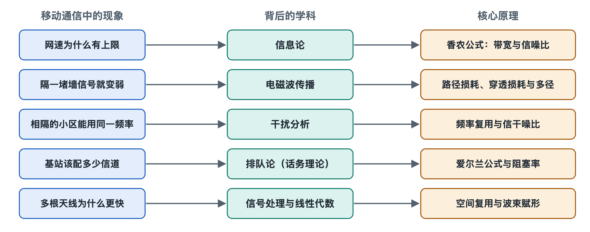

# 8.1 香农定理：信道容量的上限

在地铁站台打开测速软件，下载速率可能是几百兆比特每秒；走进电梯，信号格掉到一格，速率跌到几兆；再往里走，视频干脆转圈。很多人会想：只要工程师再努力一点、手机再先进一点，是不是任何地方都能跑满速？答案是否定的。早在 1948 年，美国数学家克劳德·香农（Claude Shannon）就证明：一条信道能可靠传输的信息量有一个天花板，任何技术都无法越过它，只能尽量逼近。这一节就来看看这个天花板由什么决定。

## 8.1.1 一个公式，三个变量

香农给出的信道容量公式（也称香农—哈特利公式）写作：

### 8.1.1.1 C = B × log₂(1 + S/N)

- **C**：信道容量（Channel Capacity），单位是比特每秒（bit/s），指在误码率可以任意小的前提下，理论上能达到的最高传输速率。
- **B**：带宽（Bandwidth），单位是赫兹（Hz），即信号占用的频率范围宽度。
- **S/N**：信噪比（Signal-to-Noise Ratio，SNR），即接收到的有用信号功率与噪声功率之比。

可以把信道想成一条公路：带宽是车道数，信噪比决定每条车道上车能开多快、排多密。车道翻倍，运力直接翻倍；而把路面修得更平，运力也会增加，但增加得越来越慢——这就是公式里那个对数的含义。

## 8.1.2 带宽：最“直接”的提速手段

公式中容量与带宽成正比。这解释了移动通信演进中一条清晰的主线：不断争取更宽的频谱。

| 系统 | 单载波典型带宽（标准规定的上限） |
|---|---|
| GSM（2G） | 200 kHz |
| LTE（4G） | 最大 20 MHz |
| 5G NR，中频段（FR1） | 最大 100 MHz |
| 5G NR，毫米波（FR2） | 最大 400 MHz（3GPP 早期版本规定） |

从 200 kHz 到 100 MHz，带宽相差数百倍，这是 5G 峰值速率远高于 2G 的根本原因之一。第四章讲过频谱稀缺、要靠拍卖或分配获得；也正因如此，运营商才会用载波聚合把几段频谱“拼”起来，第七章提到的毫米波也是冲着大带宽去的。代价则在第八章下一节会看到：频率越高，传播损耗越大，覆盖越小。

## 8.1.3 信噪比：信号格背后的真正变量

信噪比通常用分贝（dB）表示：10 dB 相当于信号比噪声强 10 倍，20 dB 相当于 100 倍，30 dB 相当于 1000 倍。代入公式算一笔账（以 20 MHz 带宽为例，只考虑一路数据流）：

| 信噪比 | 线性倍数 | log₂(1+S/N) | 理论容量约 |
|---|---|---|---|
| 0 dB | 1 | 1 | 20 Mbit/s |
| 10 dB | 10 | 约 3.46 | 约 69 Mbit/s |
| 20 dB | 100 | 约 6.66 | 约 133 Mbit/s |
| 30 dB | 1000 | 约 9.97 | 约 199 Mbit/s |

可以看出两点。第一，信噪比每提高 10 dB，信号功率要增大 10 倍，容量却只多出大约 3.3 比特每秒每赫兹——靠“加大功率”提速，收益递减得很快。第二，即使信噪比为 0 dB，信号和噪声一样强，信道依然能传信息，只是慢。这也说明信号格掉到一格时网络不是“没有”，而是被压到了天花板很低的位置。

手机里看到的信号格，主要依据接收功率等测量值换算而来（第九章会教你读 RSRP、SINR 等数值）。其中 SINR（信号与干扰加噪声比，Signal to Interference plus Noise Ratio）把邻区干扰也算进“噪声”里，更贴近香农公式中的 S/N。这就是为什么有时信号满格却依然很慢：信号强，但干扰也强。

## 8.1.4 工程如何逼近这条上限

香农只证明了上限存在，并没有告诉人们怎样达到它。此后几十年的通信工程，可以看作一场“逼近香农限”的长跑，前面几章的机制都能放进这张图里：

- **调制与编码（6.2 节）**：自适应调制编码根据信噪比选择每个符号装多少比特，信噪比高就用 256QAM 等高阶调制，低就退回 QPSK；Turbo 码、LDPC 码（低密度奇偶校验码，5G 数据信道采用）、Polar 码（极化码，5G 控制信道采用）等信道编码，让实际系统在相同信噪比下离理论上限只差约 1 dB 量级（这是编码理论文献中的常见说法）。
- **多天线（6.3 节）**：香农公式描述的是单条信道。MIMO 利用空间上的多条路径同时传多路数据，在多径丰富、信噪比足够时，容量可以近似随并行数据流数量成倍增加。它没有推翻香农定理，而是把“一条公路”变成了“几条叠在空间里的公路”，每一条依然受各自的上限约束。
- **调度与功率控制（6.4 节）**：把资源分给当下信道条件好的用户，并压低对他人的干扰，相当于整体提升了有效信噪比。
- **小基站与加密站点（7.4 节）**：缩短手机到基站的距离，信号更强；每个小区服务的人更少，人均分到的带宽更多。

## 8.1.5 天花板的启示

香农定理给移动通信提速划定了三条路，也只有这三条：**拿到更多带宽、提高信噪比、增加空间上的并行信道**。任何宣称“在同样带宽、同样信号条件下突破极限”的说法，都值得怀疑。它也提醒我们，容量是整个小区共享的：理论值是一条信道的上限，几百人同时在线时，每个人分到的只是其中一份，这将在 8.4 节的话务理论中展开。

不过，公式里的 S/N 并不是固定的数字。信号从铁塔出发，穿过空气、楼宇和人群，一路衰减、反射、相互叠加，到达手机时早已面目全非。信噪比究竟为什么会忽高忽低？下一节将沿着电磁波的传播路径找答案。
