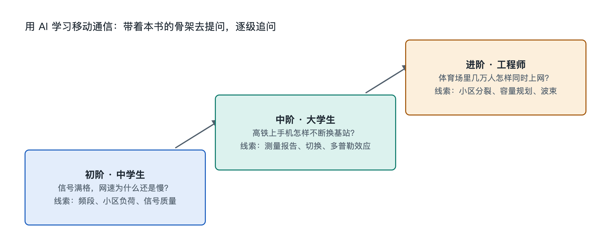

# 9.3 三阶提问阶梯：从中学生到工程师

晚上躺在床上刷视频，信号格从四格掉到两格，画面开始转圈。一个中学生可能会问 AI：“为什么墙越多信号越差？”一个通信专业的大学生会问：“室内穿透损耗大约有多少分贝，和频段有什么关系？”一位网络优化工程师则会问：“这个小区 RSRP 正常但 SINR 偏低，该先排查哪几类干扰？”三个人看到的是同一个现象，问出的却是三个层次的问题。

同一台手机、同一个信号格，可以支撑从入门到专业的整条学习路径。关键在于提问的方式。本节把前面八章的知识骨架，整理成一架可以拾级而上的“三阶提问阶梯”，帮助不同背景的读者把 AI 用成一位耐心的老师，而不是一台只会给答案的机器。

## 9.3.1 第一阶：现象之问——“是什么”和“为什么”

第一阶面向中学生和普通读者，出发点是看得见的现象，目标是建立正确的直觉。这一阶的提问有三个特点：

- **从实物出发**：描述你看到的东西，例如“地铁里信号格满格，但网速很慢”。
- **要求类比**：请 AI 用生活中的事物打比方，比如把频率复用比作“隔几个教室才能用同一套广播频道”。
- **追问一层原因**：得到答案后再问一次“为什么”，把现象和本书第三章的功能、第八章的原理连起来。

好的第一阶问题示例：“为什么手机在电梯里经常没信号？请用中学物理知识解释，并说说运营商一般怎么解决。”AI 通常会提到金属轿厢对电磁波的屏蔽，以及室内分布系统、小基站等手段——这正好对应本书 7.4 节的内容。

这一阶最容易犯的错误是把问题问得太空，例如“5G 是什么”。这样的问题只会换来一篇泛泛的介绍。把它改成“我的手机显示 5G，和显示 4G 时相比，信号从基站到我手里的路径有什么不同”，答案就会落到具体结构上。

## 9.3.2 第二阶：结构与机制之问——“怎样工作”

第二阶面向大学生、专业入门者和对技术好奇的职场人士。此时读者已经掌握了本书的骨架：终端、基站、核心网、传输网；信令流与数据流；多址、调制编码、MIMO、调度。提问的重点从“为什么”转向“怎样运作”。

这一阶的提问技巧是**给出上下文、限定范围、要求流程**。例如：

> “在 5G 独立组网（SA）中，手机开机后从搜索小区到能上网，依次经过哪些步骤？请按‘手机—基站—核心网’三方列出主要信令，并标明哪些步骤涉及鉴权。”

这样的问题明确了网络类型、参与方和输出格式，AI 的回答就更容易核对。读者可以拿本书 5.2 节的信令流描述、3.4 节的鉴权原理去比对，发现不一致之处再追问。

第二阶还特别适合用来“读数”。把手机工程模式或测网类 App 中看到的参数（如 RSRP、RSRQ、SINR、频段号、PCI）提供给 AI，请它解释每个参数的含义和典型范围。需要注意，不同手机厂商显示的字段名称和精度并不相同，应当请 AI 说明“这是公开资料中的常见范围”，而不是把某个数字当作标准答案。

## 9.3.3 第三阶：权衡与设计之问——“为什么这样设计，还能怎样”

第三阶面向工程师、研究者和需要做决策的职场人士。问题不再停留在“系统是什么样”，而是追问“为什么选择这种方案、代价是什么、条件变了怎么办”。这一阶对应本书第八章的原理溯源，尤其是 8.5 节的覆盖、容量与成本权衡。

典型的第三阶问题：

- “同样覆盖一片郊区，用低频段宏站和用中频段加密站点，在覆盖、容量、建网成本上各有什么取舍？请列出主要假设。”
- “网络切片在 5G 核心网中如何保证不同业务的隔离？在什么场景下切片的收益不足以抵消运维复杂度？”
- “开放无线接入网把基站软硬件解耦，对系统集成和故障定位会带来哪些新挑战？”

这一阶的关键是**要求 AI 写明假设和依据**。工程问题往往没有唯一答案，答案取决于频段、站址、用户密度和业务需求。请 AI 指出结论依赖的条件，并说明可以查阅的资料类型，例如 3GPP 技术规范（TS）与技术报告（TR）、ITU 建议书或运营商公开的白皮书。

## 9.3.4 三阶对照：同一现象，三种问法

| 阶梯 | 典型读者 | 关注点 | 以“视频卡顿”为例的提问 | 对应本书章节 |
|---|---|---|---|---|
| 第一阶 现象 | 中学生、普通读者 | 是什么、为什么 | 为什么信号满格视频还会卡？ | 第一、三章 |
| 第二阶 机制 | 大学生、入门者 | 怎样工作、怎样读数 | 小区用户多时，基站调度器怎样分配资源块？我手机的 SINR 低意味着什么？ | 第五、六章 |
| 第三阶 权衡 | 工程师、决策者 | 为什么这样设计、还能怎样 | 在高话务小区，扩容应优先加载波、加天线还是加站点？各自的代价是什么？ | 第七、八章 |

这张表也可以反过来用：遇到一个专业问题看不懂时，就往下退一阶，先把现象和机制弄清楚，再回到权衡层面。

## 9.3.5 让阶梯可靠的三条守则

无论站在哪一阶，都应遵守三条守则：

1. **核对来源**。AI 可能混淆不同代际或不同标准版本的细节，也可能编造数字。涉及标准内容时，请它指出对应的规范编号，并自行查证；涉及具体产品或网络部署时，要记住那只是某一时刻、某家企业的情况。
2. **用实物验证**。能在手机上看到的参数、能用测速 App 测出的结果，就亲自测一测，结合 9.2 节的动手实验，把 AI 的说法放回真实网络中检验。
3. **守住安全边界**。可以问鉴权、加密“为什么安全”“如何防范伪基站诈骗”，但不应索取干扰、窃听或绕过网络防护的操作步骤——这类请求既违法，也偏离了学习的目的。

三阶提问阶梯的意义在于：书给出稳定的骨架，手机提供随时可观察的实物，AI 则沿着阶梯带你一层层往下展开。从“信号格为什么会掉”到“网络为什么这样建”，每一次追问，都是对“边走边连”这套系统的又一次透视。下一节将把本章的方法汇总成一张可以长期使用的骨架清单。
