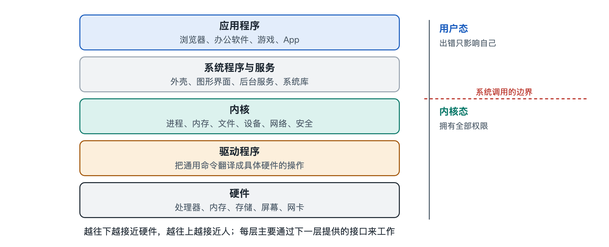

# 1.2 操作系统做什么：硬件的管家与应用的平台

打开手机，你可以一边听音乐，一边在聊天软件里打字，后台的地图还在记录你的位置，相册也在悄悄备份照片。这几件事各自都要用到处理器、内存、存储和网络，可你从没见过它们为了抢喇叭吵起来，也没见过聊天软件把相册里的照片改坏。这些事情能够相安无事，是因为有一位你看不见的“总管”在调度。这位总管就是操作系统（Operating System，OS）。

操作系统要同时向两个方向负责。向下，它管理一堆脾气各异的硬件；向上，它给成千上万的应用提供一个统一、可靠的工作平台。教科书常把这两面概括为“资源管理者”和“扩展机器”。下面分开来看。

## 1.2.1 向下：做硬件的管家

一台电脑或手机里，能被程序使用的硬件资源大致有四类：

| 资源 | 读者看得见的样子 | 稀缺在哪里 |
|---|---|---|
| 处理器（CPU） | 任务管理器里的“CPU 使用率” | 核心数量有限，每个核心同一时刻能执行的指令流很少（通常一到两条） |
| 内存（RAM） | 手机设置里的“运行内存” | 容量有限，掉电后内容丢失 |
| 存储（硬盘、固态硬盘、闪存） | “存储空间已用 XX GB” | 速度比内存慢得多，需要有组织地存放 |
| 外部设备与网络 | 摄像头、麦克风、Wi-Fi、蓝牙 | 往往同一时间只能交给一方使用，或需要排队 |

管家要做三件事。

第一是**分配**。处理器只有几个核心，正在运行的程序却可能有几十上百个。操作系统把处理器时间切成很短的片段，按一定规则轮流交给各个程序，每段通常是毫秒量级。切换得足够快，人看起来就觉得这些程序在“同时”运行。内存也一样，由操作系统决定谁用哪一块、用多少，不够时把哪些内容暂时挪走。

第二是**隔离**。聊天软件不应该读到银行应用的内存，一个程序崩溃也不应该拖垮整台机器。操作系统借助处理器提供的硬件机制，给每个程序划出边界，越界的访问会被拦下来。你在电脑上见过“某某程序已停止响应”，系统其他部分却照常运行，靠的就是这种隔离。

第三是**仲裁**。两个程序同时想用麦克风，或同时想写同一个文件，必须有人裁决先后，或者干脆拒绝其中一方。手机弹出“是否允许此应用使用相机”，就是一次摆到台面上的仲裁，最终决定权交给了你。

## 1.2.2 向上：做应用的平台

再换到应用开发者的角度。世界上的硬盘、网卡、显卡型号数不胜数，每一种的控制方式都不相同。如果每个应用都要自己去驱动每一种硬件，开发一款记事本恐怕都要耗上好几年。

操作系统的另一项工作，就是把这些杂乱的细节藏起来，换成少数几个整齐的概念，这叫**抽象**（abstraction）：

- 硬盘上一个个扇区、一块块闪存页，被包装成“**文件**”和“**文件夹**”；
- 处理器的寄存器和执行状态，被包装成“**进程**”和“**线程**”，也就是一个个正在运行的程序；
- 一段段物理内存芯片，被包装成每个程序眼中各自独立、连续的“**地址空间**”；
- 网卡收发的电信号，被包装成可以像读写文件一样使用的“**网络连接**”。

应用只要说一句“帮我打开这个文件”“帮我向这个网址发送数据”，具体怎样操作硬件，交给操作系统去办。应用向操作系统提出请求的正式通道叫**系统调用**（system call），第四章会专门讲。

这样做的好处很实在：同一款浏览器，装在不同品牌、不同配置的电脑上都能运行；你换了一块更快的固态硬盘，原来的软件不用改一行代码。硬件换代很快，应用却能跟着用下去，这是平台带来的稳定性。

## 1.2.3 两种角色的对照

把两个方向放在一起看，更容易记住：

| 角度 | 面对谁 | 核心问题 | 典型手段 |
|---|---|---|---|
| 硬件的管家 | 处理器、内存、存储、设备 | 资源怎样分得公平、安全、高效 | 调度、内存分配、访问控制 |
| 应用的平台 | 应用程序与开发者 | 怎样让软件写起来简单、跑起来可靠 | 文件、进程、地址空间等抽象，系统调用接口 |

这两种角色其实是同一件事的两面。正因为操作系统牢牢握着硬件的控制权，它才能向应用作出“你的数据不会被别人改坏”这类承诺；也正因为要兑现这些承诺，它才必须把硬件管得严丝合缝。

## 1.2.4 还有一位用户：你

除了硬件和应用，操作系统还面对着屏幕前的人。桌面、开始菜单、手机主屏幕、通知栏、设置界面，都是操作系统提供给人的入口。很多看起来平常的提示，背后都是总管在工作：

- “存储空间不足”：文件管理在提醒你资源快用完了；
- “某应用在后台耗电较多”：调度与电源管理在汇报账目；
- “是否允许访问位置信息”：安全与权限机制在请你拍板；
- “系统需要重启以完成更新”：系统正在替换自己的组成部分。

了解操作系统做什么，就能读懂这些提示真正在说什么，在电脑变卡、手机发热或遇到权限弹窗时作出判断，而不是凭感觉乱点。

## 1.2.5 小结：一位两头负责的总管

可以把操作系统想象成一栋写字楼的物业。它向下管理电梯、水电、门禁这些设施，向上为租户提供“刷卡进门、按键上楼”这类统一服务。租户不必知道电梯用的是哪家的电机，只要按规矩使用；物业则要保证电梯不超载，也不让甲公司的人走进乙公司的办公室。

不过，“物业”具体包括哪些人？前台、保安、维修工都算吗？租户自己装的设备又算不算？换到操作系统上，问题就是：哪些软件属于操作系统，哪些只是跑在它上面的应用。下一节讨论这条边界。
