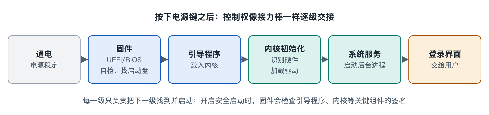

# 2.1 固件与引导程序：从通电到交出控制权

很多人都见过这样的画面：按下电脑电源键，屏幕先闪出主板或品牌厂商的标志，有时角落里还写着“按 F2 进入设置”“按 F12 选择启动设备”。几秒钟后标志消失，Windows 的旋转圆点或 Linux 的滚动文字才接着出现。手机开机时，厂商标志会停留片刻，然后才轮到系统的开机动画。

第一章已经说过，屏幕亮起前的那几秒并没有闲着。这一节把那段时间拆开来看：在操作系统真正登场之前，是谁先醒来，它做了哪些准备，最后又怎样把整台机器交给操作系统。

## 2.1.1 处理器醒来时“一无所知”

通电那一刻，处理器（CPU，中央处理器）的处境相当尴尬。内存（RAM，随机存取存储器）断电后内容会全部丢失，所以里面什么都没有。硬盘里虽然存着操作系统，但处理器还不知道硬盘接在哪里，更不知道怎样读取它。

硬件设计者的办法是事先做一个约定：处理器复位以后，总是从一个固定的地址开始取指令，这个地址叫“复位向量”。主板设计会让这个地址指向一块断电也不丢数据的存储芯片，通常是闪存（Flash）。芯片里烧录着最先运行的程序，这就是固件（Firmware）。

“固件”这个名字说明了它的位置。它是软件，但被固化在硬件里，平时很少改动，介于“硬”和“软”之间。可以把它看成一栋大楼的值班保安：业主（操作系统）还没到，保安先打开总闸、巡视各层，确认水电正常，再把钥匙交出去。

## 2.1.2 固件做的三件事

无论是电脑还是手机，固件的工作大致都可以归成三件事。

1. **自检与初始化**：检查处理器、内存等关键部件能否工作，配置内存控制器和时钟，让内存真正可用。在个人电脑上，这一步常被称为加电自检（POST，Power-On Self-Test）。电脑开机时发出的“嘀”声，或者故障时的报警声，就来自这个阶段。
2. **发现设备**：枚举硬盘、固态硬盘、USB 接口、显卡等设备，弄清楚机器上都接了哪些东西。
3. **找到并加载下一棒**：按照预先设置的启动顺序，在存储设备里找到引导程序，把它读进内存，然后跳过去执行。

个人电脑的固件经历过一次换代，对照如下：

| 对比项 | 传统 BIOS | UEFI |
|---|---|---|
| 全称 | 基本输入输出系统（Basic Input/Output System） | 统一可扩展固件接口（Unified Extensible Firmware Interface） |
| 年代 | 20 世纪 80 年代起用于 IBM PC 兼容机 | 2000 年代出现，2010 年代起在个人电脑上逐步普及，目前新电脑基本都采用 |
| 找引导程序的方式 | 读取磁盘第一个扇区（主引导记录 MBR），空间只有几百字节 | 读取专门的 EFI 系统分区，可以直接识别文件 |
| 磁盘分区方式 | 常配 MBR 分区表，单盘容量受限 | 常配 GPT 分区表，支持大容量磁盘 |
| 安全特性 | 基本没有 | 支持“安全启动”（Secure Boot） |

很多人至今仍把开机设置界面叫作“BIOS”，这只是习惯说法，大多数新电脑里运行的其实是 UEFI 固件。

## 2.1.3 引导程序：接力赛的中间一棒

固件不直接启动操作系统，中间还隔着一个引导程序（Bootloader），也常叫“启动加载器”。原因是固件必须通用，不可能认识世界上所有操作系统。于是职责做了拆分：固件负责“找到并启动引导程序”，引导程序负责“认识某个具体的操作系统并把它启动起来”。

不同系统常见的做法如下（以写作时的情况为准）：

- **Windows**：使用 Windows 启动管理器（Windows Boot Manager），由它加载 Windows 的启动程序，再由启动程序加载内核。
- **Linux**：桌面和服务器上常用 GRUB（GRand Unified Bootloader），开机时出现的那张可以选择“Ubuntu”或“Windows”的菜单就是它提供的。
- **安卓手机**：芯片厂商的启动代码之后会运行一个引导程序，常被称为 bootloader。所谓“解锁 bootloader”，就是允许它加载非官方签名的系统。

引导程序的核心工作有三项：把操作系统内核（以及启动所需的一个小型临时文件系统）从磁盘读进内存，按要求准备好启动参数，然后把处理器的执行位置跳到内核入口。跳转完成的那一刻，控制权正式交给了操作系统。从这里开始，接下来几章要讲的内核、驱动和进程才陆续登场。

## 2.1.4 信任链：为什么启动要“验明正身”

启动过程中最先运行的代码权限最高，也最难被察觉。一种叫 bootkit 的恶意程序就专门藏在这个阶段，它比操作系统先运行，杀毒软件很难发现它。为此，现代系统引入了“信任链”的思路：每一棒在交接之前，都先核对下一棒的数字签名，签名不对就拒绝运行。

- UEFI 的**安全启动**会检查引导程序的签名是否来自受信任的厂商。Windows 11 的安装要求中就包含 UEFI 与安全启动，以及可信平台模块（TPM）。
- 苹果的 iPhone 从芯片里固化的只读启动代码（Boot ROM）开始，逐级校验签名。这是苹果公开安全文档中描述的做法。
- 许多安卓设备采用“验证启动”（Verified Boot）。解锁 bootloader 后，开机时往往会出现一条警告，提示系统完整性无法保证。

这就像接力赛里的每一棒都要查验身份证。哪一环被冒名顶替，比赛就停下来。

## 2.1.5 小结

从通电到操作系统接手，可以概括为一条链：**复位向量 → 固件（自检、发现设备）→ 引导程序 → 内核**。固件让一台“一无所知”的机器具备最基本的运行能力，引导程序负责找到具体的操作系统并把它请进内存，信任链则保证这一路交接没有被冒名顶替。控制权交出去以后，真正的主角内核开始工作。下一节我们就打开内核，看看它的内部结构。
