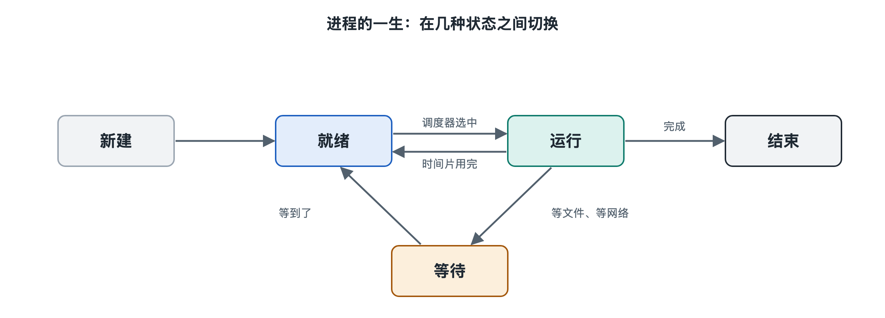

# 3.1 进程管理：让很多程序同时运行

现在打开你电脑上的任务管理器。Windows 上同时按下 Ctrl+Shift+Esc，macOS 上打开“活动监视器”。列表里通常有上百个条目：浏览器、聊天软件、音乐播放器，还有许多你从没听说过的名字。你的电脑可能只有 4 到 16 个处理器核心，却同时“运行”着上百个进程。这件事靠的是操作系统的进程管理。

## 3.1.1 程序与进程：菜谱和正在做的菜

先分清两个常被混用的词。**程序**（Program）是存放在硬盘上的一个文件，里面是写好的指令，比如浏览器的安装目录里那个可执行文件。**进程**（Process）是程序被运行起来之后的样子，也就是一次正在进行的执行活动。

可以用厨房来类比。菜谱写在纸上，不会自己变成菜，它相当于程序。厨师照着菜谱开火、切菜、下锅的那个过程相当于进程。同一份菜谱可以同时被两位厨师照着做，于是有两道正在做的菜。同理，同一个程序可以同时开出好几个进程。你在任务管理器里常会看到多个同名的浏览器进程，原因就在这里。

操作系统为每个进程准备一份“档案”，教科书里叫**进程控制块**（Process Control Block，PCB）。档案里记录的主要内容如下：

| 档案项目 | 记录什么 | 厨房里的对应物 |
|---|---|---|
| 进程编号（PID） | 系统内唯一的身份号 | 订单号 |
| 运行状态 | 正在运行、等待或就绪 | 正在炒，还是在等水开 |
| 寄存器与程序计数器 | 执行到哪一条指令 | 菜谱读到第几步 |
| 内存信息 | 占用了哪些内存区域 | 用了哪块案板 |
| 打开的文件与设备 | 正在使用的资源 | 手里拿着哪些锅铲 |
| 所属用户与权限 | 谁启动的，能做什么 | 哪位厨师负责 |

任务管理器“详细信息”页里的 PID 一栏，显示的就是这份档案的编号。

## 3.1.2 一个进程的一生：状态的转换

进程从创建到结束，会在几种状态之间来回切换。教科书中最常见的模型分为五种状态：

1. **新建**：系统正在为它分配档案和内存。
2. **就绪**：一切准备好，只等轮到处理器。
3. **运行**：正在某个处理器核心上执行指令。
4. **等待**（也叫阻塞）：在等某件事发生，例如等硬盘读出数据、等网络消息到达、等你按下键盘。
5. **终止**：执行完毕或被关闭，系统回收它占用的资源。

关键在于“等待”这一状态。大多数进程在绝大部分时间里并不需要处理器。聊天软件在你没收到消息时只是在等，文本编辑器在你没打字时也只是在等。所以活动监视器里多数进程的 CPU 占用接近 0%。几百个进程里，真正同时排队要用处理器的，往往只有少数几个。

## 3.1.3 “同时运行”的真相：快速轮换

一个处理器核心在某一瞬间只能执行一个进程的指令。之所以看起来有很多程序同时运行，是因为操作系统让它们**轮流**使用处理器，而且轮换得非常快。

具体过程是这样的：系统给运行中的进程一小段时间，称为**时间片**，常见量级在几毫秒到几十毫秒之间。时间片用完，或者进程主动进入等待，系统就把这个进程当前的执行现场，也就是寄存器内容和执行位置，存回它的档案；再取出下一个进程的档案，恢复它的现场，让它接着上次停下的地方继续执行。这个动作叫**上下文切换**（Context Switch）。

人对时间的分辨能力大约在几十到上百毫秒这一量级，每秒钟发生成百上千次切换，人是察觉不到的，看起来就像音乐和打字同时在进行。这种交替推进叫**并发**（Concurrency）。多核处理器上，几个核心可以真正各自执行不同进程，这叫**并行**（Parallelism）。现代电脑和手机两者兼有：几个核心并行工作，每个核心上又有多个进程并发轮换。

上下文切换并非没有代价，保存和恢复现场都要花时间。切换太频繁，处理器就会把不少时间耗在“交接班”上。谁先运行、每次运行多久，由调度策略决定，第六章 6.1 节会专门讲。

## 3.1.4 线程：一个进程里的多位帮手

再看浏览器。网页在加载图片的同时，你仍然能滚动页面。这是因为一个进程内部还可以再分出多条执行路线，称为**线程**（Thread）。

回到厨房：进程好比一间独立的厨房，有自己的案板、灶台和食材；线程好比同一间厨房里的几位厨师，共用这些东西，各自负责一部分工作，一位炒菜，一位煮汤。两者的区别可以这样对照：

| 对比项 | 进程 | 线程 |
|---|---|---|
| 资源 | 各自拥有独立内存空间 | 同一进程内的线程共享内存 |
| 创建和切换开销 | 较大 | 较小 |
| 相互影响 | 一个进程崩溃，通常不影响其他进程 | 一个线程出错，可能拖垮整个进程 |
| 协作方式 | 需要借助系统提供的通信机制 | 可以直接读写共享数据 |

正因为进程之间相互隔离，一个网页卡死时，往往只需要关掉对应的那个标签页。以 Chrome 为代表的多种主流浏览器采用多进程架构，把不同网页放进不同进程，这是它们的设计选择，不是所有程序都这样做。共享内存方便了线程之间协作，也带来了新问题：两个线程同时修改同一份数据，结果可能出错。这正是第六章 6.4 节“同步与死锁”要讨论的内容。

## 3.1.5 手机上的进程：更严格的管家

手机的电量和内存都更紧张，Android 和 iOS 管理进程也更严格。按写作时的公开资料，两者通常会限制退到后台的应用：iOS 一般在应用进入后台后很快将其挂起，只允许特定类型的任务，如音乐播放、导航，在后台继续运行；Android 在内存紧张时，会按优先级结束后台进程，并对后台活动加以限制。所以你从多任务界面切回某个应用时，它有时会重新加载。这并不是故障，而是系统为了省电、省内存，提前结束了这个进程。

## 3.1.6 小结

进程管理要做三件事：为每个运行中的程序建立档案并跟踪它的状态；让它们在有限的处理器核心上快速轮换，看起来同时运行；在进程之间建立隔离，必要时允许它们协作。不过，每个进程都需要一块属于自己的内存空间，这块空间从哪里来、怎样保证互不侵犯，是下一节内存管理要回答的问题。
