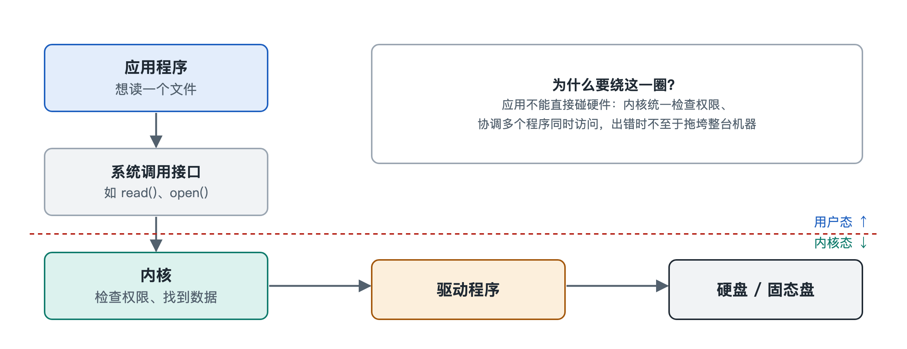

# 4.1 应用与系统：系统调用与应用编程接口

打开手机上的记事本，写下一行字，点“保存”。不到一秒，这行字就安全地躺进了存储芯片。可是记事本这个应用自己并不知道存储芯片的电路怎样工作，也无权直接去碰它。真正把字写进芯片的，是操作系统。应用和操作系统之间隔着一道明确的“窗口”，应用只能在窗口前递上请求，由系统在里面替它办事。这道窗口就是本节的主角：系统调用（System Call）和应用编程接口（Application Programming Interface，API）。

## 4.1.1 银行柜台：应用为什么不能“自己动手”

可以把操作系统想象成一家银行。金库里放着硬件资源，包括处理器时间、内存、硬盘、网卡、摄像头。顾客就是各个应用。银行不会让顾客自己走进金库拿钱，所有业务都要在柜台办理：顾客填好单子递进去，柜员核对身份和余额，再进金库操作，最后把结果递出来。

这样安排有三个理由：

- **安全**：如果任何应用都能直接读写硬盘，一个恶意程序就能删掉别人的文件，甚至改写系统本身。
- **秩序**：几十个应用同时想用网卡，必须有人统一排队，否则数据会互相踩踏。
- **简化**：硬盘有上百种型号，应用开发者不可能为每一种写一遍代码。柜台把差异挡在后面，应用只需说“把这些数据存成一个文件”。

在计算机里，这个柜台由硬件和操作系统共同支撑。处理器区分两种运行状态：应用运行在权限受限的**用户态**（User Mode），内核运行在权限完整的**内核态**（Kernel Mode）。用户态的程序执行某些敏感指令时，处理器会直接拒绝。应用想办“金库业务”，唯一合法的途径就是发起系统调用，请内核代办。用户态和内核态的切换细节，第六章 6.5 节还会展开。

## 4.1.2 系统调用：递进柜台的那张单子

系统调用是内核对外公开的一组“服务项目”，每一项都有编号和规定格式。以类 Unix 系统（如 Linux、macOS）为例，常见的系统调用可以这样分类：

| 类别 | 典型系统调用（类 Unix 系统中的名称） | 通俗含义 |
|---|---|---|
| 文件 | open、read、write、close | 打开、读、写、关闭文件 |
| 进程 | fork、exec、exit、wait | 创建进程、运行新程序、退出、等待子进程 |
| 内存 | mmap、brk | 申请或映射一块内存 |
| 网络 | socket、connect、send、recv | 建立网络连接、收发数据 |
| 信息 | getpid、时间相关调用 | 查询自身编号、当前时间等 |

Windows 内核也有自己的一套系统调用（如 NtCreateFile 之类），名称和编号与类 Unix 系统完全不同。一般认为，一个主流内核提供的系统调用数量在几百个这个量级。数量不算多，却支撑着成千上万种应用。

一次系统调用大致经历以下几步：

1. 应用把“要办什么业务”的编号和参数放到约定的位置（通常是处理器的寄存器）；
2. 执行一条专门的陷入指令，比如 x86-64 处理器上的 syscall 指令，处理器随即切换到内核态，并跳到内核预先登记好的入口；
3. 内核检查参数是否合法、调用者是否有权限，然后真正去操作硬件或内核数据；
4. 内核把结果或错误码放回约定位置，切回用户态，应用从下一条指令继续执行。

这个过程就像递单、核验、办理、回执。切换状态本身有开销，所以频繁的小额系统调用会拖慢程序。这也是许多程序在内存里攒一批数据、再一次性写盘的原因之一。

## 4.1.3 API：柜台外面那本更友好的“办事指南”

几乎没有应用开发者会亲手写陷入指令。他们调用的是更高一层的 **API**，也就是系统或程序库公开的一套函数接口。API 内部再去发起系统调用。

还是用银行打比方：系统调用是柜台内部使用的标准单据，API 是大堂里那本办事指南，外加一位帮你填单的引导员。你说“我要转账”，引导员可能替你填好两三张单子。

几个常见的例子：

- **C 标准库**：程序员调用 printf 打印文字，库函数先整理格式、放进缓冲区，攒够了再调用 write 系统调用。
- **POSIX**（Portable Operating System Interface，可移植操作系统接口）：一套国际标准接口，Linux、macOS 等类 Unix 系统都在很大程度上遵循它，因此同一份程序往往稍作修改就能在这些系统间移植。
- **Win32 API**：Windows 上传统的应用接口，比如 CreateFile、ReadFile。微软一直把这一层作为对外的稳定承诺，底层的系统调用则可以随版本调整。
- **移动平台框架**：Android 应用通过 Android 框架提供的 Java/Kotlin 接口工作，iOS 应用通过苹果提供的框架工作。它们离内核更远，中间隔着好几层。

于是，记事本的“保存”一层层往下走：

> 点击保存 → 应用调用框架的“写文件”接口 → 系统库函数 → write 等系统调用 → 内核文件系统 → 驱动程序 → 存储芯片

## 4.1.4 稳定接口：应用生态的“合同”

API 分层带来一个很重要的好处：**稳定性**。只要接口不变，内核内部怎么重写都不影响应用。这是一份系统与应用之间的“合同”。Linux 内核社区有一条广为人知的原则，大意是“不破坏用户空间”，即已经对外提供的系统调用行为不应随意改变，否则会让大量现有程序失灵。Windows 能运行许多年前编写的老程序，也得益于它长期维持 API 兼容。

反过来，接口也是一道安全关口。当手机弹出“是否允许此应用访问相机”时，背后正是系统在 API 和系统调用这一层做权限把关：应用申请打开相机，系统先查授权，没有授权就直接返回拒绝。第三章讲到的权限机制，正是在这里落地。

## 4.1.5 小结

应用与操作系统的关系，可以归结为“申请—代办—回执”：应用在用户态通过 API 提出需求，API 转化为系统调用，处理器切换到内核态，由内核核验后代为操作硬件。系统调用是底层的硬边界，API 是面向开发者的友好封装，两层共同保证了安全、秩序和兼容。

不过，内核在柜台后面拿到请求之后，又是怎样指挥真实硬件的？硬盘写完了怎样通知内核？这就要走进下一节，看看内核与硬件之间的中断、寄存器与总线。
