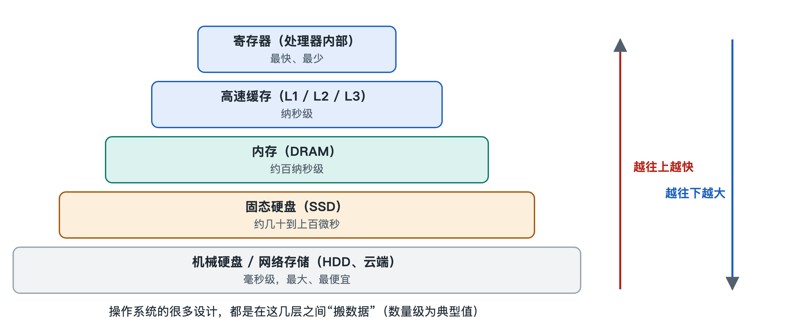

# 5.3 数据流：一次读写文件的完整旅程

在电脑上打开一篇昨天写到一半的文档，改了两段话，按下 Ctrl+S（在 Mac 上是 Command+S），屏幕角落的“已保存”一闪而过。整个过程不到一秒。但在这不到一秒里，数据穿过了应用程序、操作系统内核、文件系统、设备驱动、存储控制器，最后才落到固态硬盘的闪存颗粒上。打开文件时，数据沿着这条路反向走一遍。本节把这两趟旅程拆开来看，看清每一站做了什么，以及为什么要这样安排。

## 5.3.1 第一站：应用发出请求，系统调用把它送进内核

文字处理软件自己并不知道硬盘在哪里，也无权直接操作硬盘。它能做的，是向操作系统提出请求。以打开文件为例，应用会调用一个“打开”接口，告诉系统要打开的路径，比如“文档/周报.docx”。这个请求通过**系统调用（System Call）**从用户态进入内核态。系统调用是应用请求内核服务的唯一正式通道，第 4.1 节介绍过它，第 6.5 节还会细讲背后的特权级切换。

内核收到请求后先做两件事。第一，**解析路径**：从根目录或当前目录出发，一层层找到“文档”目录，再在其中找到“周报.docx”对应的记录。第二，**检查权限**：当前用户有没有读这个文件的资格，这一步对应第 3.5 节讲的权限模型。两项都通过后，内核返回一个小小的编号，在 Linux、macOS 这类类 Unix 系统里叫**文件描述符（File Descriptor）**，在 Windows 里对应的是**句柄（Handle）**。此后应用读写这个文件，只需出示这个编号，不必每次重报路径。

这就像去图书馆借书：先在服务台报书名、验借书证，馆员给你一张取书单，之后凭单据办事即可。

## 5.3.2 第二站：虚拟文件系统与具体文件系统

同一台电脑上可能同时挂着几种格式不同的存储：系统盘可能是 NTFS（Windows）或 APFS（macOS）、ext4（许多 Linux 发行版），U 盘常见 FAT32 或 exFAT，还可能有网络共享盘。应用却用同一套“打开、读、写、关闭”去操作它们，靠的是一层统一的抽象。Linux 把这一层叫作**虚拟文件系统（Virtual File System，VFS）**，其他系统也有作用类似的设计，名称和实现各不相同。

VFS 像一位前台总调度：它对上提供统一接口，对下把请求转交给具体的文件系统。具体文件系统负责把“文件第 0 到 4095 字节”这种逻辑说法，翻译成“磁盘上第几号块”这种物理位置。它查阅自己维护的索引结构，比如 ext4 中的索引节点（inode），找到数据实际存放的位置。目录、索引和日志的细节留到第 6.3 节。

## 5.3.3 第三站：页缓存——大多数读写其实没碰硬盘

这是整趟旅程中最容易被忽略、也最关键的一站。内核会在内存里开辟一块区域，专门存放最近读写过的文件数据，Linux 中称为**页缓存（Page Cache）**，Windows 和 macOS 也有各自的文件缓存机制。

读文件时，内核先查缓存。如果数据已经在内存里（称为“命中”），直接复制给应用，不必惊动硬盘；没有命中，才向下发起真正的读取，读回来的数据同时留一份在缓存里，以备下次使用。这就是为什么同一个大文件第二次打开往往明显更快。

写文件时更值得注意。应用按下保存后，内核通常只是把新数据写进页缓存，把对应的内存页标记为“脏页”，然后就告诉应用“写好了”。真正写到硬盘，要等稍后由内核在后台集中完成，这种做法叫**写回（Write-back）**。

| 环节 | 读文件 | 写文件 |
|---|---|---|
| 先找谁 | 页缓存 | 页缓存 |
| 何时碰硬盘 | 缓存未命中时 | 后台定期写回，或应用主动要求立即落盘 |
| 主要好处 | 重复读取快 | 应用不必等待慢速设备，零散小写可合并 |
| 主要风险 | 几乎没有 | 突然断电时，尚未落盘的数据可能丢失 |

所以“已保存”不一定等于“已经在硬盘上”。对数据可靠性要求高的程序，比如数据库，会调用专门的接口（类 Unix 系统中的 `fsync`）要求内核立即把数据刷到存储设备上。拔 U 盘前要先点“安全弹出”，原因也在这里：系统需要把缓存里的脏数据写完。

## 5.3.4 第四站：块设备层、驱动与硬件

确实需要访问硬盘时，文件系统把请求交给**块设备层**。硬盘对操作系统来说是一排编了号的固定大小数据块，块设备层负责把多个请求排队、合并、调整顺序。对机械硬盘，按磁头移动路线重新排序能明显减少寻道时间；对固态硬盘，这类排序意义下降，系统通常采用更简单的策略。

请求接着交给**设备驱动**（第 2.3 节）。驱动按照硬盘接口的规范，比如 SATA 或 **NVMe（非易失性存储器快速接口）**，把命令写进控制器，并告诉它数据在内存中的位置。真正的数据搬运多由**直接内存访问（Direct Memory Access，DMA）**完成：存储控制器直接在硬盘和内存之间传输数据，处理器无需逐字节参与，可以去运行别的程序。

搬运完成后，控制器发出**中断**通知处理器（第 5.2 节）。内核据此标记请求完成，唤醒一直在等待的那个进程，数据经由页缓存交到应用手里。屏幕上，文档的文字出现了。

## 5.3.5 把整条路连起来

读取一次文件的完整路径可以概括为：

1. 应用调用“读”接口，经系统调用进入内核；
2. VFS 把请求分派给具体文件系统；
3. 查页缓存，命中则直接返回；
4. 未命中则由文件系统换算出块位置，交给块设备层排队；
5. 驱动向控制器下达命令，DMA 把数据搬进内存；
6. 中断通知完成，内核唤醒进程，数据交给应用。

这条路上，每一层只关心自己的事：应用只认文件名和编号，文件系统只认块号，驱动只认控制器命令。分层让一个“保存”动作能在各式各样的硬盘和文件格式上都成立；缓存和 DMA 让慢速的存储设备不至于拖住整台电脑。数据流说清了“东西怎样从硬盘走到应用”，下一节转向另一种流动：你的一次点击，怎样以事件和消息的形式一路传到应用窗口。
