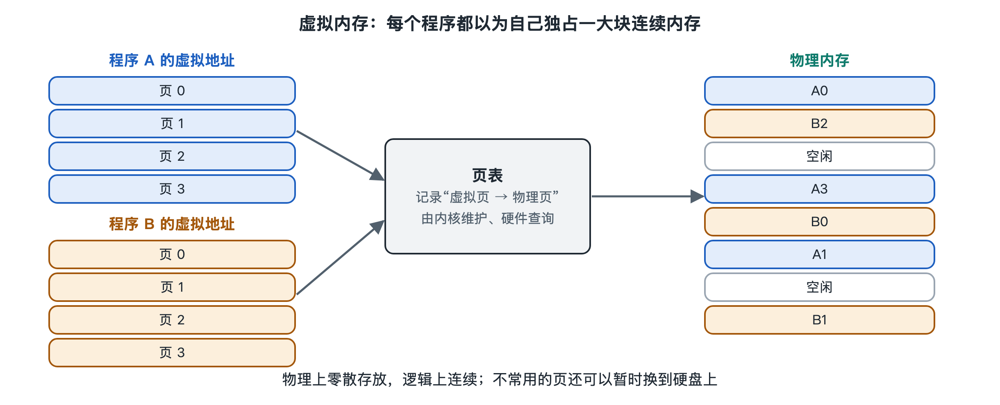

# 6.2 虚拟内存：分页、换页与地址转换

打开电脑的任务管理器（Windows）或活动监视器（macOS），你常会看到一个奇怪的现象：所有程序占用的内存加起来，似乎已经超过了机器实际装的内存条容量，可电脑并没有因此崩溃，只是偶尔变慢一点。手机上也类似：切回一个早上打开过的应用，它有时还停在原处，有时却要重新加载。这背后起作用的就是虚拟内存（Virtual Memory）。第三章说过，操作系统给每个程序一块“自己的”空间；本节要拆开看这块空间是怎样用分页、地址转换和换页一层层搭出来的。

## 6.2.1 每个程序看到的都是“假地址”

先做个类比。一栋公寓楼里，每户人家的门牌都从“101”编起，住户只记自家的编号；物业手里有一张对照表，知道“张家的101”其实是楼里第几层第几间。住户之间互不知道对方的真实位置，也就不会走错门。

虚拟内存就是这张对照表。程序运行时使用的地址叫虚拟地址（Virtual Address），每个进程都以为自己独占一整片从零开始的连续地址空间。内存条上真实存在的位置叫物理地址（Physical Address）。程序每次读写内存，都要先把虚拟地址翻译成物理地址。这样做带来三个直接好处：

- **隔离**：甲程序无法通过地址访问到乙程序的数据，一个程序出错不容易连累别人；
- **方便**：程序不必关心自己被放在内存条的哪个角落；
- **超额**：所有程序声称使用的空间之和可以大于物理内存，暂时不用的部分可以挪到别处。

## 6.2.2 分页：把内存切成大小相同的格子

如果按字节逐个记录对应关系，对照表会比内存本身还大。实际做法是分页（Paging）：把虚拟地址空间切成固定大小的“页”（Page），把物理内存切成同样大小的“页框”（Page Frame），只记录“第几页放在第几个页框”。在常见的 x86 和 ARM 处理器上，基本页大小通常是 4KB，有些系统也支持 16KB 或 2MB 等更大的页。比如苹果搭载自研芯片的 Mac 和 iPhone 默认使用 16KB 页，这是特定平台的选择，不是通用标准。

记录对应关系的表叫页表（Page Table），每个进程一份，由操作系统内核维护。一个虚拟地址被拆成两段：前一段是页号，用来查表；后一段是页内偏移，原样保留。查到页框号后，再拼上偏移，就得到物理地址。

| 概念 | 类比 | 由谁维护 |
|---|---|---|
| 虚拟页 | 住户心中的门牌号 | 程序使用 |
| 物理页框 | 楼里真实的房间 | 硬件提供 |
| 页表 | 物业的对照表 | 操作系统内核 |
| 页表项中的权限位 | 门禁卡权限 | 内核设置，硬件检查 |

页表项里除了页框号，还有几个标志位：这一页是否在内存中、能否写入、能否当作代码执行、最近是否被访问过、是否被修改过。后两个标志正是下文换页决策的依据。

由于地址空间很大，现代 64 位系统的页表通常做成多级结构，像“省—市—区—街道”逐级查找，没用到的区域就不必建表，从而节省空间。

## 6.2.3 地址转换由硬件完成：MMU 与 TLB

程序每秒访问内存的次数数以亿计，翻译不可能交给软件逐次完成。处理器内部有专门的内存管理单元（MMU，Memory Management Unit），它自动查页表、做翻译、检查权限。操作系统负责把页表准备好，并在切换进程时告诉 MMU“现在用哪一份表”。

多级页表查一次要访问好几次内存，仍然太慢。因此 MMU 里有一个小而快的缓存，叫转换后备缓冲区（TLB，Translation Lookaside Buffer），专门记住最近用过的翻译结果。由于程序访问内存具有局部性，短时间内总在少数几页里打转，大多数翻译都能在 TLB 中直接命中。这一点第八章讲缓存时还会展开。也正因为如此，切换进程往往会让 TLB 里的旧记录失效或不再可用（现代处理器用地址空间标识等机制减轻这一影响），这是进程切换有成本的原因之一。

## 6.2.4 缺页与换页：内存不够时怎么办

如果 MMU 发现某页标记为“不在内存”，就会触发缺页异常（Page Fault），处理器暂停当前程序，把控制权交给内核。缺页并不都意味着出错，常见情况有三种：

1. **首次访问**：程序刚申请的内存，内核采用“用到才分配”的策略，此时才真正分配页框；
2. **从文件加载**：程序代码按需从磁盘读入，没执行到的部分根本不进内存；
3. **被换出过**：这一页之前因内存紧张被挪到磁盘，现在要换回来。

第三种就是换页（Swapping/Paging Out）。物理内存吃紧时，内核挑出一些近期不太用的页，修改过的写到磁盘上的交换区（Linux 称为 swap，Windows 称为页面文件 pagefile.sys），没修改过的直接丢弃，需要时再从原文件重读。挑选的思路大多是近似“最近最少使用”（LRU，Least Recently Used），借助页表项里的“访问过”标志来估计。

磁盘比内存慢得多，即便是固态硬盘，访问延迟通常也比内存高出几个数量级。如果频繁换进换出，电脑会出现硬盘灯狂闪、操作卡顿的状态，这叫系统颠簸（Thrashing）。这就是开太多标签页时电脑突然“变慢”的根源。

手机系统的取舍有所不同。闪存有写入寿命，iOS 传统上不使用磁盘交换区，内存紧张时直接结束后台应用；Android 则常用 zram，即在内存中划出一块压缩区来存放换出的页；macOS 和较新的 Windows 也会先压缩内存，再考虑写盘。这就解释了开头的现象：切回的应用有时还在，是因为它的页被保留或压缩了；有时要重新加载，是因为它的进程已被系统回收。

## 6.2.5 小结：一张表撑起的“假象”

虚拟内存的核心，是在程序和内存条之间加了一层由内核编写、由硬件执行的对照表。分页让对照表变得可管理，MMU 和 TLB 让翻译足够快，缺页与换页让有限的物理内存可以“超额”使用，权限位顺带实现了隔离与保护。下一节把目光从内存转向磁盘，看文件系统怎样用目录、索引和日志，把数据可靠地长期保存下来。
