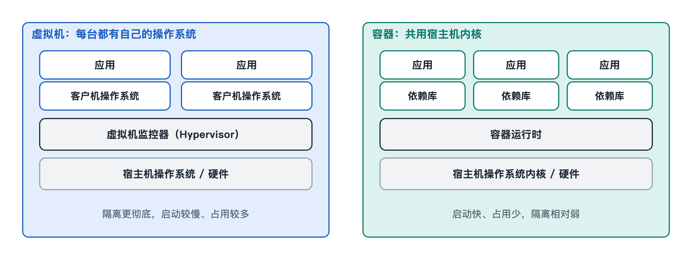

# 7.3 虚拟化与容器

在一台 Windows 笔记本上打开 VirtualBox 或 VMware，点一下“启动”，一个窗口里就跑起了完整的 Ubuntu。它有自己的开机画面、桌面和文件系统，甚至以为自己独占着一台电脑。另一个场景出现在软件公司：工程师敲一行 `docker run`，几秒钟后一个数据库服务就运转起来，删掉它也只要一秒。前者叫虚拟机，后者叫容器。第四章已经把它们放在“操作系统与云”的关系里介绍过，本节换一个角度，打开这两项技术的内部结构，看它们分别靠什么机制，把“一台机器”变成“很多台机器”。

## 7.3.1 虚拟机：把硬件“假装”出来

虚拟化（Virtualization）的基本想法，是用软件模拟出一套硬件，让一个完整的操作系统在上面运行。负责模拟和分配硬件的那层软件，叫虚拟机监视器（Virtual Machine Monitor，VMM），也常叫 Hypervisor，直译是“管理者之上的管理者”。这个名字很贴切：操作系统内核本来是硬件的管家，Hypervisor 则站在好几位管家之上，给每位管家分一块地盘。

Hypervisor 通常分为两类：

| 类型 | 运行位置 | 典型例子 | 常见用途 |
|---|---|---|---|
| 第一类（裸机型） | 直接装在硬件上，下面没有通用操作系统 | VMware ESXi、Xen、微软 Hyper-V | 数据中心、云服务器 |
| 第二类（托管型） | 作为应用运行在已有操作系统之上 | VirtualBox、VMware Workstation | 个人电脑上试用其他系统 |

Linux 内核中的 KVM（基于内核的虚拟机）不太好归类。它把 Linux 内核本身变成了 Hypervisor，所以通常被看作接近第一类。

被模拟出来的那台电脑里运行的系统叫“客户机”（Guest），承载它的叫“宿主机”（Host）。客户机内核会尝试执行特权指令，比如修改页表、关闭中断。这些操作如果直接落到真实硬件上，就会干扰宿主机和其他客户机。早期的做法是由 Hypervisor 拦截这些指令，或者在运行前把它们翻译成安全的代码，开销比较大。后来 Intel 推出 VT-x、AMD 推出 AMD-V，在处理器里增加了专门的“客户机模式”：普通指令在硬件上全速执行，只有敏感操作才“陷入”到 Hypervisor 处理。这和第六章讲的用户态陷入内核态是同一个思路，只是在原有的层级之下又加了一层。内存方面也有对应的硬件支持，Intel 叫 EPT，AMD 叫 NPT。处理器用两级地址转换，把“客户机以为的物理地址”再换算成“真正的物理地址”。

还有一种折中做法叫半虚拟化（Paravirtualization）。客户机知道自己跑在虚拟机里，于是不去冒充驱动真实网卡和硬盘，而是使用专门为虚拟环境设计的驱动，直接和 Hypervisor 交接数据。Linux 世界常用的 virtio 驱动就属于这一类，它能明显减少 I/O 的额外开销。

## 7.3.2 容器：共享内核，隔开视野

容器（Container）走的是另一条路。它不模拟硬件，也不运行第二个内核。所有容器共用宿主机的同一个内核，只是让每组进程“看到”的世界不一样。打个比方，虚拟机像在一块地上盖几栋独立的房子，每栋都有自己的地基和水电；容器像一栋公寓里的几套房间，共用地基和管线，各自锁门。

在 Linux 上，容器主要靠内核提供的三类机制组合实现：

- **命名空间（Namespace）**：负责隔离“看得见什么”。进程命名空间让容器里的程序以为自己是 1 号进程；网络命名空间给它单独的网卡和 IP 地址；挂载命名空间让它看到一套独立的目录树。此外还有用户、主机名、进程间通信等命名空间。
- **控制组（Control Groups，cgroups）**：负责限制“能用多少”。比如这组进程最多用两个 CPU 核心、512MB 内存，超出就被节流，或者由内核终止。
- **分层镜像与联合文件系统**：容器镜像由若干只读层叠在一起，最上面再加一层可写层。十个容器可以共用同一份底层镜像，各自只记录自己改动的部分。

Docker 这类工具并没有发明新的内核功能。它把这些已有机制打包，再配上镜像格式和命令行，让人能方便地使用。后来行业成立了开放容器倡议（OCI），把镜像格式和运行时接口标准化了。所以今天用 Docker、Podman 等不同工具构建的镜像，通常可以互相通用。

需要说明的是，命名空间和 cgroups 是 Linux 的机制。Windows 有自己的容器实现。在 Mac 或 Windows 上运行 Linux 容器时，工具通常会先在后台启动一台轻量的 Linux 虚拟机，再在里面运行容器，因为容器必须使用 Linux 内核。

## 7.3.3 两者对照：隔离强度与轻巧程度

| 维度 | 虚拟机 | 容器 |
|---|---|---|
| 隔离边界 | 硬件层，每台有独立内核 | 内核层，共享同一内核 |
| 启动时间 | 通常为数十秒量级 | 通常为秒级甚至更短 |
| 体积 | 镜像常为 GB 量级 | 镜像常为几十 MB 到数百 MB |
| 能否运行不同系统 | 可以，例如 Linux 上运行 Windows | 只能运行与宿主内核兼容的系统 |
| 安全隔离 | 较强，攻击需要突破 Hypervisor | 较弱，内核漏洞可能波及所有容器 |

这张表里的数字是公开资料中的常见量级，实际情况会随配置不同而变化。两者的取舍很清楚：容器更轻、更快，但大家共用一个内核，隔离也就薄了一层。为了兼顾两头，业界出现了“微虚拟机”和“沙箱容器”。亚马逊开源的 Firecracker 可以在很短时间内启动极简虚拟机，谷歌开源的 gVisor 则在容器和真实内核之间加了一层用户态的“替身内核”。截至写作时，它们都用在需要同时承载大量不同客户代码的云服务中。

## 7.3.4 从单机到集群：编排

一台服务器上可以跑几十个容器，一个数据中心里则可能有成千上万个。决定哪个容器放在哪台机器上、挂掉之后怎样自动重启、访问量上升时怎样扩容，这类工作叫“编排”（Orchestration）。写作时最广泛使用的开源编排系统是起源于谷歌的 Kubernetes（常缩写为 K8s）。从操作系统的视角看，它像是把整个集群当成一台大计算机，在上面做“调度”和“资源分配”。第六章讨论的调度问题，在这里换到了更大的规模上。

回头看，虚拟机和容器都在回答同一个老问题：怎样让多个使用者安全、公平地共享一套硬件。虚拟机在硬件这一层切分，容器在内核这一层切分，两者都离不开处理器特权级、地址转换和资源计量这些前面讲过的机制。下一节转向另一类系统，它关心的不是“多少人共享”，而是“能不能准时完成”。
