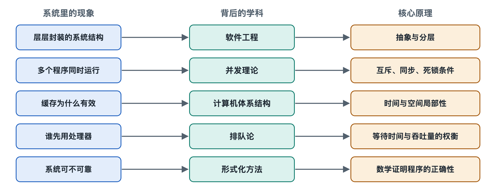

# 8.1 抽象与分层：把复杂问题拆开

打开电脑里的任意一个文件夹，双击一张照片，它就出现在屏幕上。你不需要知道这张照片存在固态硬盘的哪一块闪存芯片里，也不需要知道显卡用什么信号驱动屏幕上的每个像素。再想想手机：同一个聊天应用，可以装在不同厂商、不同芯片的手机上，用起来几乎一样。

这些司空见惯的体验背后，是操作系统最根本的一条设计思想：**抽象**（Abstraction）与**分层**（Layering）。前面七章讲过的进程、虚拟内存、文件、系统调用，其实都是这条思想的具体产物。本节回到源头，看看它们为什么能成立。

## 8.1.1 抽象：只露出需要的那一面

抽象的意思是：把复杂的细节藏起来，只给使用者一个简单、稳定的“样子”。

日常生活里到处都是抽象。开车的人面对的是方向盘、油门和刹车，而不是发动机里的燃油喷射时序；用电的人面对的是插座，而不是电网的调度。操作系统做的是同一件事，只不过对象是硬件。

回顾全书，可以列出操作系统提供的几大核心抽象：

| 抽象 | 藏起来的真实硬件 | 使用者看到的样子 |
|---|---|---|
| 进程（Process） | 有限的几个处理器核心、寄存器、时钟中断 | “我独占着一台计算机在运行” |
| 虚拟内存（Virtual Memory） | 容量有限、被多个程序共用的物理内存 | “我有一大片从零开始的连续地址空间” |
| 文件（File） | 硬盘或闪存上零散分布的数据块 | “一个有名字、可以从头读到尾的字节序列” |
| 套接字（Socket） | 网卡、数据包、重传与路由 | “一条可以收发数据的通道” |
| 窗口与事件 | 显卡帧缓冲、触摸屏电信号 | “我有一块画布，用户点了我会收到通知” |

这些抽象有一个共同点：它们都是“假象”，却是有用的假象。一个程序以为自己独占处理器，实际上它每秒可能被暂停又恢复成百上千次；一个程序以为自己的数据连续存放，实际上被分散在物理内存的各个角落，甚至一部分暂时放在了磁盘上。抽象的价值不在于真实，而在于让使用者**可以不去想**那些细节。

## 8.1.2 分层：每一层只和邻居打交道

抽象解决“看到什么”，分层解决“怎样组织”。把系统切成若干层，每一层利用下一层提供的服务，再向上一层提供更方便的服务。

以你在应用里点“保存”为例，请求大致经过这样的层次：

1. **应用层**：文字处理软件调用“写文件”函数；
2. **运行库与应用编程接口**（API）：把请求整理好，发起系统调用；
3. **内核的虚拟文件系统层**：不管底下是哪种文件系统，先统一处理；
4. **具体文件系统**：如 NTFS、APFS 或 ext4，决定数据放到哪些块、怎样记日志；
5. **块设备层与驱动程序**：把“写第几块”翻译成具体硬件能懂的命令；
6. **硬件与固件**：固态硬盘的控制器真正把电荷写进闪存。

每一层只需要懂得相邻两层的“约定”，也就是**接口**（Interface）。文字处理软件的开发者不必认识固态硬盘控制器，硬盘厂商也不必关心用户用的是哪款文字软件。

计算机网络也是分层的经典例子。第四章讲过的网络协议栈，从应用层到传输层、网络层、链路层，每层各管一摊。这种思路与操作系统的分层一脉相承。

## 8.1.3 分层带来的好处与代价

分层之所以成为工程界的普遍做法，是因为它带来了几项实实在在的好处：

- **可替换**：只要接口不变，某一层可以整体换掉。同一个 Linux 发行版能跑在多种不同的硬件上，很大程度上靠驱动层把设备之间的差异吸收掉。
- **可分工**：成千上万名工程师可以各自负责一层或一个模块，而不必人人通晓全局。像 Linux 内核这样代码规模达到数千万行的项目，没有分层就无法协作。
- **可理解、可排查**：出了问题，可以一层层定位——是应用的错，还是驱动的错，还是硬件坏了。
- **可移植**：应用只依赖上层接口，就能在系统升级后继续运行。这也是 Windows 长期重视旧程序兼容性的技术基础之一。

但分层也有代价，工程师必须清醒对待：

- **性能开销**：请求每穿过一层，就多一次检查、复制或转换。为此，系统常常开“捷径”，例如让数据直接在设备和内存之间传输，绕过处理器搬运。
- **抽象泄漏**：软件工程师 Joel Spolsky 提出过“抽象泄漏定律”，大意是：所有不那么简单的抽象，都会在某些情况下漏出底层细节。比如虚拟内存让程序以为内存无限大，但当物理内存不够、系统频繁换页时，电脑会突然变得非常卡——底层的真实情况“漏”了出来。
- **层次之争**：哪些功能该放进内核、哪些该放到内核外，并没有唯一答案。第二章提到的宏内核与微内核，本质上就是分层划分方式的不同取舍。

## 8.1.4 从 THE 系统到今天：一条持续的思想

把操作系统明确按层构建，通常追溯到 20 世纪 60 年代荷兰计算机科学家迪杰斯特拉（Edsger W. Dijkstra）主持的 THE 多道程序系统。该系统被划分为若干层，最底层管理处理器分配，往上依次处理内存、控制台、输入输出，最上层是用户程序。每层只能使用下层的功能，这使得系统可以逐层验证正确性。

此后的系统并没有都严格照此分层，但思想一直延续：

- **硬件抽象层**（HAL，Hardware Abstraction Layer）：Windows NT 系列内核中设有这一层，用来隔离不同主板与芯片组的差异；Android 也采用了名为 HAL 的设计，让上层框架不依赖具体厂商的硬件。
- **用户态与内核态**：第六章讲的特权级，本身就是一条由硬件强制保证的分层界线。
- **虚拟化与容器**：虚拟机把“一整台计算机”抽象出来，容器把“一个独立的系统环境”抽象出来，是在原有分层之上又加了新的层。

可以说，操作系统的发展史，很大程度上就是不断发明新抽象、调整层次边界的历史。

## 8.1.5 小结：看任何系统的一把钥匙

抽象与分层，是人类处理复杂系统的通用方法，并不只属于操作系统。当你下次看到一个陌生的技术名词时，不妨问自己三个问题：它向上提供了什么抽象？它向下依赖哪一层？它的接口是什么？回答了这三个问题，你就基本找到了它在系统中的位置。

不过，抽象和分层回答的是“怎样把系统拆开”。拆开之后，许多部分会在同一时刻运行、争用同一份资源——这又带来了新的难题。下一节，我们将进入并发理论，看同时发生的事情怎样做到不出错。
