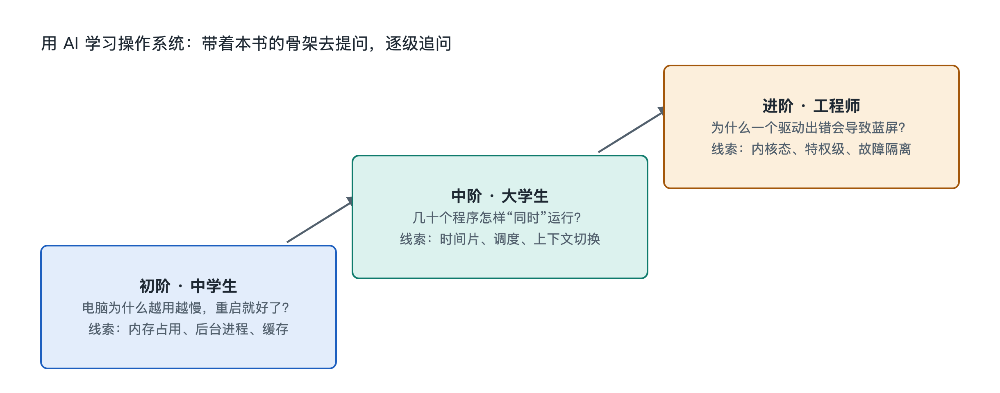

# 9.3 三阶提问阶梯：从中学生到工程师

同一个问题，在不同人手里会长出完全不同的答案。打开手机的“设置—电池”，你会看到某个应用“后台耗电”占了不少比例。一位中学生可能问 AI：“为什么应用关掉了还在耗电？”一位大学生会追问：“Android 和 iOS 对后台任务的限制有什么不同？”一位工程师则会问：“怎样定位是哪个唤醒锁或定时任务让设备无法进入深度休眠？”三个问题指向同一台手机、同一块电池，却落在认知阶梯的不同高度。

这一节要做的，是把“会提问”变成一套可以照着走的方法：三阶提问阶梯。它不是把人分成三个等级，而是同一个人在学习一个主题时可以依次登上的三级台阶。

## 9.3.1 第一阶：现象之问——“这是什么，为什么会这样”

第一阶的提问从看得见的现象出发，目标是建立直观理解。适合刚接触操作系统的读者，也适合任何人在遇到陌生现象时的第一步。

典型的问法有三种：

- **命名型**：“任务管理器里的‘提交内存’是什么意思？”
- **原因型**：“为什么电脑开机越久越慢，重启一下就好了？”
- **类比型**：“能不能用生活中的例子解释什么是进程和线程？”

这一阶提问的要点是**带上实物**。不要空泛地问“内存是什么”，而是把你屏幕上看到的数字、名称、提示原样告诉 AI，例如“我的 Windows 任务管理器显示内存使用 85%，其中‘已缓存’占了 6 GB，这正常吗？”有了具体的锚点，AI 的回答才不会停留在教科书式的泛泛定义上。

对照本书的九层阶梯，第一阶大致覆盖“对象”和“功能”两层：知道它是什么、做什么。

## 9.3.2 第二阶：结构之问——“它由什么组成，怎样连接和运转”

第二阶的提问从“是什么”转向“怎样工作”，目标是在头脑中搭出结构图和流程图。适合已经读过本书前几章、愿意多想一步的大学生和入门者。

这一阶常用的问法包括：

- **拆解型**：“从我双击一个文件到它在编辑器里打开，中间经过了操作系统的哪些部分？”
- **流程型**：“一次缺页（Page Fault，程序访问的内存页不在物理内存中）发生后，内核按什么顺序处理？”
- **对照型**：“Linux 的 ext4 和 Windows 的 NTFS 在日志机制上有哪些相同和不同？请用表格列出。”

第二阶的关键技巧是**要求 AI 给出步骤和边界**。比如追加一句“请按时间顺序分步骤说明，并标出哪一步在用户态、哪一步在内核态”。这样得到的回答能直接对应本书第四、五、六章讲过的连接、流动和机制，你也可以拿书中的骨架去检验 AI 的说法是否自洽。

这一阶还要特别注意第七章反复强调的一点：**很多机制是某个系统特有的**。提问时写明系统和具体版本号，例如“在 macOS 26 上”，并要求 AI 区分“通用原理”和“特定系统的做法”。

## 9.3.3 第三阶：原理与实践之问——“为什么这样设计，我怎样验证和改进”

第三阶面向想深入钻研的学生和工程师，目标是理解设计取舍，并能在真实系统上动手验证。

| 问法类型 | 示例 | 对应本书章节 |
|---|---|---|
| 取舍型 | “时间片设得太长或太短，分别会带来什么问题？” | 6.1、8.4 |
| 溯源型 | “虚拟内存为什么能在大多数程序上表现良好？和局部性原理有什么关系？” | 6.2、8.3 |
| 诊断型 | “`top` 显示某进程 CPU 占用很高，我该依次用哪些命令定位原因？” | 9.1、9.2 |
| 实验型 | “请设计一个安全的小实验，让我观察两个进程争抢同一个文件时会发生什么。” | 6.4、9.2 |

第三阶提问有两个习惯值得养成。一是**追问反例和代价**：“这种设计在什么情况下会失效？”任何机制都有适用范围，问出代价才算真正理解。二是**要求可验证**：让 AI 给出能在自己电脑上运行、不会损坏系统的命令或观察步骤，然后亲手执行，把结果再贴回去继续讨论。这样形成“书—实物—AI”的闭环。

## 9.3.4 沿着阶梯向上走：一个完整示例

以“电脑突然变卡”为主题，一次完整的攀登可以是这样：

1. **第一阶**：“我的电脑打开浏览器后变得很卡，任务管理器里磁盘占用 100%，这是什么意思？”
2. **第二阶**：“磁盘占用高和内存不足有什么关系？请解释换页（Paging）和交换（Swapping）是怎样让磁盘变忙的。”
3. **第三阶**：“怎样判断现在是内存不足导致频繁换页，还是某个程序本身在大量读写？请给出 Windows 上可以查看的指标和步骤。”

三个问题层层递进，读者最终不仅解决了眼前的卡顿，还把内存管理、虚拟内存和 I/O 流三块知识串在了一起。

## 9.3.5 提问时的三条底线

无论站在哪一阶，都要记住：

- **核实**：AI 可能把不同系统、不同版本的细节混为一谈，关键结论要对照官方文档或在实机上验证。
- **安全**：不要直接执行看不懂的命令，尤其是需要管理员权限、会删除文件或修改系统设置的命令；先让 AI 逐行解释。
- **隐私**：贴日志和截图前，删去用户名、序列号、网络地址等个人信息。

三阶提问阶梯的本质，是把本书的九层认知阶梯变成可操作的对话路径：从现象出发，借结构理解，凭原理和实验验证。掌握了这把梯子，书页合上之后，你手边的电脑和身边的 AI 仍会陪你继续向下探索。
