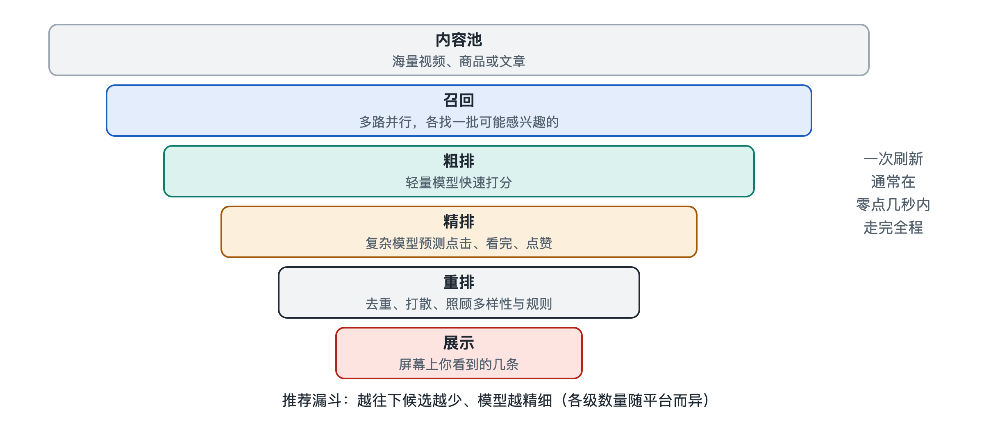

# 1.1 手指一划之后：下一条内容是怎样选出来的

晚上十点，你躺在床上，拇指在屏幕上轻轻往上一推，上一条视频滑走，下一条视频几乎同时开始播放。整个动作不到一秒，你很少会想：这条视频是从哪里来的？为什么偏偏是它，而不是平台上其他千千万万条？

这一节就从这一划开始，把它放慢、拆开，看看在你看不见的地方发生了哪些事。需要先说明：各平台的具体算法大多没有公开，下面描述的是论文、技术分享和公开资料中反复出现、被业界普遍采用的通用流程，具体到某一家应用，细节可能不同。

## 1.1.1 一划之前：系统已经在“等”你

很多人以为，推荐是在你滑动的那一刻才开始计算的。实际上，大部分应用会提前准备。你还在看当前这条视频时，客户端（也就是手机上的应用程序）往往已经向服务器要来了接下来的若干条内容，存在手机里，这叫“预加载”。所以你一划，下一条视频能立刻播放，而不是转圈等待。

当预先准备的内容快要用完时，应用会再向服务器发一次请求。这个请求里通常带着几类信息：

- **你是谁**：一个账号标识或设备标识，用来找到你过去的记录；
- **此刻的情境**：时间、网络类型、所在的大致地区、正在使用的页面（比如“推荐”页还是“关注”页）；
- **刚刚发生了什么**：你在上一条视频上停留了多久、有没有点赞、有没有中途划走。

最后这一项尤其关键。你刚才看完了一条做菜视频，还是三秒就划走了一条舞蹈视频，这些信号会被记录下来，有的系统会在很短时间内把它用于下一批推荐。这也是为什么你连续认真看了几条某类内容后，会感觉“它好像突然懂我了”。

## 1.1.2 从千万到十条：一个层层收窄的漏斗

服务器收到请求后，面对的是一个规模悬殊的问题：平台上可推荐的内容，按公开资料中常见的说法，大平台可达百万到亿级；而这一次要返回的，可能只有几条到十几条。在几百毫秒之内，不可能用最精细的方法把每一条内容都仔细评估一遍。

于是，业界普遍采用“多级漏斗”的做法，大致分为下面几步：

| 阶段 | 大致做什么 | 候选数量（典型数量级） | 特点 |
|---|---|---|---|
| 召回（Retrieval） | 从全部内容中快速找出“可能相关”的一批 | 从百万级降到数千 | 快、粗，多路并行 |
| 粗排（Pre-ranking） | 用较简单的模型初步打分筛选 | 数千降到数百 | 兼顾速度与准确 |
| 精排（Ranking） | 用复杂模型精细预测你的反应 | 数百降到几十 | 最“聪明”，也最耗算力 |
| 重排（Re-ranking） | 调整顺序，照顾多样性、规则与业务需要 | 几十降到最终展示的几条 | 看整体而非单条 |

可以用招聘来类比：召回像简历初筛，按关键词从海量投递里捞出一批；粗排像电话面试，快速淘汰明显不合适的；精排像正式面试，仔细评估每个人；重排则像最终组队，既要每个人优秀，也要团队搭配合理，不能全是同一种背景。

这些步骤的具体做法，后面第二章和第三章会逐一展开。这里只需要记住一个结构：**越往后，候选越少，判断越精细**。

## 1.1.3 “选中”到底是怎么判断的

在精排阶段，系统要回答的核心问题其实很朴素：如果把这条内容给这个人看，他会有什么反应？

对短视频来说，“反应”可以拆成好几个可以预测的量：会不会看完、会看多久、会不会点赞、评论、分享、关注作者，会不会很快划走。系统会为每条候选内容估计这些量发生的可能性，也就是概率。比如“点击率预估”（Click-Through Rate Prediction，CTR 预估），就是估计用户点开某条内容的概率。

这些预测从何而来？来自历史。系统见过大量“某类用户在某种情境下面对某类内容时的真实反应”，并从中学出规律。它并不真正“理解”你喜欢什么，而是在统计意义上判断：和你行为相似的情形里，大家通常怎么做。

然后，多个预测值会按一定权重合成一个总分。权重怎么定，体现的是平台想要什么——更看重停留时长，还是更看重互动，还是要兼顾用户长期满意度。这一点没有统一答案，不同平台、不同时期都不一样，第六章讨论多目标优化时会细谈。

## 1.1.4 返回之后：你的下一次反应又成了输入

排好序的内容被送回手机，你看到了它们。但故事没有结束：你对这几条内容的每一个动作，又会被记录下来，成为下一次请求的“刚刚发生了什么”，也会在之后汇入训练数据，用来改进模型本身。

把这个过程画成一个圈，大致是：

1. 你的行为被记录；
2. 系统据此理解你的偏好；
3. 系统挑选内容推给你；
4. 你对内容作出反应，回到第 1 步。

这是一个**反馈闭环**。它解释了推荐系统最突出的特点：它不是一次性算好的名单，而是随着你每一次滑动不断调整的过程。它也埋下了后面会讨论的许多问题——如果你只对某一类内容有反应，系统就可能越推越窄；如果新内容从没被展示过，系统就无从知道它好不好。这些分别对应后文的多样性、冷启动与“探索与利用”问题。

## 1.1.5 小结：一秒钟里的系统

回到那一划。在你看来只是画面切换，背后却串起了一条完整的链路：手机预加载并上报行为，服务器从海量内容中层层筛选，模型预测你的反应并打分排序，结果送回手机，你的新反应再进入下一轮。

后面的章节，就是沿着这条链路一段一段地走进去：先认清推荐系统到底在做什么、和搜索与广告有什么不同，再拆开它的每个部件。下一次你划走一条视频时，不妨想一想——这个动作，已经成为系统决定你下一条看什么的一份材料了。
