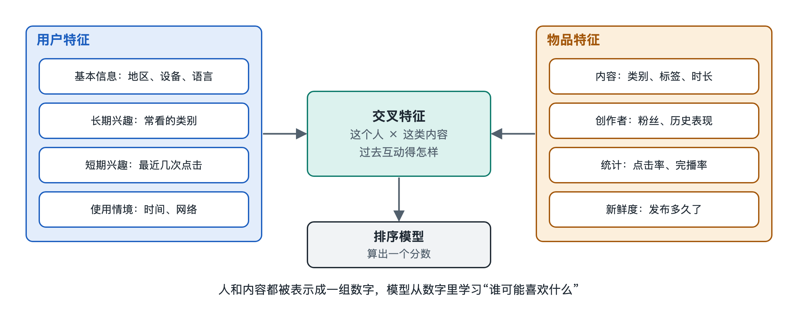

# 2.3 特征与画像：把人和内容变成数字

打开手机里的购物应用，点进“我的”页面，有些平台会给你看一份“年度账单”或“兴趣标签”：偏爱数码、常在晚上下单、关注户外运动。很多人第一次看到时会有点吃惊，因为平台好像比自己更清楚自己的习惯。这份“自画像”在系统内部只是冰山一角。上一节讲到，埋点把你的每一次点击、停留和滑走记录成日志。日志本身是一串串事件，模型没办法直接拿来比较和计算。要让系统判断“这条视频适不适合这个人”，得先把人和内容都翻译成计算机能处理的数字，这一步叫做特征工程，翻译出来的结果就是特征和画像。

## 2.3.1 什么是特征：给事物“量尺寸”

**特征**（Feature）是描述一个对象的可计算属性。可以用裁缝做衣服来类比：裁缝不需要知道你的全部人生经历，只需要量身高、肩宽、腰围几项数字，就能做出合身的衣服。推荐系统也一样，它不“理解”你这个人，只是从你身上量出一组数字，用这组数字去匹配内容。

推荐系统里的特征通常分为三大类：

| 类别 | 描述对象 | 常见例子 |
|---|---|---|
| 用户特征 | 看内容的人 | 年龄段、所在城市、设备型号、近 7 天观看的类目分布 |
| 物品特征 | 被推荐的内容或商品 | 视频时长、所属类目、发布时间、历史点击率 |
| 上下文特征 | 这一次请求的环境 | 当前时刻、星期几、网络是 Wi-Fi 还是移动数据 |

此外还有一类很重要的**交叉特征**（Cross Feature），描述“这个人和这件物品之间的关系”，比如“该用户过去看过这位创作者几次”“该用户对这个类目的点击率”。很多实践经验表明，这类关系型特征对预测是否点击往往特别有用，因为它直接刻画了匹配程度。

## 2.3.2 从日志到数字：三种常见的翻译方式

原始数据五花八门，变成数字的方式也不一样。

**一是数值型特征**，本身就是数字，比如视频时长 45 秒、商品价格 199 元。通常还要做一些处理，例如把价格按区间分成“百元以下”“百元到千元”等档位，叫做分桶，这样可以减少极端值的干扰。

**二是类别型特征**，比如城市、类目、性别。“北京”“上海”不能直接相加相减，常见做法是**独热编码**（One-Hot Encoding）：假设有一千个城市，就准备一千个格子，你在哪个城市，对应格子记 1，其余记 0。这种方法简单，但格子数量可能多到上亿个（比如用户 ID、商品 ID），而且每个人只占其中一个格子，数据极其稀疏。

**三是嵌入表示**（Embedding），这是当今大规模推荐系统中普遍采用的做法。它把一个 ID 或类别映射成一串几十到几百个数字组成的向量，相似的东西在这串数字上也接近。比如“登山鞋”和“冲锋衣”的向量会比较接近，“登山鞋”和“口红”则离得较远。这些数字不是人工指定的，而是模型从大量行为中学出来的。第六章讲矩阵分解时会详细说明它的来历，这里只需记住：嵌入是把“说不清的相似”变成“算得出的距离”。

## 2.3.3 画像：特征的汇总与标签化

**用户画像**（User Profile）是对一个用户特征的系统整理，常被理解成一组标签加权重，例如“美食 0.8、旅行 0.5、财经 0.1”。物品同样有画像，叫**物品画像**或内容理解结果，例如一条视频被识别为“美食—家常菜—川菜”，带有“教程”“快节奏”等标签。

画像的来源大致有三种：

1. **用户主动提供**：注册时填写的信息、选择的兴趣标签。
2. **统计行为得到**：根据你近期看了什么、买了什么，累加出各类目的偏好强度，并且让旧行为的权重随时间衰减。
3. **模型推断得到**：通过图像、语音、文字识别技术理解内容本身，或根据行为推测你可能的年龄段、消费能力。

需要说明的是，各平台具体用了哪些特征、画像有多细，大多没有公开。上面列举的是论文和行业公开资料中常见的类型，并不代表某个具体应用的真实做法。

还要区分两个容易混淆的东西：给人看的画像和给模型用的特征。平台展示给你的“兴趣标签”通常是简化、可读的版本；模型内部真正参与计算的，往往是成百上千维的向量和统计量，很多维度没有直观含义，连工程师也难以逐一解释。

## 2.3.4 好特征的标准与几个陷阱

特征不是越多越好。工程上常用几条标准来衡量：

- **有预测力**：能帮助区分“会点”和“不会点”。
- **及时**：兴趣会变，昨天刚开始看露营视频，今天的推荐就该体现。所以特征有离线计算的“长期特征”和秒级更新的“实时特征”之分，第五章会专门讲这两条流水线。
- **训练与线上一致**：模型训练时用的特征，必须和线上真正请求时拿到的一模一样，否则会出现“训练时考满分、上线后不及格”的情况，业内叫特征穿越或线上线下不一致。
- **合规**：涉及敏感个人信息的特征受法律约束。以中国为例，《个人信息保护法》对敏感个人信息的处理设定了更严格的条件，各地监管规定也要求平台提供关闭个性化推荐的选项（写作时的情况）。

还有一个常被忽视的陷阱：特征会把历史偏差带进未来。如果过去某类内容曝光少，它的历史点击数就少，基于点击数的特征又让它更难被推荐。这个循环在讨论冷启动和信息茧房时还会再遇到。

## 2.3.5 小结：数字化是推荐的前提

从埋点日志到特征，再到画像，系统完成了一次关键转换：把活生生的人和丰富的内容，压缩成可比较、可计算的数字。这种压缩必然有损失，它抓住了你“经常看什么”，却很难完全理解你“为什么看”。有了这些数字，系统才能在海量内容中快速筛选。下一节我们就来看，这些特征怎样在召回、粗排、精排和重排的多级漏斗中被一层层使用。
