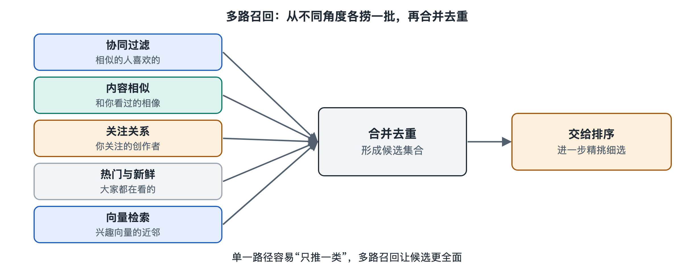

# 3.1 召回：从海量内容中找出几千个候选

打开购物应用的首页，往下滑几屏，你看到的也许是一双跑鞋、一包咖啡豆、一个手机支架。平台上的商品通常以亿计，短视频平台上的视频同样是这个量级，但从你点开应用到首屏出现，往往不到一秒。系统不可能在这么短的时间里把每一件商品都拿出来，和你仔细比对一遍。

它的办法和招聘很像。一家公司收到上万份简历，不会让总经理逐份面试，而是先由人事按岗位关键词快速筛出几百份，再进入笔试和面试。推荐系统里承担“快速初筛”任务的环节，叫作召回（Retrieval，也常称 Candidate Generation，即候选生成）。第二章介绍漏斗结构时已经提到它，本节专门讲清楚：召回要解决什么问题，常见的做法有哪些，又为什么要“多路并行”。

## 3.1.1 召回的任务：要快、要全，不求精

召回的输入是“这一刻的你”，包括你的历史行为、画像、所处场景；输出是一个候选集合，规模在公开资料中常见的说法是几百到几千条。它面对的约束可以概括为三点：

- **时间极短**。整个推荐请求通常要在几十到几百毫秒内完成，留给召回的只是其中一小部分。
- **范围极大**。它要在全量内容库中搜索，是整个漏斗里唯一要“看见所有内容”的环节。
- **宁多勿漏**。后面的粗排、精排可以把不合适的候选剔除，却无法凭空找回召回阶段漏掉的内容。一条你本来会很喜欢的视频，只要没被召回，就再没有机会出现在你面前。

所以召回追求的是“覆盖率”，而不是“排得准”。衡量它的常用指标是召回率（Recall）：在用户真正感兴趣的内容里，有多大比例被放进了候选集。至于候选之间谁先谁后，交给后面的排序去处理。

## 3.1.2 几种常见的召回思路

召回没有唯一的方法。业界公开分享和论文中反复出现的思路，大致可以归成下面几类：

| 召回方式 | 基本想法 | 生活类比 | 典型局限 |
|---|---|---|---|
| 热门召回 | 推最近大家都在看的内容 | 书店门口的畅销榜 | 千人一面，缺乏个性 |
| 标签/类目召回 | 你常看“健身”，就从“健身”类目里取 | 按书架分区找书 | 标签粗糙，容易越推越窄 |
| 物品协同召回 | 看过 A 的人也常看 B，你看了 A 就给你 B | “买了这本书的人还买了……” | 新内容缺少共同行为数据 |
| 关注/社交召回 | 你关注的创作者、好友互动过的内容 | 朋友推荐的餐馆 | 依赖社交关系是否丰富 |
| 向量召回 | 把人和内容都变成一串数字，找“距离近”的 | 在地图上找离你最近的店 | 需要模型训练和专门的检索系统 |
| 地域/场景召回 | 按位置、时间段、设备等条件取内容 | 到了饭点推附近餐厅 | 只适用于特定场景 |

其中，物品协同的原理会在 6.1 节展开，向量召回背后的嵌入（Embedding，即把对象表示为一串数字的方法）会在 6.2 节和 7.2 节细讲。这里先建立一个直观印象：向量召回常用一种被称为“双塔模型”（Two-Tower Model）的结构，一座“塔”把用户算成一个向量，另一座“塔”把内容算成向量，两者越接近，就说明越可能匹配。内容的向量可以提前算好存起来，请求到来时只需要实时算出用户向量，再到库里找最近的若干个，所以速度很快。谷歌（Google）在 2016 年发表的 YouTube 推荐论文中，就公开描述过“候选生成网络 + 排序网络”的两阶段结构，这篇论文常被当作理解召回的入门读物。

## 3.1.3 为什么要“多路召回”

如果只用一种方法，召回结果会带着这种方法的偏见。只靠标签，你会困在已知兴趣里；只靠热门，推荐就失去了个性；只靠向量，模型没学好的地方就会出现盲区。

因此，公开资料中常见的工程做法是**多路召回**：多条召回通道同时运行，每条各取一部分候选，再合并、去重，交给下游。可以把它想象成几位采购员分头进货：一位专找当季爆款，一位按老顾客的口味挑，一位去发掘新品，最后汇到同一个仓库。

多路召回带来了一个管理问题：每一路各占多少名额？名额分配往往是平台产品策略的体现。比如，想扶持新内容，就给“新品召回”多留一些位置；想加强社交属性，就提高“关注召回”的比例。具体的配比各平台都没有公开，也会随实验不断调整，不能把某一家的做法当作通用规则。

## 3.1.4 召回决定了你“可能看到什么”的边界

站在用户角度，召回有一层容易被忽视的含义：它划定了你的可能性边界。精排模型再聪明，也只能在召回给出的候选里挑选。如果你过去只看猫的视频，而召回通道又主要依据历史兴趣，那么候选集里猫的比例就会很高，后面的环节很难凭空“推”出别的东西。

这也是为什么许多系统会专门设计探索类召回，有意放进一些你没表现出兴趣、但可能喜欢的内容（这与 6.4 节的“探索与利用”相关）。讨论“信息茧房”等社会议题时（见 8.5 节），召回的设计同样是绕不开的一环。不过，推荐结果变窄还受用户自身选择、内容供给等多种因素影响，不宜简单归结为某一个环节。

## 3.1.5 小结

召回是漏斗的第一道闸门：在毫秒级时间内，从亿级内容中捞出几千个候选。它要快、要全，不求精；它依靠热门、标签、协同、社交、向量等多种通道并行，用互补来减少遗漏；它也在无形中划定了你能看到的范围。候选捞上来之后，接下来的问题就变成：这几千条里，哪一条最值得排在你的第一屏？这正是下一节“排序”要回答的。
