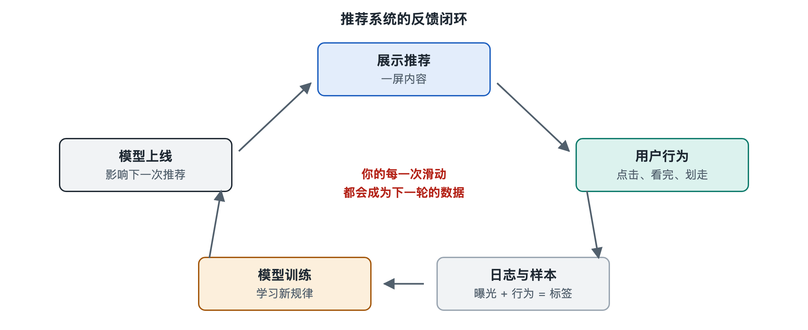

# 5.1 行为流：一次点击怎样变成训练数据

晚上十一点，你躺在床上刷短视频。一条做菜视频你看了三秒就划走；一条猫咪视频你看完了，还点了个赞；一条旅行视频你看到一半，点开评论区翻了翻。整个过程不到一分钟，你几乎没留下什么“操作”的印象。可在系统那一侧，这一分钟已经变成了几十条结构化的记录，它们会沿着一条专门的管道流动，最终在几分钟到一天之后，变成模型“学会”的东西。

第二章讲过埋点，说的是行为在哪里被记录。本节换一个视角：沿着时间顺序，看一次点击从手机里出发，经过哪些环节，最后变成一条能喂给模型的训练样本。工程上常把这条路径叫作**行为流**，也叫用户行为日志流。

## 5.1.1 从手指到日志：行为离开手机的那一刻

你每一次曝光、点击、点赞、停留，都会被手机应用里的埋点代码打包成一条**事件**（event）。一条典型的事件大致包含这样几类信息：

| 字段类别 | 举例 | 作用 |
|---|---|---|
| 谁 | 设备标识、登录账号 | 把行为归到某个用户 |
| 对什么 | 视频编号、商品编号 | 把行为归到某个物品 |
| 做了什么 | 曝光、点击、点赞、完播、跳过 | 行为类型 |
| 何时何地 | 时间戳、网络类型、页面位置 | 上下文 |
| 来自哪次推荐 | 请求编号（request id） | 把行为和当时的推荐结果对上 |

最后一项最容易被忽视，却最关键。系统给你推荐这一屏内容时，会为这次请求打上一个编号；你后来的每个动作都带着这个编号回来。这样，系统才能知道“这次点击，是对哪一次推荐、哪个位置、哪一版模型给出的结果的反应”。

事件通常不会一条一条立刻发走，而是在手机上攒一小批再上报，以节省电量和流量。网络不好时，事件可能延迟几分钟甚至更久才到达服务器，这一点后面会带来麻烦。

## 5.1.2 管道里的旅程：收集、清洗与拼接

事件到达服务器后，先进入一个**消息队列**（message queue）。可以把它想成一条传送带：上游源源不断地放东西，下游各个部门按自己的节奏取用。业界常用的开源消息队列有 Kafka 等，具体选型因公司而异。

从传送带上取下的原始日志并不干净，需要经过几道工序：

1. **清洗**：去掉格式错误、重复上报的事件，识别并过滤明显的机器刷量行为。
2. **补全**：把视频编号关联上作者、类别、时长等信息，把用户编号关联上画像。
3. **拼接**（join）：这是核心一步。系统要把“推荐时的曝光记录”和“之后发生的行为”按请求编号对齐，拼成一条完整的样本。

为什么必须拼接？因为模型要学的是“当时看到这条内容的情况下，用户会不会点”。只有点击记录而没有曝光记录，系统就不知道那些你**看到了却没点**的内容——而这些恰恰是最重要的负面信息。所以一条训练样本，本质上是“一次曝光 + 它的结局”。

## 5.1.3 打标签：什么算“喜欢”

拼接完成后，要给每条样本打上**标签**（label），告诉模型这是正例还是负例。这一步远比想象中复杂：

- **点击**：点了记为 1，曝光但没点记为 0，最直观。
- **完播或时长**：看完算正例？看了 80% 算不算？不同长度的视频标准不同，很多系统会按时长分段处理。
- **互动**：点赞、评论、分享、关注各自可以成为单独的标签，对应第六章要讲的多目标。
- **负反馈**：快速划走、点“不感兴趣”、举报，可以作为强负信号。

这里有一个“等多久”的问题。你点开一个商品，可能三天后才下单。如果样本刚曝光就急着打标签，这次购买就会被错记成“没买”；如果等三天再打，模型又学得太慢。这在业界叫**延迟反馈**问题。常见做法是设定一个等待窗口，或者先按“未转化”入库、之后再修正，具体窗口长短各家不同，属于工程权衡。

## 5.1.4 两条速度不同的河：离线与实时

拼好、打好标签的样本，通常会分流成两路：

| | 离线（批处理）路径 | 实时（流式）路径 |
|---|---|---|
| 时间尺度 | 按小时或按天汇总 | 秒级到分钟级 |
| 典型用途 | 大规模重训模型、统计分析、报表 | 实时更新特征、在线学习、及时捕捉热点 |
| 优点 | 数据完整、可反复核对 | 反应快 |
| 难点 | 慢 | 数据可能不全，标签可能还没“落定” |

刚才那条深夜猫咪视频，你看完后再刷几下，系统就可能多推几条猫——这往往依赖实时路径更新了你的“近期兴趣”。而模型本身对“什么样的人爱看猫”的整体理解，则更多依靠离线路径积累大量样本后重新训练。至于某个平台具体用了哪种组合，多数公司并未完整公开，公开的技术分享和论文中两条路径并存是常见架构。

## 5.1.5 行为流里的“暗礁”：偏差

行为数据并不是对兴趣的客观记录，它天生带着系统自己的影子：

- **曝光偏差**：你只能对被推给你的内容做出反应，没被推的内容永远没有数据。
- **位置偏差**：排在第一位的内容天然更容易被点，不全是因为它更好。
- **自我强化**：模型用自己推出的结果产生的数据训练自己，容易越推越窄。

因此，工程师在构造训练数据时，会刻意记录位置信息、保留一部分随机曝光的流量，或在建模时做纠偏。这些方法将在第六章“探索与利用”和第八章的统计原理中再展开。

## 5.1.6 小结：一条闭环的起点

把这条路串起来：**手指操作 → 埋点事件 → 上报与消息队列 → 清洗补全 → 曝光与行为拼接 → 打标签 → 离线与实时两路 → 训练与特征更新**。你的每一次划动，都在为下一次推荐提供素材；而下一次推荐，又决定了你接下来能产生什么数据。行为流是推荐系统闭环的起点。下一节我们换个方向，看看你按下刷新的那一刻，请求流怎样在几百毫秒内跑完一整套筛选。
