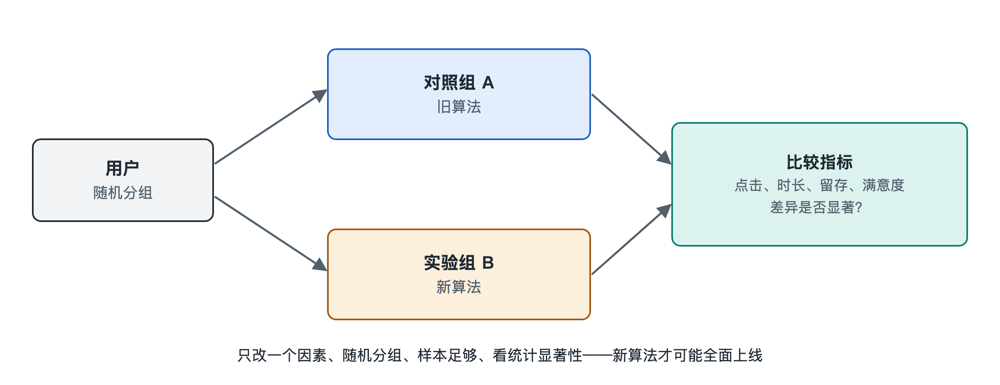

# 5.5 实验流：A/B 测试怎样决定新算法能否上线

你和室友用同一款短视频应用，同一时间打开，首页的界面却可能略有差别：你的“关注”按钮在左上角，他的在右上角；你刷到的内容节奏更快，他的更慢。这不一定是故障，也不一定只是兴趣不同，很可能你们俩正分处一场实验的两个组里。主流互联网平台公开分享过的工程实践普遍显示，新算法、新界面在全面上线之前，大多要先在一小部分真实用户身上“试一试”。这个过程就是 A/B 测试（A/B Testing，又称对照实验、在线随机实验），它在系统里形成一股独特的流动：实验流。

## 5.5.1 为什么不能“工程师觉得好就上线”

上一节讲过，新模型在离线评估中会算出各种指标，例如 AUC（曲线下面积，衡量模型把正样本排在负样本前面的能力）。可离线指标好，线上效果不一定好，原因至少有三条：

- **数据是旧的**：离线评估用的是过去的日志，而日志本身是旧模型推荐出来的结果，新模型会推出旧日志里从未出现过的内容，这部分效果离线算不出来。
- **用户会反应**：推荐改变了，用户的行为也会跟着变，比如更爱滑走或者更愿意停留，这种互动只在真实环境中发生。
- **目标不止一个**：离线只能看点击率等少数指标，线上还要看时长、留存、投诉、创作者收入等，彼此可能此消彼长。

所以，业界的普遍做法是：离线评估负责“初筛”，A/B 测试负责“终审”。

## 5.5.2 一场实验怎样搭起来

A/B 测试的思路来自医学上的随机对照试验：把人随机分成两组，一组吃药，一组吃安慰剂，比较结果。放到推荐系统里，大致步骤如下：

1. **提出假设**：例如“加入用户最近十条观看记录的新排序模型，能让人均观看时长上升”。
2. **随机分流**：系统根据用户编号做哈希计算（一种把编号均匀打散的数学变换），把一小部分流量分进来，一半进入对照组 A（旧模型），一半进入实验组 B（新模型）。同一个用户在实验期间始终待在同一组，体验才稳定。
3. **运行观察**：实验通常持续一到数周，覆盖工作日和周末，避免“周末大家都刷得多”这类周期因素干扰判断。
4. **统计比较**：比较两组核心指标的差异，判断差异是真实存在还是随机波动。
5. **做出决策**：效果显著且无明显副作用，就逐步扩大流量直至全量；否则回滚或继续改进。

由于平台上同时进行的实验往往很多，公开资料中常见的做法是“分层实验”：Google 在 2010 年发表的论文《Overlapping Experiment Infrastructure》介绍了把流量分成多个互不干扰的“层”的方法，例如界面实验一层、排序实验一层，同一个用户可以同时参与不同层的实验。这一思路被许多公司借鉴，但具体实现各家不同。

## 5.5.3 看什么指标：北极星与护栏

一场实验通常盯着两类指标：

| 指标类型 | 作用 | 推荐系统中的常见例子 |
|---|---|---|
| 核心指标（北极星指标） | 判断实验是否成功 | 人均使用时长、次日留存率、转化率 |
| 护栏指标（Guardrail Metrics） | 防止“按下葫芦浮起瓢” | 页面加载延迟、崩溃率、负反馈率、举报率 |

举个例子：新模型让点击率上升了，但“不感兴趣”的点击也同步上升，说明它可能在推“标题党”内容。这时即使核心指标好看，也不能直接上线。

## 5.5.4 统计显著：差异是真的吗

假如 A 组人均时长 30.0 分钟，B 组 30.3 分钟，能说 B 更好吗？不一定。几十万人的平均数每天本来就会上下浮动。统计学用**假设检验**来回答这个问题：先假定“两组其实没有差别”，再计算在这个假定下观察到至少这么大差距的概率，即 **p 值**。p 值很小（常用阈值是 0.05），才认为差异“统计显著”。与之相伴的还有**置信区间**，表示真实提升大致落在什么范围。第八章讲概率统计时会再回到这里。

实践中有几个常见陷阱，值得了解：

- **偷看数据**：每天看一次结果，一显著就停，误判概率会大大增加。
- **新奇效应**：新界面刚上线时用户好奇多点几下，过几周回落。
- **网络效应**：在有社交关系或双边市场（如创作者与观众）的平台上，A 组和 B 组的用户会互相影响，简单随机分组可能失真。这一问题在学术界和工业界仍在研究中。

## 5.5.5 实验流在闭环中的位置

把视角拉远，实验流把前面几股流串在了一起：行为流产生日志，模型流产出候选模型，请求流负责按分组调用不同模型，实验平台汇总两组的行为数据，算出结论，再决定哪个模型进入下一轮迭代。一次全量上线，往往是许多次失败实验之后留下的少数结果。

对普通读者来说，这也解释了一个现象：你的应用偶尔“变了样”，很可能只是你被分进了某个实验组。对做产品和运营的读者来说，A/B 测试提供了一条朴素原则：用随机对照代替拍脑袋，同时用护栏指标提醒自己，系统优化的不只是一个数字。至此，本章的五股流动已经介绍完毕，下一节将把它们拼成一张完整的骨架图。
