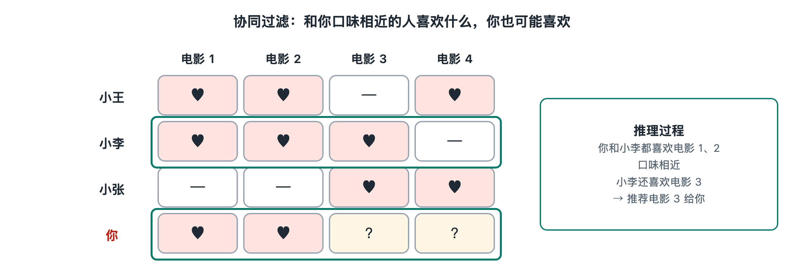

# 6.1 协同过滤：“和你相似的人也喜欢”

打开购物应用的商品详情页，往下翻，常能看到“买了这件的人还买了……”这样的栏目；在音乐应用里听完一首歌，也会收到“喜欢这首歌的人也在听”的推荐。这些推荐所用的数据，可能并不来自商品说明或歌曲风格标签，而是来自成千上万人留下的行为记录。这种思路叫**协同过滤**（Collaborative Filtering，CF）。它是推荐系统最早成形、流传最广的机制之一。“协同”指的是借助众人的行为来过滤信息，“过滤”指的是从海量物品里挑出值得看的少数。

## 6.1.1 一张“谁喜欢什么”的大表

理解协同过滤，先要在脑中画一张表。行是用户，列是物品，格子里记录用户对物品的反应：可能是打分，例如电影评分网站上的 1 到 5 星；也可能只是“点过”“买过”“看完了”这类行为。前者叫**显式反馈**（explicit feedback），用户直接表达态度；后者叫**隐式反馈**（implicit feedback），需要从行为中推测态度。在短视频和电商场景里，隐式反馈占绝大多数。

这张表通常大而空。一个平台可能有上亿用户、上千万物品，每个人一辈子接触到的只是其中极小一部分，所以表里绝大多数格子是空白。这种情况叫**数据稀疏**（sparsity）。推荐要做的事，可以简单理解为“给空格子填上猜测值”，再把猜测值高的物品推给用户。协同过滤的做法是找相似：相似的人会有相似的口味，被同一批人喜欢的物品之间也有关联。

## 6.1.2 两条路线：找相似的人，或找相似的物品

协同过滤有两种经典做法，下表做个对照。

| 路线 | 基本问题 | 推荐逻辑 | 生活类比 |
|---|---|---|---|
| 基于用户的协同过滤（User-based CF） | 谁和你口味相近？ | 把“口味相近的人”喜欢、而你还没接触过的物品推给你 | 问品味相近的朋友最近看了什么好电影 |
| 基于物品的协同过滤（Item-based CF） | 哪些物品常被同一批人喜欢？ | 根据你喜欢过的物品，推荐与之相似的物品 | 书店把常被一起买走的书摆在一起 |

基于用户的方法出现得较早。20 世纪 90 年代，明尼苏达大学的 GroupLens 项目用它为新闻组文章做推荐，是公开文献中常被引用的早期系统。基于物品的方法后来在工业界用得更多。2001 年前后有学术论文系统讨论这种方法；亚马逊的工程师在 2003 年发表文章，介绍了其网站采用的“物品到物品”（item-to-item）协同过滤思路。这是亚马逊公开的做法，其他平台是否采用、怎样改造，要看各自的公开资料。

物品路线在工程上受欢迎，原因在于“哪些物品相似”比“哪些人相似”稳定。一个人的兴趣可能这周变、下周又变，而两本书经常被一起购买，这种关系往往能维持很久。物品之间的相似关系可以提前离线算好、存起来，用户一来请求就直接查表，满足第五章所讲的毫秒级响应要求。

## 6.1.3 相似度怎样算

“相似”需要变成可以计算的数。仍以那张大表为例，把每个物品对应的那一列看成一串数字：哪些用户喜欢它、喜欢的程度如何。两个物品的列越像，物品就越相似。常用的计算方法有：

- **共同用户比例**：两件商品各被多少人买过，其中有多少人两件都买了。重叠越多，关联越强。杰卡德相似度（Jaccard similarity）就是“交集除以并集”的做法。
- **余弦相似度**（cosine similarity）：把两列数字看作空间里的两个箭头，看它们的方向是否接近，方向越一致越相似。第八章讲线性代数时会再回到这个概念。
- **皮尔逊相关系数**（Pearson correlation）：先扣除每个人打分习惯的松紧，再比较。有人习惯打高分，有人习惯打低分，扣掉这种差异后，比较才更公平。

算出相似度后，预测就是加权投票。比如要判断你会不会喜欢一部新电影，系统找出与这部电影最相似的若干部、你已经看过的电影，按相似度加权汇总你对它们的评价，得到一个预测分。

## 6.1.4 优点与短板

协同过滤的长处在于不需要理解内容本身。系统不必知道一首歌是爵士还是摇滚，只看谁听了它，就能发现一些标签描述不出来的关联，比如某部纪录片和某款登山鞋常被同一群人喜欢。这种“意外的关联”常带来惊喜感。

它的短板也很明确：

1. **冷启动**：新物品没人互动过，新用户没留下行为，表里对应的行和列都是空的，相似度无从算起。这正是第三章 3.4 节讨论冷启动问题的原因之一。
2. **热门偏差**（popularity bias）：热门物品与很多物品都有共同用户，容易出现在各种“相似推荐”里，越推越热，小众内容更难被看见。
3. **稀疏与规模**：用户和物品数量巨大时，两两计算相似度的开销很大，而稀疏的数据又会让相似度估计不稳定。
4. **只看到表面重叠**：两个物品哪怕风格相近，只要恰好没有共同用户，就被视为毫不相关。

这些短板推动了后来的改进。工业系统中，协同过滤常常作为召回阶段的一路通道，与基于内容、基于热度、基于向量的召回并列使用，而不是单独决定最终结果。

## 6.1.5 从“找邻居”到“找隐藏的口味”

回头看，协同过滤的核心假设很朴素：群体行为里藏着个人偏好的线索。它直接比较表里的行和列，像是挨家挨户地找邻居。那么能不能更进一步，从这张稀疏的大表里提炼出少数几个隐藏的“口味维度”，比如“偏爱悬疑”“喜欢轻松”，再用这些维度去描述每个人和每件物品？这就是下一节要讲的矩阵分解与嵌入，它把兴趣变成了向量，也为后面的深度推荐模型打下了基础。
